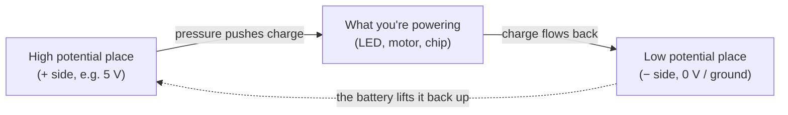
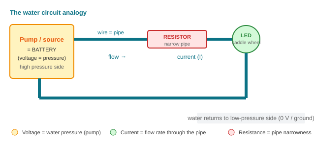
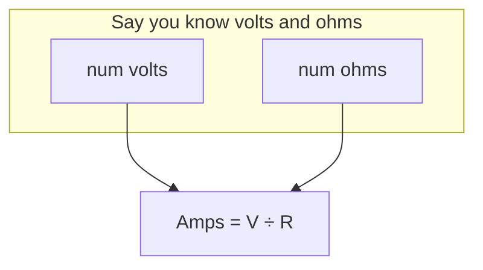
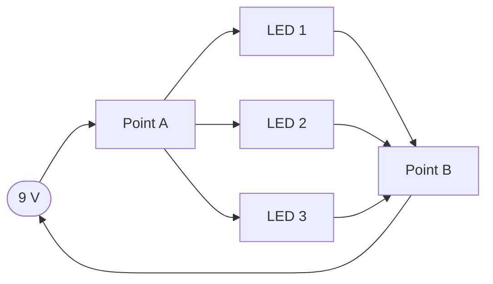

# How Electricity Works

Every project in this hub — an LED blinking, a motor spinning, an ESP32 talking to
your router — is just us **moving electric charge around a path on purpose**. This page
builds the three ideas everything else stands on: **voltage**, **current**, and
**resistance**. If you only remember one thing from here, remember that this whole page is
just a careful version of "pressure pushes flow through a pipe."

We'll use a **water analogy** throughout, because electronics people lean on it constantly
and it genuinely works.

## The three fundamental ideas

### Voltage (V) — the "pressure"

**Voltage is electrical pressure.** It's what *pushes* charge around a circuit. We measure
it in **volts (V)**.

More precisely, voltage is a **difference in electrical potential energy** between two
points. That last part matters: voltage is always *between two points*. There is no such
thing as "the voltage at a component" — only "the voltage *across* a component" or "the
voltage *from here to there*." That's why engineers sometimes call it **potential
difference**.

In the water model, think of voltage as the height difference between two buckets, or the
water pressure at your faucet. A pumped-up supply holds high pressure at the tap; drop the
pressure and the "push" falls to zero and nothing flows.



Sketch the whole circuit as a loop of water — pump, pipe, narrow section, and wheel:



*Voltage = water pressure (pump), current = the flow rate through the pipe, resistance = pipe narrowness. The water always returns to the low-pressure side to complete the loop.*

### Current (I) — the "flow"

**Current is the flow of charge.** We measure it in **amperes** (amps, **A**). One amp is
the movement of about one *coulomb* of charge (6.24 × 10¹⁸ electrons) past a point every
second.

In the water model, current is the amount of water moving through the pipe **per second** —
the flow rate, not the pressure. You can have high pressure with no flow (a shut tap has
pressure but zero current), and you can push a lot of water at low pressure.

Two things beginners trip on here:

1. **Current needs a complete loop.** Charge must have a path *out* and *back* — that's
   why circuits are called *circuits*. Break the loop anywhere and current stops
   everywhere (that's what a switch does).
2. **"Current" and electron flow point opposite ways.** We draw signals moving from + to −
   ("conventional current"). The actual electrons drift from − to +. The math works either
   way, so everyone just uses the +→− convention. Don't get stuck on it; pick one mental
   model and stay consistent.

### Resistance (R) — the "pipe narrowness"

**Resistance is how hard it is for current to get through.** We measure it in **ohms (Ω)**.

In the water model, resistance is the diameter of the pipe. A fat pipe flows easily (low
resistance); a kinked, narrow pipe fights the flow (high resistance). A resistor is just a
deliberately narrow section of pipe — a component we drop in to *limit* how much current
can pass. This is essential, because many parts (like LEDs) will happily draw too much
current and destroy themselves if you don't put a narrow bit of pipe in front of them.

## Ohm's law — the one formula

These three ideas are tied together by the single most important relationship in all of
electronics:

```
V = I × R
```

- **V** = voltage in volts
- **I** = current in amps
- **R** = resistance in ohms

Read it out loud: "**the voltage across something is the current through it times its
resistance.**" Using algebra you can get the other two forms, which you'll use constantly:

| What you want | Formula | "Cover the letter" trick |
|---|---|---|
| Voltage | **V = I × R** | Cover the V, left with I×R |
| Current | **I = V / R** | Cover the I, left with V over R |
| Resistance | **R = V / I** | Cover the R, left with V over I |

In the water model, Ohm's law is just: *pressure = flow × resistance*. More pressure, more
flow; more resistance, less flow. It's a straight trade-off.

### A worked example

You have a 9 V battery and an LED that needs to see no more than **20 mA** (0.02 A) of
current. What resistor do you put in series?

Use the *current* form:

```
R = V / I = 9 V / 0.02 A = 450 Ω
```

So a **470 Ω** resistor (the nearest common value) keeps your LED safely lit. We'll redo
this exact calculation when we actually wire the LED up in the *Circuits* section.



## Circuits: the loop, series, and parallel

A **circuit** is any closed loop that lets current flow from the supply's + side, through
your components, and back to the − side. The three "everything else" circuit ideas are:

### Open vs. closed

- **Closed circuit**: the loop is complete, current flows.
- **Open circuit**: there's a break somewhere (a switch is open, a wire fell out), no
  current flows.
- **Short circuit**: current finds a near-zero-resistance path and bypasses your components
  entirely. This lets a huge, uncontrolled current roar through — the thing that makes
  batteries hot and breaks parts. Your number-one habit as a beginner: **always double-check
  for accidental shorts before connecting power.**

### Series — one line of dominoes

In **series**, components are daisy-chained one after another, so the **same current**
flows through each one. What *adds up* here is voltage — each component "uses up" part of
the supply's pressure.


Rules for series:

- **Same current** everywhere in the loop.
- **Voltages add** — the sum of every drop equals the supply voltage.
- **Resistances add**: `R_total = R1 + R2 + R3`.

If you break the chain anywhere (pull one resistor), the whole loop stops — every domino
was standing on the one before it.

### Parallel — separate lanes

In **parallel**, components sit across the same two points, each getting the **full supply
voltage**, with the current *splitting* between the lanes.



Rules for parallel:

- **Same voltage** across every branch.
- **Currents add** — the supply must push the sum of all branch currents.
- **Resistance *decreases*** the more branches you add (`1/R_total = 1/R1 + 1/R2 + ...`),
  because each new lane is another path for current.

If one parallel branch breaks, the others keep working — that's why your house lights don't
all die when one bulb blows (they're wired in parallel).

### Which is which, one quick analogy

- **Series** = one checkout line; everyone shuffles along single file, everyone pays once.
- **Parallel** = many checkout lines; each line gets the full "supply" of attention, and
  the shop handles more people at once.

## Units and what's "normal" for hobbyist electronics

You'll see a lot of prefixes. Handy cheat sheet (moving the decimal by factors of 1000):

| Prefix | Meaning | Example you'll meet |
|---|---|---|
| milli (m) | × 10⁻³ | 20 **m**A LED current (0.02 A) |
| micro (µ) | × 10⁻⁶ | 10 **µ**s pulses for a sensor |
| nano (n) | × 10⁻⁹ | small capacitor values, e.g. 10 **n**F |
| kilo (k) | × 10³ | 10 **k**Ω pull-up resistor (10,000 Ω) |
| mega (M) | × 10⁶ | 1 **M**Ω, a very "narrow pipe" resistor |

For the kinds of boards here (Arduino, ESP32), we almost always work at **3.3 V or 5 V**
and **milliamps of current**.

## Watch & learn

These are short, honest introductions that spell out the same ideas visually — often with
the water analogy drawn out:

- [🔌 Basic Electricity – What is voltage? — Afrotechmods](https://www.youtube.com/watch?v=TBt-kxYfync)
- [Basic Electricity – What is an amp? — Afrotechmods](https://www.youtube.com/watch?v=8gvJzrjwjds)
- [Electricity – Basic Introduction — The Organic Chemistry Tutor](https://www.youtube.com/watch?v=ybuhfEa-PrU)

---

**Next up:** [Ohm's law & components](02-components.md) — the parts (resistors, LEDs,
capacitors, transistors, diodes) that you'll build on top of these ideas.

---

<div class="quiz" data-title="Quick check: electricity basics">

<div class="q" data-type="choice">
  <p class="question">Voltage is best described as:</p>
  <ul class="options">
    <li data-correct>The electrical pressure (potential difference) pushing charge</li>
    <li>The amount of charge flowing per second</li>
    <li>The opposition to current</li>
    <li>The energy stored in a battery</li>
  </ul>
</div>

<div class="q" data-type="choice">
  <p class="question">Current is measured in:</p>
  <ul class="options">
    <li data-correct>Amperes (amps)</li>
    <li>Volts</li>
    <li>Ohms</li>
    <li>Watts</li>
  </ul>
</div>

<div class="q" data-type="tf">
  <p class="question">True or false: alternating current (AC) reverses direction periodically, unlike direct current (DC).</p>
  <ul class="options">
    <li data-correct>True</li>
    <li>False</li>
  </ul>
</div>

<div class="q" data-type="fill">
  <p class="question">A 9 V battery pushing 0.5 A through a circuit delivers ____ watts of power.</p>
  <input class="answer" data-answers="4.5, 4.5 w, 4.5 watts, 4 5">
</div>

</div>

## 🧪 Exercises & Projects

> **Estimated total time:** ~2–3 hours, split across a few sessions. Print the
> Ohm's-law table from above and keep it next to you — you'll use it constantly.

### 📝 Exercises

**🟢 Easy — Ohm's law warm-up.** For each row, solve for the missing value. Show your
working (`V = I × R`, `I = V / R`, or `R = V / I`). Checkbox each one off when it's done.

- [ ] A 9 V battery pushes current through a 450 Ω resistor. What current flows?
      *(Hint: `I = V / R` → 9 / 450 = 0.02 A = 20 mA.)*
- [ ] A 5 V supply drives exactly 20 mA through a resistor. What's the resistance?
      *(Answer: 250 Ω.)*
- [ ] You measure 10 V across a 2 kΩ resistor. How much current is flowing?
      *(Careful with the k — 2 kΩ = 2000 Ω.)*

**🟡 Medium — pick the resistor.** You have a 3.3 V supply and an LED that drops ~2 V
and wants no more than 20 mA.

- [ ] How much voltage must the series resistor absorb? *(Hint: `3.3 − 2 = 1.3 V`.)*
- [ ] What resistor value keeps current at ~20 mA? Compute `R = V / I`.
      *(Answer: 65 Ω → use a common 100 Ω for margin.)*
- [ ] Repeat the same two steps assuming the LED is blue and drops ~3 V. The resistor
      now only has to absorb 0.3 V — explain in one sentence why a blue LED from 5 V
      needs a *smaller* safety margin on the resistor.

**🔴 Hard — series & parallel reasoning.** No calculator in your head; just the rules
from this page.

- [ ] Two resistors, 1 kΩ and 1 kΩ, are in **series** across 9 V. What is the total
      resistance? What voltage appears across each resistor? *(They split 9 V evenly → 4.5 V each.)*
- [ ] The same two resistors are moved to **parallel** across 9 V. What is the total
      resistance? What current does the 9 V supply see? *(Total resistance halves to
      500 Ω; supply current `9 / 500 = 18 mA`.)*
- [ ] Explain in one paragraph why house wiring is **parallel**, not series — use the
      word "independent" and reference what happens when one bulb blows.

### 🛠️ Mini-Project: Build a voltage divider on a breadboard

**Goal:** build a resistor voltage divider that turns a fixed supply into a smaller,
adjustable-in-steps output — the same trick sensors and potentiometers use.

**Time:** ~30–40 minutes. **Components:** breadboard, 3 jumper wires, two resistors
(R1 = 1 kΩ, R2 = 2 kΩ), a 5 V source (a 5 V pin or a battery), and a multimeter.

**Build steps:**

1. Plug **R1** into the breadboard. It's two legs, so push each leg into a different
   row on the same side (rows 1 and 2).
2. Plug **R2** so one leg shares **row 2** with R1's lower leg, and the other leg goes
   into **row 3**. Now R1 and R2 are in series, and **row 2 is their shared midpoint**.
3. Run a **jumper from the + rail to row 1** (the top of R1).
4. Run a **jumper from the − rail to row 3** (the bottom of R2).
5. Feed **5 V into the + rail** and **0 V into the − rail**.
6. Set your **multimeter to DC volts** and probe **row 2** against ground (− rail).

**Verify it against the formula:** `V_out = V_in × (R2 / (R1 + R2)) = 5 × (2000/3000) ≈ 3.3 V`.
The meter should read close to 3.3 V.

**Extend it:** swap R2 for a different value and predict the output *before* you measure.
Make a table of three different R2 values and compare predicted vs. measured. If they
differ by more than ~5%, double-check the resistor values (read the color bands — that's
next chapter).

**Why it matters:** voltage dividers are how you'll read sensors (a light-dependent
resistor changes one leg and the output voltage changes) and how you'll safely connect
3.3 V and 5 V logic. You've built the first "real" building block.

> **Tips:** color-code your jumpers (red = +, black = −, any other = the midpoint
> signal). If the meter reads 0 or 5 V, you've probably got a leg in the wrong row —
> same row = connected, so trace where each leg actually lands.
