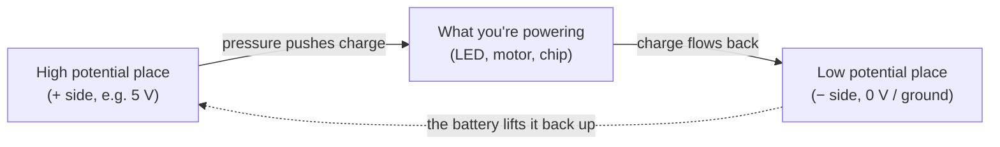
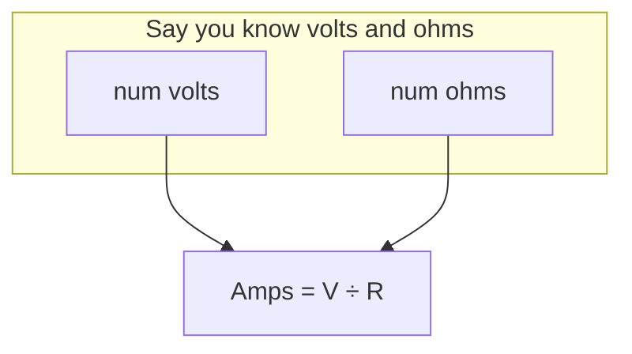
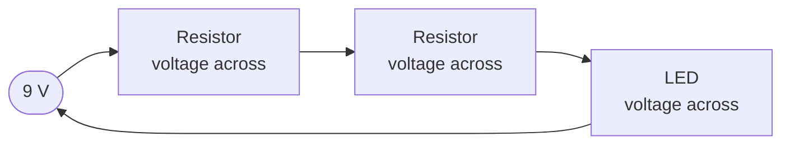

# How Electricity Works

Every project in this hub — an LED blinking, a motor spinning, an ESP32 talking to
your router — is just us **moving electric charge around a path on purpose**. This page
builds the three ideas everything else stands on: **voltage**, **current**, and
**resistance**. If you only remember one thing from here, remember that this whole page is
just a careful version of "pressure pushes flow through a pipe."

We'll use a **water analogy** throughout, because electronics people lean on it constantly
and it genuinely works.

## The three fundamental ideas

### Voltage (V) — the "pressure"

**Voltage is electrical pressure.** It's what *pushes* charge around a circuit. We measure
it in **volts (V)**.

More precisely, voltage is a **difference in electrical potential energy** between two
points. That last part matters: voltage is always *between two points*. There is no such
thing as "the voltage at a component" — only "the voltage *across* a component" or "the
voltage *from here to there*." That's why engineers sometimes call it **potential
difference**.

In the water model, think of voltage as the height difference between two buckets, or the
water pressure at your faucet. A pumped-up supply holds high pressure at the tap; drop the
pressure and the "push" falls to zero and nothing flows.



### Current (I) — the "flow"

**Current is the flow of charge.** We measure it in **amperes** (amps, **A**). One amp is
the movement of about one *coulomb* of charge (6.24 × 10¹⁸ electrons) past a point every
second.

In the water model, current is the amount of water moving through the pipe **per second** —
the flow rate, not the pressure. You can have high pressure with no flow (a shut tap has
pressure but zero current), and you can push a lot of water at low pressure.

Two things beginners trip on here:

1. **Current needs a complete loop.** Charge must have a path *out* and *back* — that's
   why circuits are called *circuits*. Break the loop anywhere and current stops
   everywhere (that's what a switch does).
2. **"Current" and electron flow point opposite ways.** We draw signals moving from + to −
   ("conventional current"). The actual electrons drift from − to +. The math works either
   way, so everyone just uses the +→− convention. Don't get stuck on it; pick one mental
   model and stay consistent.

### Resistance (R) — the "pipe narrowness"

**Resistance is how hard it is for current to get through.** We measure it in **ohms (Ω)**.

In the water model, resistance is the diameter of the pipe. A fat pipe flows easily (low
resistance); a kinked, narrow pipe fights the flow (high resistance). A resistor is just a
deliberately narrow section of pipe — a component we drop in to *limit* how much current
can pass. This is essential, because many parts (like LEDs) will happily draw too much
current and destroy themselves if you don't put a narrow bit of pipe in front of them.

## Ohm's law — the one formula

These three ideas are tied together by the single most important relationship in all of
electronics:

```
V = I × R
```

- **V** = voltage in volts
- **I** = current in amps
- **R** = resistance in ohms

Read it out loud: "**the voltage across something is the current through it times its
resistance.**" Using algebra you can get the other two forms, which you'll use constantly:

| What you want | Formula | "Cover the letter" trick |
|---|---|---|
| Voltage | **V = I × R** | Cover the V, left with I×R |
| Current | **I = V / R** | Cover the I, left with V over R |
| Resistance | **R = V / I** | Cover the R, left with V over I |

In the water model, Ohm's law is just: *pressure = flow × resistance*. More pressure, more
flow; more resistance, less flow. It's a straight trade-off.

### A worked example

You have a 9 V battery and an LED that needs to see no more than **20 mA** (0.02 A) of
current. What resistor do you put in series?

Use the *current* form:

```
R = V / I = 9 V / 0.02 A = 450 Ω
```

So a **470 Ω** resistor (the nearest common value) keeps your LED safely lit. We'll redo
this exact calculation when we actually wire the LED up in the *Circuits* section.



## Circuits: the loop, series, and parallel

A **circuit** is any closed loop that lets current flow from the supply's + side, through
your components, and back to the − side. The three "everything else" circuit ideas are:

### Open vs. closed

- **Closed circuit**: the loop is complete, current flows.
- **Open circuit**: there's a break somewhere (a switch is open, a wire fell out), no
  current flows.
- **Short circuit**: current finds a near-zero-resistance path and bypasses your components
  entirely. This lets a huge, uncontrolled current roar through — the thing that makes
  batteries hot and breaks parts. Your number-one habit as a beginner: **always double-check
  for accidental shorts before connecting power.**

### Series — one line of dominoes

In **series**, components are daisy-chained one after another, so the **same current**
flows through each one. What *adds up* here is voltage — each component "uses up" part of
the supply's pressure.



Rules for series:

- **Same current** everywhere in the loop.
- **Voltages add** — the sum of every drop equals the supply voltage.
- **Resistances add**: `R_total = R1 + R2 + R3`.

If you break the chain anywhere (pull one resistor), the whole loop stops — every domino
was standing on the one before it.

### Parallel — separate lanes

In **parallel**, components sit across the same two points, each getting the **full supply
voltage**, with the current *splitting* between the lanes.


Rules for parallel:

- **Same voltage** across every branch.
- **Currents add** — the supply must push the sum of all branch currents.
- **Resistance *decreases*** the more branches you add (`1/R_total = 1/R1 + 1/R2 + ...`),
  because each new lane is another path for current.

If one parallel branch breaks, the others keep working — that's why your house lights don't
all die when one bulb blows (they're wired in parallel).

### Which is which, one quick analogy

- **Series** = one checkout line; everyone shuffles along single file, everyone pays once.
- **Parallel** = many checkout lines; each line gets the full "supply" of attention, and
  the shop handles more people at once.

## Units and what's "normal" for hobbyist electronics

You'll see a lot of prefixes. Handy cheat sheet (moving the decimal by factors of 1000):

| Prefix | Meaning | Example you'll meet |
|---|---|---|
| milli (m) | × 10⁻³ | 20 **m**A LED current (0.02 A) |
| micro (µ) | × 10⁻⁶ | 10 **µ**s pulses for a sensor |
| nano (n) | × 10⁻⁹ | small capacitor values, e.g. 10 **n**F |
| kilo (k) | × 10³ | 10 **k**Ω pull-up resistor (10,000 Ω) |
| mega (M) | × 10⁶ | 1 **M**Ω, a very "narrow pipe" resistor |

For the kinds of boards here (Arduino, ESP32), we almost always work at **3.3 V or 5 V**
and **milliamps of current**.

## Watch & learn

These are short, honest introductions that spell out the same ideas visually — often with
the water analogy drawn out:

- [🔌 Basic Electricity – What is voltage? — Afrotechmods](https://www.youtube.com/watch?v=TBt-kxYfync)
- [Basic Electricity – What is an amp? — Afrotechmods](https://www.youtube.com/watch?v=8gvJzrjwjds)
- [Electricity – Basic Introduction — The Organic Chemistry Tutor](https://www.youtube.com/watch?v=ybuhfEa-PrU)

---

**Next up:** [Ohm's law & components](02-components.md) — the parts (resistors, LEDs,
capacitors, transistors, diodes) that you'll build on top of these ideas.
