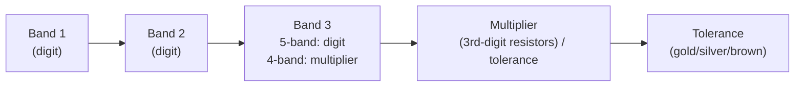
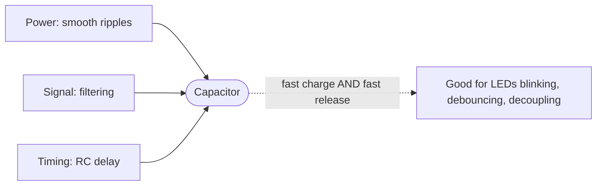
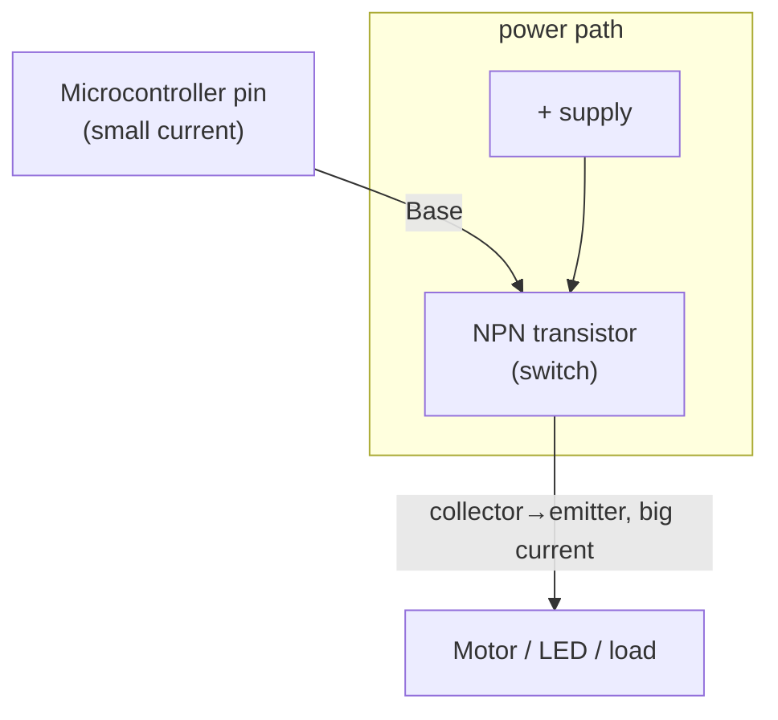

# Ohm's Law & Components

Now that you know **voltage** (pressure), **current** (flow), and **resistance** (pipe
narrowness), let's meet the actual parts you'll hold in your hand. This page is a practical
field guide to the five components you'll use in the first hundred projects: **resistors,
LEDs, capacitors, transistors, and diodes** — plus the color codes that let you read a
resistor's value at a glance, and Ohm's-law worked examples that connect the theory to the
parts.

A friendly motto before we start: **components are tools, not magic.** Each one does one
obvious job, and once you know what that job is, you'll spot them everywhere.

## Ohm's law refresher (with real numbers)

Ohm's law is your component calculator. The three forms, again:

| Want | Formula | Typical use |
|---|---|---|
| Voltage | `V = I × R` | "What voltage is across this resistor?" |
| Current | `I = V / R` | "How much current will flow?" |
| Resistance | `R = V / I` | "What resistor do I need?" |

**Worked example 1 — limiting an LED.** An LED wants about 20 mA and drops ~2 V. You power
it from 5 V. The resistor must absorb the *leftover* voltage: `5 V − 2 V = 3 V`. Then:

```
R = V / I = 3 V / 0.02 A = 150 Ω
```

Grab the nearest standard **220 Ω** value. (Slightly more resistance = a little dimmer and
very safe — a great habit.)

**Worked example 2 — a voltage divider.** Two resistors in series share the supply voltage
in proportion to their resistance. With R1 = 1 kΩ (1,000 Ω) and R2 = 2 kΩ across 9 V, the
voltage at their midpoint is:

```
V_out = V_in × (R2 / (R1 + R2)) = 9 × (2000 / 3000) = 6 V
```

Voltage dividers are everywhere — sensors and potentiometers use exactly this trick. This
is also a nice taste of the *voltage-drop* idea from the electricity page.

**Worked example 3 — "what current is flowing?"** You measure 10 V across a 2 kΩ resistor.
`I = V / R = 10 / 2000 = 0.005 A = 5 mA`. Tiny numbers like this are normal and fine.

## The parts

### Resistors (R) — the controlled "narrow pipe"

The most common part in electronics. A resistor limits current and/or sets voltages by
providing a fixed, known resistance. It's not polarized — you can put it in either way, and
it reads the same backwards.

Resistors come with color bands because a tiny component can't fit printed numbers. The
bands encode value + tolerance.

### Reading resistor color codes (the 5 bands)

Most hobby resistors are **4-band** (2 digits + multiplier + tolerance) or **5-band**
(3 digits + multiplier + tolerance). The mnemonic everyone learns (in order *black, brown,
red, orange, yellow, green, blue, violet, grey, white*):

> **B**ad **B**oys **R**ave **O**ver **Y**oung **G**irls **B**ut **V**eto **G**etting **W**ed

| Color | Digit | Multiplier |
|---|---|---|
| Black | 0 | ×1 |
| Brown | 1 | ×10 |
| Red | 2 | ×100 |
| Orange | 3 | ×1,000 |
| Yellow | 4 | ×10,000 |
| Green | 5 | ×100,000 |
| Blue | 6 | ×1,000,000 |
| Violet | 7 | ×10,000,000 |
| Grey | 8 | — |
| White | 9 | — |
| Gold | (tolerance ±5%) | ×0.1 |
| Silver | (tolerance ±10%) | ×0.01 |

**How to read a 4-band resistor:** hold it so the bands are on the left (or the separated
tolerance band is on the right).

- Band 1 = first digit
- Band 2 = second digit
- Band 3 = multiplier (add this many zeros)
- Band 4 = tolerance

**Example:** *red-red-orange-gold* → 2, 2, ×1,000 → **22,000 Ω = 22 kΩ**, ±5%.

**How to read a 5-band resistor:** same idea, but you get a third digit before the
multiplier, which gives finer values.

**Example:** *brown-black-black-black-brown* → 1, 0, 0, ×1 → **100 Ω**, ±1%.



### LEDs (D) — tiny lights, but picky eaters

An **LED** (light-emitting diode) is a **diode** that glows when current runs through it in
the forward direction. Three facts rule every LED circuit:

1. **It's polarized.** The **long leg is the anode (+)**; the **short leg (or the flat
   edge on the case) is the cathode (−)**.
2. **It needs a minimum "forward voltage" to turn on** (~2 V for red, ~3 V for blue/white),
   and once on, the voltage across it stays roughly constant.
3. **It has a maximum current** (usually ~20 mA). Feed it more and it lets through
   everything and **burns out**. That's *why* every LED needs that series resistor.

**Rule of thumb you'll use forever:** size the resistor so current ≈ 20 mA, as in Worked
Example 1 above. If you have a 5 V supply and a 2 V LED, a **220 Ω** resistor is the classic
go-to.

### Capacitors (C) — tiny, fast batteries

A **capacitor** stores charge (energy) in an electric field between two plates separated by
an insulator. It's like a battery that can't hold much but charges and releases *instantly*.
Capacitance is measured in **farads (F)**, though you'll practically always see micro- (µF),
nano- (nF), or pico- (pF).

Three jobs capacitors do constantly:

- **Smooth power** — flatten the lumps and dips in a supply so chips get clean voltage.
- **Filter signals** — pass some frequencies and block others (think bass/treble).
- **Timing** — with a resistor, a capacitor charges slowly and sets a delay (the "RC time
  constant").

**Polarity matters** for *electrolytic* capacitors (their symbol has a + or −, and they have
a marked stripe/long leg for +). Get one backwards and it can pop. Ceramic capacitors are
non-polarized — either way is fine.



### Diodes (D) — one-way valves

A **diode** lets current flow in only one direction. Forwards = open (low resistance);
backwards = closed (blocks current). That makes it a **one-way valve** — the foundation of
rectifiers (AC → DC) and of all that protection circuitry hiding on your boards.

- **LED** is a diode that happens to emit light.
- A **zener diode** is a special diode that conducts in reverse once voltage exceeds a
  reference value — great for making a stable voltage reference.

### Transistors (Q) — electrically controlled switches / amplifiers

A **transistor** is a solid-state switch or amplifier: a small current (or voltage) at one
terminal controls a larger current flowing between the other two. It's the single component
that makes all modern electronics possible — billions of them live inside every chip.

For beginners, think of the humble **NPN transistor as an electrically controlled switch**:

- **Base (B)** = the control input.
- **Collector (C)** = power goes in.
- **Emitter (E)** = power comes out.

Apply a small current to the base, and it lets a big current flow from collector to
emitter — like a faucet the control current turns on. This is exactly how you'll drive a
motor that draws more current than a microcontroller pin can safely supply.



> ⚠️ **Why transistors matter for boards:** a microcontroller pin can usually only source or
> sink ~20–40 mA. A motor wants hundreds of mA. So you don't connect the motor to the pin
> directly — you use the tiny pin current to switch a *transistor*, which then switches the
> big motor current using power from the supply. Same trick drives relays, buzzers, and
> high-power LEDs.

## Component letter codes (the "reference designator")

On schematics and circuit boards you'll see each part labeled with a letter + number:

| Code | Component |
|---|---|
| R | Resistor |
| C | Capacitor |
| D | Diode (incl. LED) |
| Q | Transistor |
| L | Inductor |
| SW | Switch |
| U / IC | Integrated circuit / chip |
| J | Connector / jack |
| F | Fuse |

"R7" means "the 7th resistor in this design." These labels let you look up any part in a
bill of materials and find it physically on the board — we'll build on this in the
*Schematics* section.

## The beginner component kit

To build every project in this hub you need remarkably little:

- An **assortment of resistors** (220 Ω, 1 kΩ, 10 kΩ cover 90% of needs)
- **Red/green/blue LEDs** + a few **buttons/switches**
- A few **capacitors** (0.1 µF "decoupling" and 10–100 µF electrolytic)
- An **NPN transistor** (2N2222 or 2N3904) and a **diode** (1N4007)
- A **potentiometer** (twist-adjustable resistor — great for learning)
- A **breadboard**, **jumper wires**, and a **multimeter** (your eyes on voltage/current)

That's well under $20 and covers years of learning.

## Watch & learn

Verified, beginner-friendly videos that show the parts doing their jobs:

- [How to Read Resistor Color Code — Electro University](https://www.youtube.com/watch?v=TpMtASajEGQ)
- [Capacitors Explained — The Engineering Mindset](https://www.youtube.com/watch?v=X4EUwTwZ110)
- [How a Transistor Works — Ben Eater](https://www.youtube.com/watch?v=DXvAlwMAxiA)

---

**Next up:** [Circuits & schematics](03-circuits.md) — reading symbols, using a breadboard,
and wiring your first real LED + resistor circuit.
