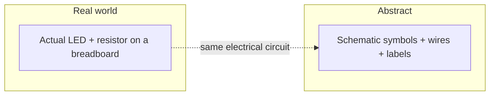
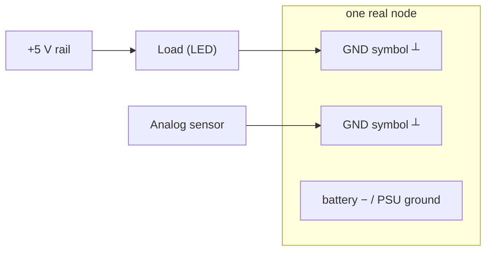
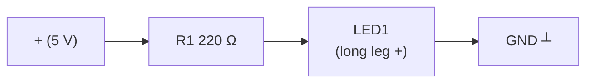

# Circuits & Schematics

You know the ideas (voltage, current, resistance) and the parts (resistor, LED, capacitor,
transistor). Now we connect the two: **how to read a schematic**, **what ground means**,
**how a breadboard actually works**, and a full **walkthrough of your first real circuit** —
an LED with a series resistor. By the end you'll be able to look at a circuit drawing,
understand it, and build it on a breadboard by hand.

## What a schematic is (and isn't)

A **schematic** (or circuit diagram) is a *map* of how components are electrically
connected — drawn with standardized **symbols** instead of pictures. The crucial point:

> A schematic tells you how parts are **connected** (electrically), **not** how they're
> placed physically. Wires on a schematic can be drawn as tidy straight lines that don't
> look anything like the messy real breadboard — and that's fine.

Schematics are how engineers communicate circuits. They label every part with a
**reference designator** (R1, C2, D3 — recall the letter codes from the components page) and
its value, so you know exactly what goes where.



## Common circuit symbols — your alphabet

You don't need to memorize everything; you'll learn the handful you use. These are the ones
that show up in nearly every beginner project:

| Symbol (rough) | Name | Code | Notes |
|---|---|---|---|
| `─/\/\/─` (US) or `─[ ]─` (EU) | Resistor | R | Zigzag (US) or box (EU) |
| `─▶|─` | LED | D | Diode symbol + two light arrows |
| `─|─` | Diode | D | Triangle/bar = one-way valve |
| `─||─` | Capacitor (non-polar) | C | Two parallel lines |
| `─|+||──` | Electrolytic capacitor | C | One curved plate = negative side |
| `─|>|─` (base/collector/emitter) | NPN transistor | Q | Junction symbol |
| `(+ short / − long)` | Battery | BT | Long line = + |
| `─ / ─` | Switch (open) | SW | Gap = open = no current |
| ┴ | Ground | GND | The common "0 V" reference |

Two rules about wires on a schematic:

- **Crossing wires that touch** are marked with a **dot** (●) at the junction.
- **Crossing wires that don't touch** have **no dot** — they just pass near each other.

That little dot is the difference between "these connect" and "these are unrelated." Look
for dots first when following a schematic.

## Ground: the "sea level" of your circuit

**Ground (GND) is your 0 V reference point** — the common "return" that every part's
negative side connects back to. It's like sea level: all your voltage measurements are
"with respect to what?" and ground is the answer.

Key ideas:

- **Voltage is always measured between two points** — ground is your fixed "zero" so that
  "5 V" usually means "5 V *relative to ground*."
- **Ground is shared.** The battery's − terminal, the microcontroller's GND pin, and all the
  return wires of your components all meet at the same common node. This lets current
  complete its loop through a single shared ground.
- **On schematics, you don't draw a wire back to the battery for every part.** Instead you
  stamp the **ground symbol** (┴) wherever a return is needed, and everyone understands all
  those ┴ are politely joined together. It's a schematic trick that keeps drawings tidy.



Every ┴ connects to every other ┴ — they're all the same point electrically.

## The breadboard: build circuits without soldering

A **breadboard** is a plastic board of holes with **metal strips hidden underneath** that
connect certain holes together. Push component leads and jumper wires into the holes and
you've built a circuit — no soldering, and it's easy to rearrange.

The two things that unlock it:

1. **The power rails** (the long red/blue strips along the edges, marked + and −) are
   **connected vertically** — the whole strip is one long node for +5 V and one for GND.
2. **The rows** (in the middle, between the +/− rails) are **connected horizontally**, in
   groups of five holes, on each side of the center channel. Put two wires in the *same
   row* and they're electrically joined.

The **center channel** exists so chips (ICs) can straddle it with their pins landing in
separate rows.

```mermaid
flowchart TD
    subgraph Breadboard (top view)
        direction LR
        Rplus["+ rail — all connected (vertical)"]
        Rminus["− rail — all connected (vertical)"]
        Row1["row A .. E — one row all connected"]
        Row2["row F .. J — one row all connected"]
        Gap["center channel (no connection across)"]
    end
```

**The big mental model:** *same row = connected; power rails run the whole length; the two
sides don't touch across the channel.* Color your wires (red = +, black/blue = −, other = signal)
to keep your own circuits readable.

## Your first circuit, end to end: LED + resistor

Let's combine everything. We'll drive one LED from a power supply (or a 5 V pin later), with
a resistor to keep the LED safe.

### 1. The schematic



That's the whole circuit: from +5 V, through the resistor, through the LED, back to ground.

### 2. Why the resistor value?

Recall Worked Example 1: LED drops ~2 V, wants ~20 mA, supply is 5 V.

```
Resistor must drop 5 − 2 = 3 V
R = V / I = 3 V / 0.02 A = 150 Ω  → use 220 Ω for margin
```

The resistor *absorbs the extra voltage* and *caps the current* — two jobs in one part.

### 3. Build it on the breadboard

- Put the **LED** across the center channel: long leg in one row (say row 20), short leg in
  the other row (row 21). This straddles the gap so the two legs aren't shorted together.
- Put the **220 Ω resistor** with one leg in the *same row* as the LED's long leg (row 20)
  and the other leg in any row that's *not* connected to those (e.g. row 25).
- Run a **jumper from the + power rail to the resistor's free row** (row 25).
- Run a **jumper from the − power rail to the LED's short-leg row** (row 21).
- Feed **+5 V into the + rail** and **0 V into the − rail**.

Tracing the path: +5V rail → jumper → row 25 → resistor → row 20 → LED (long) → LED (short)
→ row 21 → jumper → − rail → back to ground. **Closed loop, LED glows.**

### 4. Verify before powering (and a safety habit)

- **Eyeball the loop** — trace it on paper before connecting power.
- Check the LED **polarity** (long leg toward +).
- Confirm the resistor is actually **between + and the LED** (not bypassing it — that'd be a
  short).
- Only then connect power. If the LED doesn't glow, the top three suspects are: **polarity
  backwards**, **resistor in the wrong row**, or a **loose/bad jumper**.

### 5. Test with a multimeter

When something's off, a **multimeter** turns guesswork into measurement:

- **Voltage** across the LED should read ~2 V (its forward voltage).
- **Voltage** across the resistor should read ~3 V (the leftover).
- **Current** in the loop (meter in series) should read ~20 mA.

If the numbers match Ohm's law, the physics is happy and any remaining problem is wiring.

## Troubleshooting checklist

Circuit not working? Go in this order — don't rewire randomly:

1. **Power on?** Supply connected, battery not flat.
2. **Complete loop?** Trace the path; find the break/short (look for the missing solder/bad
   jumper, and the accidental short that bypasses a part).
3. **Polarity right?** LEDs, electrolytic capacitors, transistors, diodes are all picky.
4. **Values right?** Multimeter-check the resistor; confirm no part is fried.
5. **Breadboard contacts?** Reseat the part — bad push-in contacts are incredibly common.

## Watch & learn

Verified, beginner-friendly walkthroughs:

- [How to Read a Schematic — RimstarOrg](https://www.youtube.com/watch?v=_HZ-EQ8Hc8E)
- [How to Use a Breadboard — Science Buddies](https://www.youtube.com/watch?v=6WReFkfrUIk)
- [LED Basics — Afrotechmods](https://www.youtube.com/watch?v=Yo6JI_bzUzo)

---

**Next up:** [Microcontroller basics](04-microcontrollers.md) — the chip that will run your
circuits and turn them into *projects*.

---

<div class="quiz" data-title="Quick check: circuits & schematics">

<div class="q" data-type="choice">
  <p class="question">In a series circuit, current is:</p>
  <ul class="options">
    <li data-correct>The same through every component</li>
    <li>Divided among the components</li>
    <li>Zero in the middle components</li>
    <li>Different at each point</li>
  </ul>
</div>

<div class="q" data-type="choice">
  <p class="question">What does a schematic symbol with a triangle and a line represent?</p>
  <ul class="options">
    <li data-correct>An operational amplifier (op-amp)</li>
    <li>A resistor</li>
    <li>A capacitor</li>
    <li>A ground connection</li>
  </ul>
</div>

<div class="q" data-type="tf">
  <p class="question">True or false: a short circuit is a low-resistance path that can allow dangerously large current.</p>
  <ul class="options">
    <li data-correct>True</li>
    <li>False</li>
  </ul>
</div>

<div class="q" data-type="fill">
  <p class="question">Kirchhoff's current law states that the sum of currents entering a node ____ the sum of currents leaving it (one word: equals, exceeds, or... ).</p>
  <input class="answer" data-answers="equals, is equal to, balances">
</div>

</div>

## 🧪 Exercises & Projects

> **Estimated total time:** ~2–2.5 hours. The schematic-reading exercises need only a
> pencil; the project needs a breadboard, one LED, a push button, two resistors, and a
> multimeter.

### 📝 Exercises

**🟢 Easy — read the schematic.** Draw the following circuit as a schematic *and* as a
breadboard layout in your notebook (or trace it on paper). Check each box when both
match.

- [ ] A 9 V battery, a 470 Ω resistor, and an LED all in **series**. Mark the LED's
      anode (+) so the drawing is unambiguous. Label each part with its letter code
      (R1, D1, BT).
- [ ] The *same* circuit drawn with a **ground symbol** (┴) instead of drawing the wire
      all the way back to the battery. Note where the ┴ goes.

**🟡 Medium — spot the connection.** Recall the breadboard rules (same row = connected;
power rails run the length; no connection across the center channel).

- [ ] You push the two legs of a resistor into rows A5 and A5 on the *same side*. Are
      they connected? *(No — same row but the two legs of one part both in A5 means the
      part is folded; they must be in *different* rows.)*
- [ ] One wire is in **row B3** and another in **row C3**. Are they electrically joined?
      *(Yes — same row on the same side of the channel.)*
- [ ] A wire in **row E3** (left side) and one in **row F3** (right side, across the
      channel). Connected? *(No — the center channel isolates the two sides.)*

**🔴 Hard — troubleshoot a broken build.** A classmate's LED won't light. They show you
their breadboard. Walk through the 5-step troubleshooting checklist from this page and
write, for each step, the *one thing* you'd check first.

- [ ] What's step 1 (power) and the most likely single fault there?
- [ ] Trace a plausible "open loop" (a missing jumper) and name it.
- [ ] Predict the symptom if the LED is in **backwards** vs. if the **resistor is
      bypassed** (a short straight across the LED's two rails). Which one risks damaging
      the LED? *(The bypassed resistor — a literal short.)*

### 🛠️ Mini-Project: Breadboard a switch

**Goal:** build a complete, closed-loop circuit you toggle by hand — and learn how an
open circuit behaves — by adding a push button to your LED circuit.

**Time:** ~30–40 minutes. **Components:** breadboard, one LED, a 220 Ω resistor, one push
button, jumper wires, a 5 V source, and a multimeter.

**Build steps:**

1. Build the **LED + resistor circuit** exactly as you did on the components page: LED
   across the channel, 220 Ω resistor from the LED anode's row to a free row.
2. Add the **push button** straddling the center channel so its four legs land in four
   different rows (say rows 5, 5 — the button's two pins on the near side, rows 5 and 6
   on the far side).
3. Wire so the current path is: **+5 V → button → resistor → LED → ground**. Concretely:
   - Jumper **+ rail → one leg row of the button** (row 5, near side).
   - Jumper **the button's opposite leg row (row 6, far side) → the free end of the
     resistor** (where it connects through to the LED).
   - Complete **LED cathode → − rail**.
4. Power up. The LED stays **off** until you **press the button** — then it lights. That's
   an *open circuit* (button open = break in the loop) becoming a *closed circuit*.

**Verify with the multimeter:**

- With the button **open**, measure voltage across the **button's two legs**: it reads
  the full ~5 V even though no current flows (pressure, no flow — recall the electricity
  page).
- Press the button and re-measure: it should drop to ~0 V, and the LED row should now
  show its ~2 V forward drop.

**Extend it:** try the same button but wired so pressing it *turns the LED off* (put the
button in the ground path instead). Explain why it toggles the opposite way. Then draw
both versions as schematics — you've now made a real switch, the simplest possible
"input" to any future microcontroller project.

> **Tips:** a push button's four legs are internally connected in pairs (the two on each
> side). If pressing it does nothing, rotate it 90° — it's a very common orientation
> mistake. Always trace the loop on paper *before* powering; a short across the LED's rails
> (resistor bypassed) is the one wiring error that can kill the LED.
