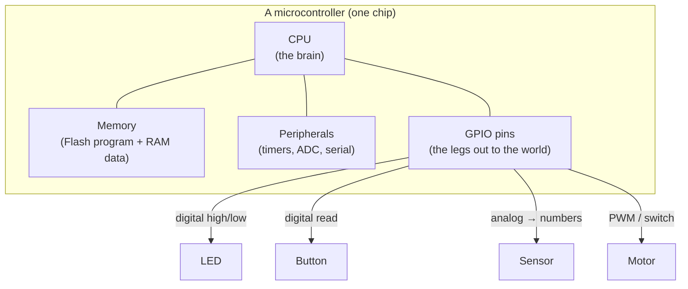
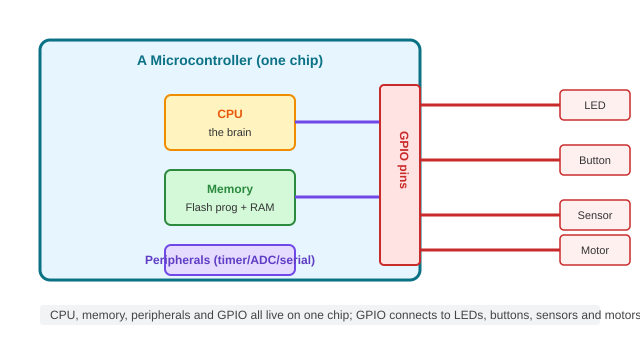
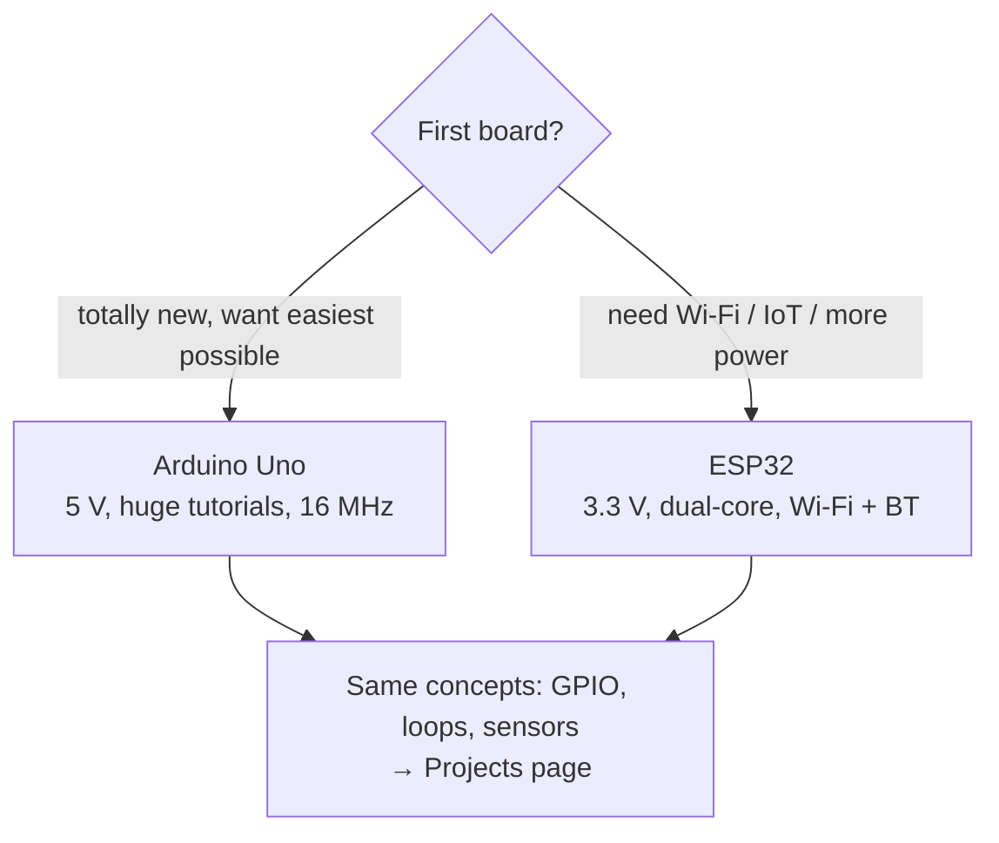

# Microcontroller Basics

Your LED circuit works — it glows whenever power is on. To make it *do things* (blink on a
schedule, react to a button, sense light, spin a motor, talk to the internet), you need a
**brain** on the board: a **microcontroller**. This page explains what one is, how it
differs from a PC's CPU, and why **Arduino** and **ESP32** are the friendliest ways to start
— the two boards this whole hub is built around.

## What a microcontroller is

A **microcontroller (MCU)** is a **complete little computer on a single chip**. It bundles
together the things a computer needs into one tiny, cheap, low-power package:

- A **CPU** (the brain that does the math and runs your program)
- **Memory** (to store the program and its data)
- **Peripherals** (built-in circuit blocks to talk to the outside world)
- **GPIO pins** (the metal legs, or pads, that connect to LED, buttons, sensors, motors)

Because it's all on one chip, a microcontroller is perfect for **one specific, devoted job**
in a device — reading an oven's temperature, running a toy, controlling a washing machine,
talking to a sensor. It doesn't need an operating system or a screen; it just runs your
program forever in a tight loop.



Same picture as a concrete hardware block diagram:



*Inside the chip: CPU, memory, and peripherals talk to each other, and the GPIO pins are the hands that reach out to LEDs, buttons, sensors, and motors in the outside world.*

## Microcontroller vs. CPU — the key difference

Your laptop's **CPU** (microprocessor) is a super-powered brain that does *nothing else*:
it needs external RAM, an external storage drive, a GPU, an operating system, and a whole
motherboard around it. It's fast and flexible, but heavy.

A **microcontroller** is the opposite trade:

| | CPU / computer | Microcontroller |
|---|---|---|
| Includes | brain only | brain + memory + I/O on one chip |
| Memory | external RAM + disk (lots) | small, on-chip (KB to a few MB) |
| Speed | GHz, blazing | MHz, modest (8–240 MHz typical) |
| Power | watts, needs cooling | milliwatts, often battery-friendly |
| OS | Windows / Linux / macOS | bare-metal loop or tiny RTOS |
| Job | run many general tasks | run one devoted task, reliably, cheaply |

**The one-line summary:** a computer is a multi-purpose machine that needs a body built
around its brain; a microcontroller is a whole mini-organism — brain, memory, and senses
in one chip — that you point at exactly one job.

Microcontrollers aren't "worse computers" — they're **purpose-built**. Your thermostat,
keyboard, TV remote, and car's ABS each have one, because they're cheap, tiny, fast to
respond, and sip power for years. (Of the 30+ billion chips sold every year, the vast
majority are microcontrollers.)

## Inside the chip: the parts you'll actually touch

### GPIO — the "hands" that talk to the world

**GPIO** = **G**eneral **P**urpose **I**/**O**. These are the pins that you connect your
components to. Each pin can be software-configured to behave as:

- **Digital output** — drive the pin to HIGH (near the supply voltage, e.g. 3.3 V or 5 V) or
  LOW (0 V). That's how you turn an LED on/off.
- **Digital input** — read whether the voltage on the pin is HIGH or LOW (e.g. "is the button
  pressed?"). 
- **Analog input** — (on ADC-capable pins) convert a continuous voltage into a number, so you
  can read things like a light sensor or potentiometer.
- **PWM output** — flicker the pin on/off many times a second to fake an adjustable
  voltage (dimmer LED, motor speed).

**Key limit:** a GPIO pin can normally only **source/sink ~20–40 mA** of current. That's
fine for an LED, not enough for a motor — which is exactly why you learned about transistors
as "bigger switches" on the components page.

### Clock — the heartbeat

The microcontroller has an internal **clock** (a crystal/oscillator) that ticks millions of
times a second. Every instruction the CPU runs lines up with these ticks. A 16 MHz Arduino
runs ~16 million steps per second; a 240 MHz ESP32 is much faster. Higher clock = more work
per second (and more power). For blinking an LED, even 1 MHz is absurdly fast.

### Memory — the short- and long-term notes

A typical MCU has three kinds:

- **Flash** — stores *your program* (the code). It survives power-off. Arduino calls this
  its little "hard drive."
- **RAM** — temporary working space for *variables* while the program runs. It's lost when
  power goes off.
- **EEPROM** (or flash-emulated) — a tiny bit of *both*: data that must survive reboots
  (like "last setting").

On a small Arduino, maybe 32 KB Flash and 2 KB RAM. An ESP32 is roomier (a few MB Flash).
Tiny by PC standards, but plenty for one devoted job.

### Peripherals — the built-in helpers

Rather than reinventing everything in software, the chip has dedicated hardware blocks:

- **Timers** — count clock ticks and fire events at exact intervals (blink every 500 ms
  without wasting CPU).
- **ADC** (Analog-to-Digital Converter) — turns a voltage into a number, so sensors work.
- **UART / I²C / SPI** — serial communication peripherals that let the chip talk to other
  chips, sensors, displays, and your computer. (The ESP32 adds **Wi-Fi and Bluetooth**
  peripherals.)
- **Watchdog timer** — resets the chip if the program hangs. Boring but vital for
  reliability.

## Why Arduino and ESP32 are the friendly entry points

Bare microcontrollers are tiny surface-mount chips you can't easily plug a breadboard wire
into; they need special programmers and fiddly setup. **Development boards** wrap the chip
in a friendly package, and **Arduino** and **ESP32** wraps it in a friendly experience.

### Arduino (AVR) — the friendliest first board

- **Board = chip + everything you need**: a USB port (to plug into your computer and upload
  code), voltage regulator, a built-in LED on pin 13, and rows of sockets that take
  breadboard wires directly.
- **Simple, forgiving language**: Arduino "sketches" are C/C++ boiled down to two functions
  — `setup()` (run once) and `loop()` (repeat forever). Here's the whole "make it blink"
  program:

  ```cpp
  void setup() {
    pinMode(LED_BUILTIN, OUTPUT);   // set the built-in LED pin as an output
  }
  void loop() {
    digitalWrite(LED_BUILTIN, HIGH); // LED on
    delay(1000);                     // wait 1 second
    digitalWrite(LED_BUILTIN, LOW);  // LED off
    delay(1000);                     // wait 1 second
  }
  ```

- **Huge community**: tens of thousands of tutorials and examples. Whatever you want to
  do, someone already made it and shared the code.
- **5 V logic**, very tolerant — ideal for learning on a breadboard.

### ESP32 — when you want Wi-Fi and more muscle

- **Same beginner-friendly Arduino-style workflow** (you can write it in the Arduino IDE or
  in MicroPython), but the chip is far more powerful.
- **Built-in Wi-Fi + Bluetooth** — so your project can talk to your phone or the internet
  without extra hardware. This is the go-to for **IoT (Internet of Things)**.
- **Dual-core, faster clock, more memory** — can handle bigger programs and multiple tasks.
- **3.3 V logic** — a little more care needed (an ESP32 pin pushing into a 5 V-only part can
  be a problem, fixable with voltage dividers), but Arduino-style code shields you from the
  difference in general.

### Which to pick first?

- Want the **smoothest possible start**, total beginner, lots of hand-holding? → **Arduino
  Uno**. It's the classic "first board."
- Building something that must **connect to your phone or the internet** (an IoT weather
  station, a smart device) or needs more power for audio/processing? → **ESP32**.
- The concepts in this hub apply to **both** — that's the whole point of learning the
  fundamentals first.



## A microcontroller's "life" — the blink in slow motion

When you power an Arduino, it:

1. **Loads** your program from Flash.
2. Runs **`setup()`** once (configures pins, peripherals, serial).
3. Loops **`loop()`** forever: set pin HIGH, wait, set pin LOW, wait, repeat.

Meanwhile the **clock ticks** a million+ times a second, the **timer** counts out your
`delay()`, the **GPIO** flips the pin voltage, and the **register/LED** responds. Every
microcontroller project is that same skeleton with different details.

## Watch & learn

Verified, beginner-friendly introductions:

- [What is a Microcontroller? ft. Raspberry Pi Pico — Raspberry Pi](https://www.youtube.com/watch?v=ZY-HrRGCQ4w)
- [A Beginner's Guide to Microcontrollers — Electronic Wizard](https://www.youtube.com/watch?v=GZAg9XSIs_Q)
- [Arduino Tutorial #1 – Getting Started — mjlorton](https://www.youtube.com/watch?v=kLd_JyvKV4Y)

---

**Next up:** [From breadboard to board](05-projects.md) — a proven project ladder: blink →
button → sensor → motor → network, with build steps you can follow today.

---

## 🧪 Exercises & Projects

> **Estimated total time:** ~2–3 hours. You'll want a microcontroller board (Arduino Uno
> or ESP32), its USB cable, and the Arduino IDE installed. The button project also needs
> a breadboard, a push button, an LED, a 220 Ω resistor, and two wires.

### 📝 Exercises

**🟢 Easy — know your chip.** No code needed; answer from the page.

- [ ] Name the four things a microcontroller bundles onto one chip that a bare CPU lacks.
      *(CPU, memory, peripherals, GPIO — all on one die.)*
- [ ] True or false: a microcontroller can drive a motor directly from a GPIO pin.
      *(False — pins source ~20–40 mA; a motor wants hundreds. Use a transistor.)*
- [ ] Where does your *program* live after power-off, and where do *variables* live
      while it runs? *(Flash vs. RAM.)*

**🟡 Medium — trace the blink.** Read this code and predict the behaviour *before* running:

```cpp
void setup() { pinMode(LED_BUILTIN, OUTPUT); }
void loop() {
  digitalWrite(LED_BUILTIN, HIGH);
  delay(500);
  digitalWrite(LED_BUILTIN, LOW);
  delay(200);
}
```

- [ ] Write down exactly what the LED does (on/off and for how long). *(On 0.5 s, off
      0.2 s — an uneven "SOS-ish" blink.)*
- [ ] Rewrite it so the LED blinks **3 times fast (100 ms), then stays off 2 seconds,
      then repeats**. Sketch the `loop()` logic. *(Tip: use a `for` loop for the 3 blinks.)*

**🔴 Hard — why Arduino vs. ESP32?** For each project below, say which board you'd pick
and *why*, citing a concrete spec from this page (clock, memory, Wi-Fi, logic level).

- [ ] A battery-powered sensor that must last months and only blinks when tripped.
- [ ] An IoT device that sends temperature readings to a phone over Wi-Fi.
- [ ] A beginner's very first blink, maximum hand-holding.

### 🛠️ Mini-Project: Blink, then a button turns it off

**Goal:** flash the onboard LED on a schedule, then use a GPIO input (a button) to
override it — your first two-way conversation between chip and the physical world.

**Time:** ~40–50 minutes. **Components:** board + USB, breadboard, one push button, one
LED, a 220 Ω resistor, two jumpers.

**Build steps:**

1. **Upload** the classic blink from the page (or the Medium exercise above) and watch
   the onboard LED blink. Confirm upload works before adding hardware.
2. Add an **external LED + 220 Ω resistor** from a free digital pin (say pin 9/GPIO4) to
   ground, long leg toward the pin.
3. Wire the **button** with an **internal pull-up** (the Arduino/ESP32 handles it in
   software — no external resistor): one button leg to ground, the opposite leg to a
   digital pin (say pin 2/GPIO0).
4. Upload a **modified loop** that blinks the onboard LED *unless* the button is pressed,
   in which case it keeps the external LED on solid:

   ```cpp
   const int btn = 2;      // adjust to your board's pin
   const int ext = 9;      // adjust to your board's pin
   void setup() {
     pinMode(LED_BUILTIN, OUTPUT);
     pinMode(ext, OUTPUT);
     pinMode(btn, INPUT_PULLUP);   // pull-up: reads LOW when pressed
   }
   void loop() {
     if (digitalRead(btn) == LOW) {   // pressed
       digitalWrite(ext, HIGH);       // hold external LED on
       digitalWrite(LED_BUILTIN, LOW);
     } else {                         // released: back to blinking
       digitalWrite(ext, LOW);
       digitalWrite(LED_BUILTIN, !digitalRead(LED_BUILTIN)); // toggle
       delay(500);
     }
   }
   ```

5. Verify: blinking normally; press and hold → external LED lights, blink stops.

**The idea you've just exercised:** GPIO can be *input* or *output*, and software decides
what the current flows do. A button press is just a voltage falling to ground that you
read as `LOW`. That's the entire input-side of every future project (the 05-projects page
climbs blink → button → sensor → motor from exactly here).

> **Tips:** if the button input seems "random," you likely have a floating pin — with a
> pull-up it's solid HIGH until pressed. If the LED is dim or won't light, check you
> added the series resistor and got the long-leg polarity right. And remember GPIO pins
> can't drive a motor — that's the transistor you'll meet on the projects page.
