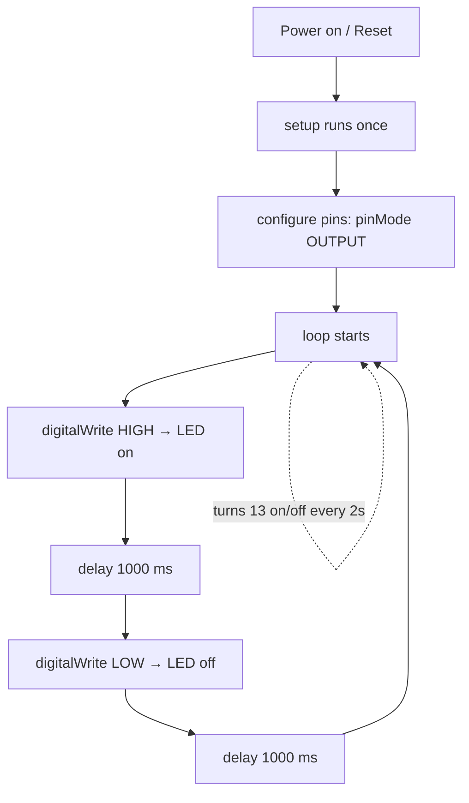

# Arduino Beginner (C)

*This is **Step 4½** of the [Arduino path](index.md).* You'll write your first real programs in **C**
for an Arduino Uno (an **ATmega328P / AVR** microcontroller). We assume you have an Arduino, an LED
and a resistor, a push button, and the **Arduino IDE** installed — that's it. No prior electronics
or programming experience needed.

> ⚠️ **Safety rule that matters most (3.3 V vs 5 V):** your Arduino Uno runs at **5 V** logic.
> That's fine for this page. The ESP32 (next path) runs at **3.3 V** — always check before wiring
> both into the same project.

---

## 1. The anatomy of a sketch

Every Arduino program is a **sketch**, and every sketch has exactly two functions you must write:

```c
// runs ONCE when the board powers on or resets
void setup() {
    // configure pins, start serial, initialize things
}

// runs forever, over and over, as fast as it can
void loop() {
    // the main "body" of your program
}
```

Everything else in C (variables, functions, arrays) sits *around* these two. The Arduino IDE adds a
little hidden `main()` for you; you never see it. Your job is just to fill in `setup()` and
`loop()`.

**Why two functions?** `setup()` is for *configuration* — things you set once, like "this pin is an
output." `loop()` is for *behaviour* — things that repeat, like "turn the LED on, wait, turn it
off."

A sketch is plain C (technically C++), so every statement ends with a semicolon `;` and every block
`{ }` is indented with two spaces. Get these two habits right and the rest is easy.

---

## 2. Blink: your first program

The hardware equivalent of "Hello, world." Wire an LED to **pin 13** (many Unos have the LED
built-in and already connected there — perfect for a first test):

- **LED longer leg (anode / +)** → pin 13
- **LED shorter leg (cathode / −)** → through a **220 Ω resistor** → **GND**

> Why the resistor? It *limits* the current so the LED doesn't burn out. Without it the pin would
> drive several times more current than the LED can take. This is Ohm's law in action — see
> [Ohm's law & components](../../concepts/02-components.md).

```c
// blink.ino — turn the built-in/pin-13 LED on and off forever
const int LED_PIN = 13;        // name the pin so the code reads clearly

void setup() {
    pinMode(LED_PIN, OUTPUT);  // tell the chip: this pin will SEND voltage
}

void loop() {
    digitalWrite(LED_PIN, HIGH);   // pin 13 → 5 V  ⇒ LED on
    delay(1000);                   // wait 1000 ms (1 second)
    digitalWrite(LED_PIN, LOW);    // pin 13 → 0 V  ⇒ LED off
    delay(1000);                   // wait another second
}
```

**Anatomy of the three functions you just used:**

| Function | What it does | Notes |
|----------|--------------|-------|
| `pinMode(pin, mode)` | Sets a pin as an **input** or **output** | Call once in `setup()`. Mode is `OUTPUT` or `INPUT` |
| `digitalWrite(pin, value)` | Sets an **output** pin HIGH (5 V) or LOW (0 V) | The pin must be `OUTPUT` first |
| `delay(ms)` | Pauses the program for `ms` **milliseconds** | 1000 ms = 1 s. Don't use negative values |

`const int LED_PIN = 13;` above the `setup()` is a **constant**. It's good practice: your code says
`LED_PIN` instead of a bare `13`, and you can't accidentally reassign it.

> 🚨 **Don't `delay()` too long if you also read buttons** — while `delay()` runs, the board can't
> do anything else. Fine for blinking; bad for responsive projects (see the button section below).

---

## 3. How the flow works (a diagram)

When you press **Upload**, the IDE compiles your sketch and flashes it to the AVR chip. Power on →
`setup()` once → `loop()` forever:



The heart of the idea: **loop() never stops**. Whatever you want the board to *keep doing* goes
inside it.

---

## 4. Variables and arrays

A **variable** is a named box for a number or value. An **array** is a list of them in one box,
indexed from `0`.

Often you want to control *several* LEDs at once. An array of pin numbers plus a `for` loop cleans
this right up:

```c
// three_leds.ino — blink three LEDs on pins 9, 10, 11 one after another
const int ledPins[3] = {9, 10, 11};   // array of 3 pin numbers
const int COUNT = 3;

void setup() {
    for (int i = 0; i < COUNT; i++) { // i = 0, 1, 2
        pinMode(ledPins[i], OUTPUT);  // set each of the three pins as an output
    }
}

void loop() {
    for (int i = 0; i < COUNT; i++) {
        digitalWrite(ledPins[i], HIGH);  // turn LED i on
        delay(300);                      // wait 300 ms
        digitalWrite(ledPins[i], LOW);   // turn LED i off
    }
}
```

Key C facts to remember:
- Arrays are **zero-indexed**: `ledPins[0]` is `9`, `ledPins[2]` is `11`.
- `for (int i = 0; i < COUNT; i++)` counts `0, 1, 2` — the classic C loop shape.

---

## 5. Functions — your own building blocks

The biggest readability win in C is writing your **own functions** so `loop()` reads like a
sentence instead of a pile of GPIO calls:

```c
// functions.ino — use a function to keep loop() clean
const int LED_PIN = 13;
const int ON_TIME  = 500;
const int OFF_TIME = 500;

void blink(int times) {              // our own function: blink an LED N times
    for (int i = 0; i < times; i++) {
        digitalWrite(LED_PIN, HIGH);
        delay(ON_TIME);
        digitalWrite(LED_PIN, LOW);
        delay(OFF_TIME);
    }
}

void setup() {
    pinMode(LED_PIN, OUTPUT);
}

void loop() {
    blink(3);   // blink 3 times quickly
    delay(1000);
    blink(5);   // then blink 5 times
    delay(1000);
}
```

A C function has a **return type** (`void` = returns nothing), a **name**, **parameters in
parentheses**, and a **body in braces**. Now `loop()` reads like a plan: blink three, pause, blink
five.

---

## 6. Reading a button (digital input)

So far pins have only *sent* voltage. A pin can also *read* it if we set it to `INPUT`. A push
button is a switch: pressed = connected, released = not connected. When it's not pressed, the pin
is "floating" — it reads noise. We fix that with a **pull-up resistor**.

The trick: connect the button between the pin and **GND**, and use the AVR's internal pull-up. Then
"not pressed" reads `HIGH` and "pressed" reads `LOW` (inverted logic, but rock-solid):

```c
// button.ino — press the button, light the LED
const int BUTTON = 2;   // button to GND
const int LED    = 13;

void setup() {
    pinMode(BUTTON, INPUT_PULLUP);  // internal pull-up: stable until pressed
    pinMode(LED, OUTPUT);
}

void loop() {
    int pressed = digitalRead(BUTTON);   // HIGH = not pressed, LOW = pressed

    if (pressed == LOW) {                // pressed
        digitalWrite(LED, HIGH);
    } else {
        digitalWrite(LED, LOW);
    }
}
```

**Gotchas to know:**
- `digitalRead()` returns `HIGH` or `LOW`.
- `INPUT_PULLUP` gives you a predictable HIGH when nothing is connected — use it instead of leaving
  an input floating.
- This read happens **instantly**, every loop pass — no `delay()` in the way, so the button feels
  responsive. (If you had a long `delay()`, presses during it would be missed — this is why
  responsive code avoids long delays.)

---

## 7. PWM: fading an LED with `analogWrite`

Some AVR pins can output **PWM** (pulse-width modulation): instead of a flat HIGH or LOW, the pin
rapidly toggles, spending a *fraction* of each cycle HIGH. The **average** voltage — and therefore
the LED's brightness — depends on that fraction. On the Uno, use pins marked with `~` (3, 5, 6, 9,
10, 11).

`analogWrite(pin, 0–255)` sets the duty: `0` = off, `255` = full on, `127` ≈ half brightness.

```c
// fade.ino — breathe an LED up and down using PWM
const int LED = 9;      // must be a PWM pin (has a ~ on the board)

void setup() {
    pinMode(LED, OUTPUT);
}

void loop() {
    for (int brightness = 0; brightness <= 255; brightness++) {  // fade UP
        analogWrite(LED, brightness);
        delay(10);
    }
    for (int brightness = 255; brightness >= 0; brightness--) {  // fade DOWN
        analogWrite(LED, brightness);
        delay(10);
    }
}
```

> 🔎 **"Analog" but really digital:** `analogWrite` *sounds* analog but is a fast digital toggle.
> True analog *measurement* (reading a voltage) is a different thing — `analogRead`, covered on the
> [projects concept page](../../concepts/05-projects.md).

---

## 8. Serial output: making the board talk to you

The serial port is how the board reports to your computer — the single most useful debugging tool
in embedded work. It sends text over the USB cable to the **Serial Monitor** (bottom-right button
in the IDE).

```c
// serial.ino — print the state of the button to the Serial Monitor
const int BUTTON = 2;

void setup() {
    pinMode(BUTTON, INPUT_PULLUP);
    Serial.begin(9600);     // open the serial link at 9600 baud
    Serial.println("Started!");   // send a line of text
}

void loop() {
    int pressed = digitalRead(BUTTON);  // LOW = pressed
    if (pressed == LOW) {
        Serial.println("Button pressed!");  // each press prints a line
    }
    delay(50);   // debounce-ish: don't print dozens of times per press
}
```

Serial essentials:
- `Serial.begin(9600)` must match the Serial Monitor's baud rate (set it to **9600** in the IDE).
- `Serial.print(x)` sends without a newline; `Serial.println(x)` sends with a newline.
- You can print numbers *and* text and mix them: `Serial.println("count: " + String(count));`

---

## 9. Putting it all together (a mini project)

Combine input, PWM, and serial into one sketch: read a button, and while it's held, "breathe" the
LED up and down and report the build number:

```c
// mini_project.ino — everything so far in one sketch
const int BUTTON = 2;
const int LED    = 9;   // PWM pin

void setup() {
    pinMode(BUTTON, INPUT_PULLUP);
    pinMode(LED, OUTPUT);
    Serial.begin(9600);
}

void loop() {
    if (digitalRead(BUTTON) == LOW) {        // button held
        for (int b = 0; b <= 255; b++) {
            analogWrite(LED, b);
            Serial.println(b);               // watch the value ramp in the monitor
            delay(5);
        }
        for (int b = 255; b >= 0; b--) {
            analogWrite(LED, b);
            delay(5);
        }
    } else {
        analogWrite(LED, 0);                 // released → LED off
    }
}
```

---

## 👀 Watch & learn

Watch someone build these exact circuits before you solder/breadboard your own. All links verified
live:

| Video | What you'll learn |
|-------|-------------------|
| [Arduino Tutorial 1 — Programming the Arduino for Absolute Beginners (Paul McWhorter)](https://youtu.be/fJWR7dBuc18) | Install the IDE, pick the right board/port, and write your **first three programs** — the perfect zero-expectation start |
| [Arduino Blinking LED Tutorial](https://youtu.be/I0ZIrzoI61g) | Wire an LED with the right resistor on a breadboard and blink it — reinforces §2 |
| [How to Blink an LED with Arduino (Lesson #2)](https://www.youtube.com/watch?v=FKekzzj5844) | Breadboard internals, series resistors, and tidy wiring — great before your first real build |

---

## ✅ You're done with the beginner tutorial

You now know: sketch anatomy, `setup()`/`loop()`, `pinMode`/`digitalWrite`/`delay`, constants,
arrays, functions, `digitalRead` with a pull-up button, PWM with `analogWrite`, and serial output.
That is the full vocabulary of the rest of the [Arduino path](index.md).

**Next steps:**
- Build a real project → [From breadboard to board](../../concepts/05-projects.md)
- Go deeper into C → [Arduino in C (synthesized)](../../synthesized/arduino-c.md)
- Look up any term → [Electronics Glossary](../../GLOSSARY/README.md)
- Move up to wireless → [Start the ESP32 path](../esp32/index.md)
