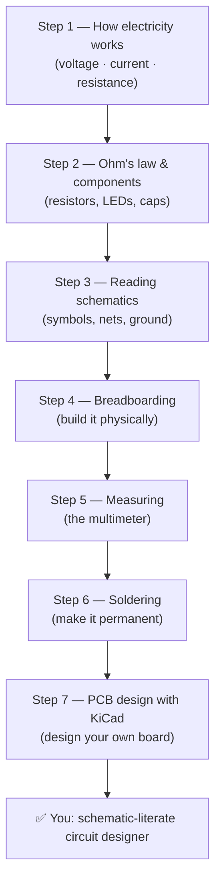

# Circuits & Schematics Path

The **Circuits & Schematics path** is the electronics foundation that makes every board in
this hub work. Where the other paths teach you *one microcontroller*, this path teaches you the
**physical world** around it: how electricity actually flows, how to size the components that
keep your chip alive, how to read (and draw) a schematic, and how to turn a breadboard experiment
into a real soldered, printed circuit board you designed yourself.

You can do this path *before* touching a microcontroller, or in parallel with one — the concepts
are pure electronics and don't depend on any particular board. Every project in the Arduino, ESP32
or MCU paths, no matter how glamorous, is still just charge moving through a circuit you designed.

> 💡 **Goal:** by the end you should be able to look at a stranger's schematic, understand what it
> does, size a resistor by hand, verify your work with a multimeter, and lay out a simple PCB in
> KiCad. That is a genuinely professional skill set, and it all starts with water-in-a-pipe.

---

## 🗺️ The Circuits track, step by step

Ordered *beginner → advanced*. Each step links to the matching core-concepts page (shared with every
other path in the hub) and then to the relevant curated resources.

### 1. How electricity works
The three quantities every circuit depends on — **voltage** (pressure), **current** (flow), and
**resistance** (friction) — and the water analogy that makes them stick. No math beyond the basics yet.
→ [How electricity works](../../concepts/01-electricity.md)

### 2. Ohm's law & components
Now the math: **V = I × R**. Why resistors exist (and how to read their color bands), how LEDs
work, and the capacitor/motor/switch parts that appear in every project. This is the step where
you learn to *size* a resistor so you don't burn out an LED.
→ [Ohm's law & components](../../concepts/02-components.md)
🧰 Extra: [Circuits resource library](../../resources/curated/circuits.md)

### 3. Reading schematics
Schematics are the *blueprint* language of electronics: component symbols, connecting nets, and
the crucial rule that a wire crossing another wire is **not** connected unless a dot marks a
junction. Learn to translate a schematic into a real circuit you can build.
→ [Circuits & schematics](../../concepts/03-circuits.md)

### 4. Breadboarding
The breadboard is your no-solder playground: connect parts, run current in a complete loop, and
tear it down in seconds. If you're also following a microcontroller path, this is where you host
your first blink.
→ [From breadboard to board (projects)](../../concepts/05-projects.md)

### 5. Measuring with a multimeter
You can't debug what you can't see. Learn to measure **voltage**, **current**, **resistance**, and
**continuity** — the four powers that turn guessing into knowing. This is the tool that tells you
whether your resistor is right and whether your circuit actually has power.
> The verified multimeter walkthrough in the *Watch & learn* section below is the single best 5
> minutes you'll spend on this whole path.

### 6. Soldering
Once a circuit works on the breadboard, soldering makes the joints **permanent** — connecting a
component by melting a metal alloy onto both the pad and the lead. A proper joint is shiny and
volcano-shaped; a cold, dull joint is your #1 mystery bug.
> Safety first: solder is hot enough to burn through skin, and the flux smoke is an irritant —
> work in a ventilated area and never touch the tip.

### 7. PCB design with KiCad
The final boss. **KiCad** is a free, open-source tool that turns your schematic into a physical
**printed circuit board** (PCB) you can order for a few dollars and solder yourself:
1. Draw the schematic with symbols.
2. Run the Electrical Rules Check (ERC).
3. Assign footprints (the physical pads for each part).
4. Lay out and route the copper traces.
5. Generate the Gerber files and order the board.
→ [From breadboard to board (projects)](../../concepts/05-projects.md) — the "make it permanent" ideas that justify designing a board

---

## ▶️ Watch & learn

Three verified, beginner-first videos that map directly onto this path:

- [**Basic Electricity — Resistance and Ohm's law** (Afrotechmods)](https://www.youtube.com/watch?v=NfcgA1axPLo) — the clearest 9-minute intro to resistors and V = I × R, with a real LED circuit.
- [**How to Read a Schematic** (RimstarOrg)](https://www.youtube.com/watch?v=_HZ-EQ8Hc8E) — walks the symbols, nets, and ground rules from the simplest schematic up.
- [**THE BEST Multimeter tutorial (HD)** (Afrotechmods)](https://www.youtube.com/watch?v=bF3OyQ3HwfU) — what to look for and exactly how to measure voltage, current, resistance, and continuity.

Found something you need to go deeper on? The full [curated video library](../../resources/curated/videos.md) has channel links for soldering, KiCad, and oscilloscope work.

---

## 📚 The universal reference

- **[Circuits resource library](../../resources/curated/circuits.md)** — components, tools, and further reading
- **[Curated Videos](../../resources/curated/videos.md)** — the best beginner electronics video walkthroughs, including soldering & PCB channels
- **[Electronics Glossary](../../GLOSSARY/README.md)** — look up any term you hit as you go
- **[Core concepts index](../../concepts/03-circuits.md)** — the schematics deep-dive

---

## 🪜 Difficulty ladder (where this path sits)

| Step | Difficulty | Skill you'll have afterwards |
|------|-----------|------------------------------|
| 1–2 (electricity, Ohm's law) | 🟢 Beginner | Read a resistor; explain V, I, R |
| 3 (schematics) | 🟢 Beginner | Translate a schematic into a circuit |
| 4 (breadboard) | 🟡 Warming up | Build a complete loop from parts |
| 5 (multimeter) | 🟡 Warming up | Measure and debug a real circuit |
| 6 (soldering) | 🟠 Intermediate | Make permanent, reliable joints |
| 7 (KiCad & PCB) | 🔴 Advanced | Design and order your own circuit board |

---

## ✅ What "done" looks like

When you finish this path you should be able to:

- Explain voltage, current, and resistance, and use **Ohm's law** to size a resistor for an LED.
- Read a simple schematic and re-create it on a breadboard.
- Use a multimeter to measure voltage, check continuity, and verify a resistor's value.
- Solder a clean, shiny through-hole joint (and recognize a cold one).
- Draw a simple schematic in **KiCad**, run the ERC, assign footprints, and understand what routing a PCB means.

That foundation — reading, building, measuring, and manufacturing circuits — applies to **every**
microcontroller project you'll ever make. When you're ready to put a brain in your circuits,
continue to any of the [other paths](../index.md).

---

*Next: jump to [another path](../index.md) or start with [How electricity works](../../concepts/01-electricity.md).*
