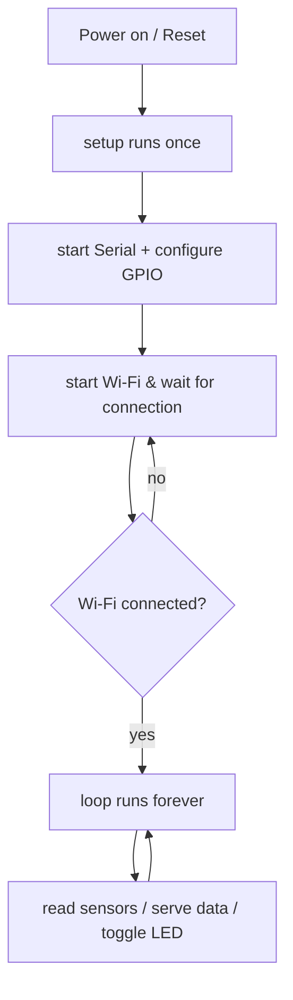

# ESP32 Beginner (C & MicroPython)

*This is **Step 4½** of the [ESP32 path](index.md).* In one sitting you'll set up an ESP32, blink
its onboard LED, read a GPIO, and connect to **Wi-Fi** — then choose your programming language. We
assume an ESP32 dev board (e.g. the classic **ESP32-WROOM-32 DevKit**), a USB cable, and the
**Arduino IDE** installed. If you're brand new to microcontrollers, doing the
[Arduino path](../arduino/index.md) first helps, but it's **not required**.

> ⚠️ **The one rule that saves your board:** ESP32 GPIO pins are **3.3 V** only. Never feed them
> 5 V directly. Always power sensors from **3V3/VIN** appropriately and level-shift any 5 V signal.

---

## 1. What's inside an ESP32

The ESP32 is a family, not one chip. Two processor families matter:

| Family | Cores | Example chips | Notes |
|--------|-------|---------------|-------|
| **Xtensa** | original dual-core | ESP32 (original/WROOM), ESP32-S2, ESP32-S3 | The classic, most documented |
| **RISC-V** | newer, open ISA | ESP32-C3, ESP32-C6 | Cheaper, modern, single-core tweaks |

All of them share the same big selling points:
- **Wi-Fi (802.11 b/g/n)** + **Bluetooth/BLE** built in.
- **Dual-core** at up to 240 MHz (most models).
- Lots of RAM and flash compared to an AVR, so it can run a web server.
- A **2.4 GHz only** radio — it will *not* see 5 GHz networks, so connect it to a 2.4 GHz one.
- **3.3 V** logic with a wide input-voltage range (the regulator on the dev kit takes the USB 5 V).

---

## 2. Setting up the ESP32 in the Arduino IDE

The ESP32 isn't in the IDE by default. Add it once:

1. **Boards Manager URL:** open *File → Preferences*, and in "Additional Boards Manager URLs" add:
   `https://dl.espressif.com/dl/package_esp32_index.json`
2. **Install the boards:** *Tools → Board → Boards Manager*, search **esp32 by Espressif Systems**,
   and click **Install**.
3. **Select your board:** *Tools → Board → ESP32 Arduino →* your model (e.g. **"ESP32 Dev Module"**).
4. **Pick the port:** *Tools → Port →* the COM/UART port the board shows up as (install the
   CP210x/CH340 driver if it doesn't appear).
5. **Upload:** press the arrow (**→**) button. Some boards need you to hold **BOOT** while uploading,
   then press **EN/RST** afterwards.

> 🔌 **Brownout, not working?** Fresh ESP32s pulling Wi-Fi current from a long/thin USB cable can
> reset. Try a shorter, thicker cable or an external 5 V supply. Very common first-time confusion.

---

## 3. Blink the onboard LED

Most dev boards have an onboard LED wired to **GPIO 2** (the classic WROOM DevKit) or **GPIO 5** on
some others. Blinking it is the fastest way to confirm your whole toolchain works:

```c
// blink_esp32.ino — blink the onboard LED (GPIO 2 on most WROOM DevKits)
const int LED_PIN = 2;      // adjust to 5 if your board's LED is on GPIO5

void setup() {
    pinMode(LED_PIN, OUTPUT);
}

void loop() {
    digitalWrite(LED_PIN, HIGH);   // LED on
    delay(500);                    // 500 ms
    digitalWrite(LED_PIN, LOW);    // LED off
    delay(500);
}
```

That's it — the ESP32 accepts the same `setup()`/`loop()`, `pinMode`, `digitalWrite`, and `delay`
you know from Arduino. The Arduino framework abstracts the underlying Xtensa/RISC-V hardware the
same way it abstracts AVR.

---

## 4. How the flow works

A sketch on an ESP32 flows exactly like on an AVR — the runtime difference appears only when Wi-Fi
joins in (see §6):



The important addition vs. an Arduino: **connecting to Wi-Fi happens once in `setup()`, and the
program blocks (waits) until connected** before `loop()` starts real work.

---

## 5. Reading a GPIO (digital input)

Same button + internal pull-up trick as Arduino, except the pin runs at **3.3 V**:

```c
// button_esp32.ino — press a button on GPIO 4, light the LED on GPIO 2
const int BUTTON = 4;
const int LED    = 2;

void setup() {
    pinMode(BUTTON, INPUT_PULLUP);  // internal pull-up → stable HIGH until pressed
    pinMode(LED, OUTPUT);
    Serial.begin(115200);           // ESP32 defaults to 115200 in the monitor
}

void loop() {
    int pressed = digitalRead(BUTTON);
    if (pressed == LOW) {           // pressed (pull-up inverts the logic)
        digitalWrite(LED, HIGH);
        Serial.println("Pressed");
    } else {
        digitalWrite(LED, LOW);
    }
}
```

> ⚠️ **Pins to avoid on many ESP32s:** GPIO **6–11** are tied to the flash chip and can crash the
> board. And if you use Wi-Fi, the **ADC2** analog pins behave unpredictably — prefer ADC1 for
> analog sensors. Read your board's pinout diagram before wiring.

---

## 6. Connecting to Wi-Fi

This is the party piece — nothing on an Arduino Uno can do this without a separate shield. You
connect as a **station (STA)** to your router:

```c
// wifi_connect.ino — join a Wi-Fi network and report your IP over serial
#include <WiFi.h>                 // ESP32 Wi-Fi library

const char* ssid     = "YOUR_NETWORK_NAME";      // 2.4 GHz network
const char* password = "YOUR_NETWORK_PASSWORD";

void setup() {
    Serial.begin(115200);
    delay(1000);

    Serial.print("Connecting to ");
    Serial.println(ssid);
    WiFi.begin(ssid, password);   // start connecting (non-blocking init)

    while (WiFi.status() != WL_CONNECTED) {   // wait until we're on the network
        delay(500);
        Serial.print(".");
    }

    Serial.println();
    Serial.println("Connected!");
    Serial.print("IP address: ");
    Serial.println(WiFi.localIP());   // your board's address on the LAN
}

void loop() {
    // after Wi-Fi is up, this runs forever — serve a page, read a sensor, etc.
    Serial.print("Signal: ");
    Serial.println(WiFi.RSSI());      // received signal strength in dBm
    delay(5000);
}
```

**What's happening:**
- `WiFi.begin(ssid, password)` kicks off the connection.
- `WiFi.status() != WL_CONNECTED` is a blocking wait. A **better** production pattern is *non-blocking*
  (do other work while connecting, retry, time out) — but this is the clearest way to learn.
- `WiFi.localIP()` is the address other devices use to reach your board — the seed of every IoT
  project.
- Open the **Serial Monitor at 115200** to watch it join the network and print its IP.

**Troubleshooting:** make sure it's a 2.4 GHz network, the password is exact, and the board stays
powered (Wi-Fi draw can cause brownouts on weak cables — see §2).

---

## 7. MicroPython vs C/C++ — which language?

The ESP32 can be programmed in two very different ways:

| | **C / C++ (Arduino framework)** | **MicroPython** |
|---|---|---|
| **Vibe** | Compiled — close to the hardware, fast, powerful | Interpreted — a tiny Python runtime on the chip |
| **Speed** | Very fast (native code) | Slower (interpreted) — usually fine for IoT |
| **Setup** | Install board package in Arduino IDE | Flash MicroPython firmware, then use an editor/REPL |
| **Memory usage** | Lean | Higher overhead (Python runtime) |
| **Debugging** | Serial prints, harder to poke live | **REPL**: type commands and see results instantly |
| **Great for** | Performance, libraries, tight control | Rapid prototyping, beginners, quick experiments |

**Bloom's honest take:** beginners often find MicroPython faster to *experiment* in (no compile
step; you type into a REPL and it runs). But C/C++ gives you more control, more performance, and
the same code style as the Arduino path. **Start in C/C++ if you did the Arduino path; try
MicroPython if you prefer Python.**

A MicroPython blink looks like this (saved as `main.py` on the board so it auto-runs at boot):

```python
# main.py — MicroPython blink for ESP32 (onboard LED on GPIO 2)
from machine import Pin
import time

led = Pin(2, Pin.OUT)      # GPIO 2 as an output

while True:                # like loop()
    led.value(1)           # on
    time.sleep(0.5)        # 0.5 s
    led.value(0)           # off
    time.sleep(0.5)
```

The mapping is nearly direct: `Pin(2, Pin.OUT)` ≈ `pinMode(2, OUTPUT)`, `led.value(1)` ≈
`digitalWrite(2, HIGH)`, `while True` ≈ `loop()`.

---

## 8. Watch & learn

Verified-live YouTube walkthroughs, ordered easiest → deeper:

| Video | What you'll learn |
|-------|-------------------|
| [How to Setup and Program ESP32 Microcontroller (BINARYUPDATES)](https://www.youtube.com/watch?v=AitCKcyjHuQ) | Install the ESP32 board package, pick the right board/port, and blink — the fastest possible setup |
| [Introduction to ESP32 — Getting Started (DroneBot Workshop)](https://www.youtube.com/watch?v=xPlN_Tk3VLQ) | The clearest overview of the ESP32, its Wi-Fi, and running real examples |
| [Connect ESP32 to WiFi — ESP32 Beginner's Guide](https://www.youtube.com/watch?v=aH3sLEQI4_w) | Two clean methods to join a network, matching §6 |
| [Getting Started with MicroPython on ESP32](https://www.youtube.com/watch?v=1efsWgK_QaU) | Flash MicroPython, use the REPL, blink and button-control an LED |

---

## ✅ You're done with the ESP32 beginner tutorial

You now know: what an ESP32 is (Xtensa vs RISC-V), how to set it up in the Arduino IDE, GPIO
blinking and input at **3.3 V**, how to connect to Wi-Fi and find your IP, and how to pick between
**MicroPython** and **C/C++**.

**Next steps:**
- Build a connected project → [From breadboard to board](../../concepts/05-projects.md)
- Go deeper in C++ → [ESP32 in C++ (synthesized)](../../synthesized/esp32-cpp.md)
- Go deeper in Python → [MicroPython (synthesized)](../../synthesized/micropython.md)
- Look up any term → [Electronics Glossary](../../GLOSSARY/README.md)
- Refresh the basics you skipped → [the Arduino path](../arduino/index.md)
