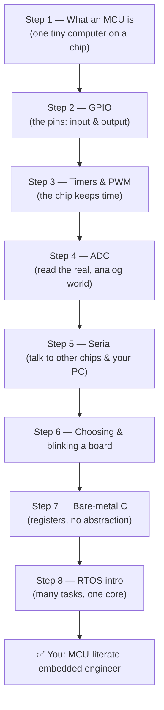

# Microcontrollers Path

The **Microcontrollers path** (MCU for short) is the board-agnostic core of this hub: what a
microcontroller *is*, how its **GPIO**, **timers**, **ADC**, and **serial** peripherals work, and
how you go from "I can blink a board" to "I understand what that chip is actually doing every
nanosecond." If you've already done (or are doing) the [Arduino](../arduino/index.md) or
[ESP32](../esp32/index.md) paths, this is the layer underneath them — the ideas that are true no
matter which chip you pick up next.

A **microcontroller** (MCU) is a complete, tiny computer on a single integrated circuit: a CPU,
some flash memory for your program, some RAM for your data, and a set of configurable **peripheral**
blocks — all in one cheap chip. Unlike your laptop, it runs *one* program, talks directly to real
pins, and is designed to sense and control the physical world.

> 💡 **Not sure if this path is for you?** If you haven't flashed a board yet, start with the
> [Arduino path](../arduino/index.md) to get a blinking LED fast, then come back here to learn
> *why* it works. This path is about understanding, not just following.

---

## 🗺️ The Microcontroller track, step by step

Ordered *beginner → advanced*. It weaves in the core concepts (shared with every other path) as you
need them, then goes deeper into the peripherals that make an MCU useful, and finally up to
bare-metal C and real-time operating systems.

### 1. What a microcontroller actually is
One chip containing a CPU, memory, and I/O peripherals. Understand the difference between a
**microcontroller** and the **microprocessor** in your computer, and how a *development board*
(Arduino Uno, ESP32 DevKit) wraps the bare chip in power, USB, and a bootloader so you can use it.
→ [Microcontroller basics](../../concepts/04-microcontrollers.md)

### 2. GPIO — the pins
**GPIO** (General-Purpose I/O) is how the chip talks to the world: each pin can be configured as an
*input* (read a button or sensor) or an *output* (drive an LED to HIGH/LOW). This is the foundation
every blink is built on.
→ [Microcontroller basics](../../concepts/04-microcontrollers.md) and [From breadboard to board (projects)](../../concepts/05-projects.md)

### 3. Timers & PWM
A microcontroller has a small, free-running **counter** driven by the clock. You can use it to
measure elapsed time, generate precise delays, and create **PWM** (pulse-width modulation) — the
trick that dims an LED or sets a servo's angle by switching a pin on and off very fast with a
varying duty cycle.
→ [Microcontroller basics](../../concepts/04-microcontrollers.md)

### 4. ADC — reading the analog world
The real world is continuous, but a chip is digital. An **ADC** (analog-to-digital converter)
samples a voltage and returns a number (e.g. 0–1023 on a 10-bit ADC). This is how you read a
potentiometer, a light sensor, or a temperature sensor.
→ [Microcontroller basics](../../concepts/04-microcontrollers.md)

### 5. Serial communication
**Serial** is how chips talk to each other and to your PC over a few wires: **UART** (one wire each way,
used for the Serial Monitor), **I²C** (two wires, many devices), and **SPI** (fast, for sensors and
displays). This is also how you flash most boards.
→ [Microcontroller basics](../../concepts/04-microcontrollers.md) and [Microcontroller resource library](../../resources/curated/microcontrollers.md)

### 6. Choosing a board & your first blink
Now apply it. Decide between the friendly **Arduino (AVR)**, the connected **ESP32**, or a micro
Python/runtime board — then build a blink. This step hands you off to the practical paths.
→ [Microcontrollers (general) resources](../../resources/curated/microcontrollers.md) · [Start the Arduino path](../arduino/index.md) · [Start the ESP32 path](../esp32/index.md)

### 7. Bare-metal C — the registers
The lids come off. Instead of `digitalWrite`, you write directly to the chip's **registers**
(like `DDRB |= (1 << PB5)`). You finally see exactly what the friendly libraries were doing.
→ [Arduino in C (synthesized)](../../synthesized/arduino-c.md) and the [Concepts on microcontrollers](../../concepts/04-microcontrollers.md)

### 8. RTOS intro — many tasks, one core
A real-time operating system lets a single CPU appear to run several tasks at once, with each task
meeting a **deadline**. Learn what "real-time" means, when you need it, and how a scheduler
time-slices the CPU.
→ [Rust on embedded (synthesized)](../../synthesized/embedded-rust.md) shows the modern, memory-safe take on this world

---

## ▶️ Watch & learn

Three verified videos that map directly onto this path:

- [**A Beginner's Guide to Microcontrollers**](https://www.youtube.com/watch?v=GZAg9XSIs_Q) — what an MCU is, how it differs from a microprocessor, and why you'd learn one.
- [**How to Use a Simple Microcontroller — An Introduction**](https://www.youtube.com/watch?v=TvsLWEJ4kNI) — go down to the register/assembly level and see the chip's 256 words of flash do real work.
- [**Arduino 101 — Physical Computing for Beginners**](https://www.youtube.com/watch?v=gMMxPPYjlvI) — sensors → microcontroller → actuators: the input/process/output loop at the heart of every project.

More channels and the broader embedded world are in the [curated video library](../../resources/curated/videos.md).

---

## 📚 The universal reference

- **[Microcontroller resource library](../../resources/curated/microcontrollers.md)** — core MCU knowledge, boards, and guides
- **[Curated Videos](../../resources/curated/videos.md)** — the best embedded-systems video walkthroughs
- **[Electronics Glossary](../../GLOSSARY/README.md)** — look up any term you hit (GPIO, PWM, ADC, ISR…)
- **[Core concepts index](../../concepts/04-microcontrollers.md)** — the MCU deep-dive

---

## 🪜 Difficulty ladder (where this path sits)

| Step | Difficulty | Skill you'll have afterwards |
|------|-----------|------------------------------|
| 1–2 (MCU, GPIO) | 🟢 Beginner | Explain what's inside a chip; drive a pin |
| 3 (timers/PWM) | 🟡 Warming up | Use timers and dim an LED with PWM |
| 4 (ADC) | 🟡 Warming up | Read a real analog sensor as a number |
| 5 (serial) | 🟡 Warming up | Print to a terminal; read a sensor over I²C |
| 6 (choose + blink) | 🟢 Beginner | Pick a board and flash a working blink |
| 7 (bare-metal C) | 🟠 Intermediate | Write to registers without libraries |
| 8 (RTOS) | 🔴 Advanced | Reason about tasks, scheduling, deadlines |

---

## ✅ What "done" looks like

When you finish this path you should be able to:

- Explain what a microcontroller is and how it differs from a microprocessor, a board, and a computer.
- Configure a **GPIO** pin as input or output and use it to blink an LED and read a button.
- Describe what **timers**, **PWM**, and **ADC** do, and write small programs that use each.
- Send and receive data over **serial** (UART at minimum) to talk to your PC or another chip.
- Choose an appropriate board for a project and flash a first program.
- Read a **register** directly in bare-metal C and explain how it maps to a physical pin.
- Describe what an **RTOS** is, what "real-time" means, and when you need one.

That understanding transfers to *every* chip you'll ever touch — AVR, ESP32, STM32, RP2040, all of
them. From here you can go deeper with the [Arduino path](../arduino/index.md), connect things with
the [ESP32 path](../esp32/index.md), or harden your electronics with the
[Circuits & Schematics path](../circuits/index.md).

---

*Next: start with [Microcontroller basics](../../concepts/04-microcontrollers.md) or jump back to [choose a path](../index.md).*
