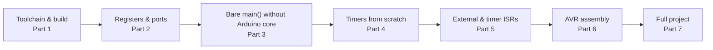

# Bare-Metal AVR — Ports, Timers, and ISRs Without the Arduino Core

> **Track:** Arduino (AVR) · **Difficulty:** Intermediate
> **What you'll get:** programming the ATmega328P the way professionals do — pure `avr-gcc`
> C with a `main()`, no Arduino core, writing registers by hand, plus a real dive into AVR
> **assembly**. You'll drive ports, configure timers, and write interrupt service routines
> (ISRs) with complete control and no hidden layers.
> **Prereq:** the [Arduino C tutorial](../synthesized/arduino-c.md) is the ideal warm-up —
> it introduces registers through Arduino sketches. This tutorial removes even the Arduino
> **library layer** and goes straight to the silicon and the assembler.

The Arduino core is wonderful until you need to know *exactly* what the chip is doing, or you
want every single clock cycle. Underneath everything Arduino does, the ATmega328P is just a
set of memory-mapped **registers** — bytes at fixed addresses — plus the **AVR instruction
set**. This tutorial hands you the full toolchain (`avr-gcc`, `avr-libc`, `avrdude`), writes
from a bare `int main(void)`, and then drops down to raw assembly. By the end you can read the
datasheet and write firmware that Arduino's own `millis()` and `digitalWrite` are built from.



---

## 🎯 Prerequisites

- An **Arduino Uno/Nano** (ATmega328P) or bare ATmega328P on a breadboard, plus a
  **USB-serial** adapter or the Arduino board's own bootloader for flashing.
- The **AVR GNU toolchain**: `avr-gcc`, `avr-libc`, and `avrdude`. On Windows (MSYS2) install
  `mingw-w64-x86_64-avr-gcc` and `avrdude`; on Linux `apt install gcc-avr avr-libc avrdude`.
- The [ATmega328P datasheet](https://ww1.microchip.com/downloads/en/DeviceDoc/Atmel-7810-Automotive-Microcontrollers-ATmega328P_Datasheet.pdf) — the map to every register we touch.
- One **LED** + 220 Ω, one **push button** + 10 kΩ (optional).

> ⚠️ **Big departure from Arduino:** we will **not** use `pinMode`, `digitalWrite`,
> `delay`, `Serial`, or `setup()/loop()`. Everything is `main()`, a register write, or an
> assembly instruction. You lose convenience and gain total control — and the ability to read
> any AVR's datasheet cold. Expect a steeper first hour; it pays off immediately.

---

## 🔧 Part 1 — The toolchain: compile, link, flash

Without the Arduino build system you must assemble the pieces yourself. The pipeline is:
`.c` → `avr-gcc` → `.elf` → `avr-objcopy` → `.hex` → `avrdude` → chip. A **Makefile** makes it
one command.

`Makefile`:

```make
# Makefile — build and flash a bare-metal ATmega328P program.
MCU     = atmega328p
F_CPU   = 16000000UL          # 16 MHz
CC      = avr-gcc
CFLAGS  = -Os -Wall -mmcu=$(MCU) -DF_CPU=$(F_CPU)
OBJCOPY = avr-objcopy
AVRDUDE = avrdude
PORT    = /dev/ttyACM0        # Windows: COM3, etc.

all: main.hex

main.elf: main.c
	$(CC) $(CFLAGS) -o $@ $<

main.hex: main.elf
	$(OBJCOPY) -O ihex -R .eeprom $< $@

flash: main.hex
	$(AVRDUDE) -c arduino -p $(MCU) -P $(PORT) -b 115200 -U flash:w:main.hex:i

clean:
	rm -f *.elf *.hex *.o
```

**Build & flash:** `make` then `make flash`. Let's name the three tools precisely:

| Tool | Job |
|------|-----|
| `avr-gcc` | Compiles C → AVR machine code (`.elf`) |
| `avr-objcopy` | Converts `.elf` → Intel `.hex` for avrdude |
| `avrdude` | Talks to the chip's bootloader/ICSP to burn the `.hex` |

> ⚠️ **Pitfall — wrong `MCU` breaks timing.** `-mmcu=atmega328p` selects both the instruction
> set and the register/I/O addresses. Build for the wrong chip and your register writes land
> at the wrong addresses — silent, baffling misbehavior. Always match the chip you're on.
>
> ⚠️ **Pitfall — forget `-DF_CPU`.** Macros like `_delay_ms()` (from `util/delay.h`) compute
> loops from `F_CPU`. Miss the define and your "500 ms" delay is wildly wrong — usually
> *much* too slow or the compile fails on `#error`. Keep it in `CFLAGS`.

---

## 📍 Part 2 — Registers & ports: the only thing Arduino is hiding

Every AVR pin lives behind three registers per port (B, C, D on the 328P). Learn these three
and you've learned every port on the chip:

| Register | Full name | `1` means |
|----------|-----------|-----------|
| `DDRx`   | Data Direction Register | pin is an **output** (1) / input (0) |
| `PORTx`  | Data Register (output latch/ pull-up) | drive **HIGH** as output, or enable **pull-up** as input |
| `PINx`   | Input Pins Register | reads the **actual** pin level |

On the Uno: **Port B** holds pins 8–13 (PB5 = built-in LED), **Port D** holds pins 0–7,
**Port C** holds A0–A5.

```c
// ports.c — make PB5 an output and toggle it, registers only.
#include <avr/io.h>       // gives us DDRB, PORTB, PINB names for free
#include <util/delay.h>

int main(void) {
    DDRB |= _BV(PB5);     // bit 5 of DDRB: PB5 (pin 13) -> output
    // _BV(PB5) is just (1 << PB5). We |= it so we don't disturb other pins.

    while (1) {
        PORTB ^= _BV(PB5);          // XOR toggles the bit: HIGH<->LOW
        _delay_ms(500);
    }
    return 0;             // never reached
}
```

`_BV(n)` is avr-libc's helper for `(1 << n)`. The **bit-manipulation idiom** you'll use for
the rest of your life:

| Want to… | Write |
|----------|-------|
| Set a bit (output / drive high) | `PORTB |= _BV(PB5);` |
| Clear a bit (input / drive low) | `PORTB &= ~_BV(PB5);` |
| Toggle a bit | `PORTB ^= _BV(PB5);` |
| Test a bit | `if (PINB & _BV(PB5))` |

> ⚠️ **Pitfall — clobbering the whole port.** Never write `PORTB = something = ...;` when you
> mean to change one pin. That overwrites every other pin's state on the port. Always do a
> **read-modify-write** with `|=`, `&= ~`, or `^=` so only the bit you care about changes.

---

## 🧪 Part 3 — A complete bare `main()`: blink with a button

Now everything without Arduino: a button read through registers, debounce in software, and an
LED driven through registers. This is the "no-core" version of a classic sketch.

```c
// bare_main.c — button (PD2, pull-up) drives the LED (PB5). No Arduino core, at all.
#include <avr/io.h>
#include <util/delay.h>

#define BTN  PD2          // button on PD2 (physical pin 4 on DIP-28)
#define LED  PB5          // LED on PB5 (pin 13)

int main(void) {
    // LED pin -> output.
    DDRB  |= _BV(LED);
    PORTB |= _BV(LED);      // start with LED off (drive pin high; LED to GND)

    // Button pin -> input WITH internal pull-up.
    DDRD  &= ~_BV(BTN);     // clear -> PD2 is an input
    PORTD |=  _BV(BTN);     // set   -> internal pull-up on PD2

    while (1) {
        // Read the button: LOW (0) when pressed (pulled to GND).
        if (!(PIND & _BV(BTN))) {
            PORTB &= ~_BV(LED);   // LED on
        } else {
            PORTB |=  _BV(LED);   // LED off
        }
        _delay_ms(20);            // debounce-ish refresh pause
    }
    return 0;
}
```

**What's different from Arduino?** No `pinMode`, no `digitalRead`, no `setup/loop` — just a
`main()` whose first job is to configure pins and whose last is `while(1)`. The wiring is
identical to the Arduino version: button one side to GND, other side to PD2; LED (+220 Ω)
from PB5 to GND.

> ⚠️ **Pitfall — `_delay_ms()` only at compile-time constants.** `_delay_ms(500)` is fine, but
> `_delay_ms(x)` with a runtime variable *silently overflows* / is wrong (it's a compile-time
> loop unroll). For variable delays, build them with a timer (Part 4) or pulse counting —
> never hand `_delay_ms` a changing value.

---

## ⏱️ Part 4 — Timers from scratch: your own `millis()`

Arduino's `millis()` is *powered by Timer0* — 2 KB of the core you just removed. Let's rebuild
it: configure **Timer1** to trigger an interrupt once per millisecond, and count.

**The clock math (the one calculation that matters):** Timer1 ticks at a rate set by a
**prescaler** dividing the 16 MHz system clock. Choose prescaler 64:

```
timer ticks/sec = 16,000,000 / 64 = 250,000 Hz
OCR1A           = 250,000 / 1000 - 1 = 249   -> interrupt every 1 ms
```

```c
// timer1_ms.c — a 1 ms Timer1 interrupt: your own millis(), no Arduino core.
#include <avr/io.h>
#include <avr/interrupt.h>

volatile uint32_t ticks = 0;   // incremented every ms; MUST be volatile (ISR-shared)

// The ISR the vector table jumps to on a Timer1 compare match A:
ISR(TIMER1_COMPA_vect) {
    ticks++;
}

int main(void) {
    DDRB |= _BV(PB5);
    // Turn OFF Timer1 interrupts & config while we set it up (safety):
    TIMSK1 = 0; TCCR1A = 0; TCCR1B = 0;

    OCR1A = 249;                    // compare value -> 1 ms at /64
    TCCR1B |= _BV(WGM12);           // CTC mode: reset on compare match
    TCCR1B |= _BV(CS11) | _BV(CS10); // prescaler = 64 (see datasheet table)
    TIMSK1 |= _BV(OCIE1A);          // enable the compare-match interrupt

    sei();                          // GLOBAL interrupt enable (SREG bit I)

    while (1) {
        // Blink based on our own tick counter instead of _delay_ms:
        if ((ticks % 1000) == 0) PORTB ^= _BV(PB5);   // every 1 s
    }
    return 0;
}
```

**The register roles, so the datasheet makes sense:**

| Register | What you set |
|----------|--------------|
| `TCCR1A` | COM (PWM output) + waveform mode high bits |
| `TCCR1B` | `WGM12` (CTC) + `CS11:CS10` (prescaler 64) |
| `OCR1A`  | Compare value = when the timer resets / fires |
| `TIMSK1` | `OCIE1A` = enable the Timer1 compare-match interrupt |
| `TCNT1`  | The actual 16-bit counter (reads current count) |

> ⚠️ **Pitfall — `volatile` on every ISR-shared variable.** `ticks` is incremented in the ISR
> and read in `main`. Without `volatile`, the compiler may cache `ticks` in a register and your
> `loop` never sees it update. This single keyword is the most common bare-metal AVR bug.
>
> ⚠️ **Pitfall — touching Timer0 breaks core stuff.** We're using Timer1 here specifically
> because Arduino's `millis()` owns Timer0. If you reconfigure Timer0 you'll break `millis()`
> and `delay()` (and Servo). For custom timing, prefer Timer1 or Timer2 unless you *intend* to
> reimplement the clock.

---

## 🚨 Part 5 — Interrupts: external (INT0) and timer, done correctly

Two kinds of interrupts you'll use daily: **external** (a pin edge — e.g. INT0 on PD2) and
**timer** (like Part 4). The rules are strict and universal:

1. **Keep the ISR tiny** — set a flag or a byte; do the real work in `main()`.
2. **Declare every shared variable `volatile`.**
3. **No `_delay_ms()`, no I2C/SPI, no long operations inside an ISR** — an interrupt
   call is itself an interrupt; anything blocking inside one wrecks all timing.
4. **`sei()` once after setup** to turn the whole interrupt system on.

```c
// isr.c — INT0 (PD2) fires on a falling edge; the ISR just sets a flag.
#include <avr/io.h>
#include <avr/interrupt.h>

volatile uint8_t press_flag = 0;   // set in ISR, cleared in main -- MUST be volatile

ISR(INT0_vect) {                   // the external-interrupt-0 handler
    press_flag = 1;                // DO NOT do work here -- just signal!
}

int main(void) {
    DDRB |= _BV(PB5);
    PORTB |= _BV(PB5);

    DDRD  &= ~_BV(PD2);            // PD2 = INT0 = input
    PORTD |=  _BV(PD2);            // pull-up on

    EICRA |= _BV(ISC01);           // falling edge triggers (ISC01:ISC00 = 10)
    EIMSK |= _BV(INT0);            // enable INT0
    sei();                         // global interrupts ON

    while (1) {
        if (press_flag) {          // a press was caught
            press_flag = 0;        // clear it, then handle it here
            for (int i = 0; i < 5; i++) {
                PORTB &= ~_BV(PB5); _delay_ms(40);
                PORTB |=  _BV(PB5); _delay_ms(40);
            }
        }
        // main stays free -- the interrupt is what wakes us to this branch
    }
    return 0;
}
```

**Why set a flag instead of driving the LED in the ISR?** Because the ISR runs with other
interrupts masked and can't do timing safely. Setting a flag and returning takes a few clock
cycles; the ISR exits, the CPU resumes, and `loop()` notices the flag and does the slow work
with interrupts fully enabled.

> ⚠️ **Pitfall — switch bounce.** A mechanical button can bounce for 1–20 ms, firing your
> ISR dozens of times per press. For counting presses, debounce in software (ignore further
> edges for ~50 ms), or add a hardware RC filter. A bare ISR counting edges will over-count
> wildly.

> ⚠️ **Pitfall — reading multi-byte shared data safely.** `ticks` as a 32-bit value: an
> interrupt can fire *between* the two 16-bit halves of a read in `main`. If precise counting
> matters, wrap the read in `cli()`/`sei()` or read it twice and take the consistent value.
> Know that `volatile` alone doesn't fix this for multi-byte variables.

---

## 📜 Part 6 — AVR assembly: the instruction set on the metal

C compiles to assembly anyway; writing a little by hand cements how the CPU actually works.
AVR is a small, clean RISC — a handful of instructions do most of the work. An **LED
++ counter** style program shows the rhythm: `ldi` (load immediate), `out`/`in` (I/O regs),
`rjmp` (jump), and `sbi`/`cbi`/`sbis` (set/clear/test a single bit of an I/O port).

Here's a complete `.S` that **blinks the LED by toggling a bit directly**:

```asm
; blink.S — blink PB5 in pure AVR assembly.
; Assemble with:  avr-gcc -mmcu=atmega328p -c blink.S -o blink.o
; then link and objcopy to .hex (see the Makefile pattern in Part 1).

#define LED       5            ; PB5 = onboard LED
#define DDRB_REG  0x04         ; I/O address of DDRB
#define PORTB_REG 0x05         ; I/O address of PORTB

.global main                  ; export main so the linker finds it

main:
    ; Make PB5 an output: set bit 5 of DDRB.
    sbi DDRB_REG, LED         ; sbi = Set Bit in I/O register

loop:
    ; Toggle PB5: read PORTB, xor bit 5... actually AVR has no 'xor a port bit',
    ; so we use in/eor/out (read, XOR a register copy, write back).
    in   r16, PORTB_REG       ; read current PORTB into r16
    ldi  r17, (1 << LED)      ; load a mask with only bit 5 set
    eor  r16, r17             ; r16 ^= mask  -> toggles bit 5
    out  PORTB_REG, r16       ; write it back

    ; Short delay loop (approximately), then do it again.
    ldi  r18, 0x20
delay1:
    ldi  r19, 0xFF
delay2:
    dec  r19
    brne delay2               ; branch if r19 not zero
    dec  r18
    brne delay1

    rjmp loop                 ; forever

.end
```

**The instructions you just used — the AVR core vocabulary:**

| Instruction | Meaning |
|-------------|---------|
| `ldi Rd, K` | Load immediate: put the constant K into register Rd |
| `in`/`out`  | Move data between a CPU register and an I/O register (like PORTB) |
| `sbi`/`cbi` | Set / Clear a single bit of an I/O register (fast pin ops!) |
| `sbis`/`sbic`| Skip next instruction if I/O bit is Set/Clear (the classic "test a pin") |
| `eor Rd, Rr`| XOR -- for toggling a bit |
| `rjmp` / `brne` | Relative jump / Branch if Not Equal (zero flag cleared) |
| `dec` | Decrement a register |

> ⚠️ **Pitfall — `sbi`/`cbi` only work on *bit-addressable* I/O registers (addresses 0x00–0x1F).** `PORTB` and `DDRB` happen to be there, so the one-instruction `sbi DDRB_REG, LED` is
> legal. For registers mapped only in memory (like `OCR1A`), you *must* use the `in`/`out` or
> memory access forms. Check the datasheet's I/O address column; this single distinction
> causes most "why won't my assembly compile" moments.

> ⚠️ **Pitfall — I/O addresses vs memory addresses differ by 0x20 on AVRs.** `PORTB` I/O
> address is 0x05, but its data-memory address is 0x25. `out 0x05` and `in 0x25` are *not* the
> same thing! When mixing C (which uses the memory view) and ASM (which can use the I/O
> view), be careful which addressing you're in. Actually — avr-libc's headers give you named
> macros (`_SFR_IO_ADDR(PORTB)`) precisely to keep this straight.

---

## 🧰 Part 7 — Full project: a precise second using Timer1 + assembly-grade rigor

Let's put it all together: a **1 Hz flash** built from a Timer1 interrupt (Part 4), with a
`volatile` counter shared between the ISR and `main`, and the `main` blink driven by that
counter — no Arduino, no `_delay_ms` for the pacing.

```c
// timer_blink.c — a 1 Hz blink driven entirely by Timer1 interrupts.
#include <avr/io.h>
#include <avr/interrupt.h>

volatile uint16_t ticks = 0;     // 1000 of these = 1 second; shared ISR<->main

ISR(TIMER1_COMPA_vect) {         // fires every 1 ms
    ticks++;
}

int main(void) {
    DDRB |= _BV(PB5);
    PORTB |= _BV(PB5);           // LED off initially

    TIMSK1 = 0; TCCR1A = 0; TCCR1B = 0;   // clean slate
    OCR1A = 249;                          // 1 ms at prescaler 64
    TCCR1B |= _BV(WGM12);                 // CTC
    TCCR1B |= _BV(CS11) | _BV(CS10);      // /64
    TIMSK1 |= _BV(OCIE1A);                // enable compare-match irq
    sei();

    while (1) {
        // Blink every full second:
        if (ticks >= 1000) {
            ticks = 0;                    // reset our second counter
            PORTB ^= _BV(PB5);            // toggle LED
        }
        // main is otherwise free -- add real work here as your project grows.
    }
    return 0;
}
```

**Verify it's a real second:** because prescaler 64 + compare 249 gives exactly 250,000
interrupts/sec → 1000 per ms → 1000 ticks per second, the LED toggles once per second —
provably, deterministically, and with `main` free the whole time. That's the professional
pattern: hardware timer paces events, the ISR counts, `main` acts.

**To assemble the assembly version** of the same blink, you'd link `blink.S` (Part 6) with the
same Makefile flow — swap `main.c` for `blink.o` and `make`. Both the C-interrupt route and
the pure-ASM route land you on the same blinking LED; the difference is how close to the metal
you're standing.

---

## 📐 Why this matters

- **Total control** — no hidden core, no library magic; every clock cycle is yours.
- **Datasheet literacy** — register names, prescaler math, and vectors become natural; you
  can now pick up *any* AVR (or any chip, really — the ideas transfer to ARM and RISC-V).
- **Assembly intuition** — you *saw* how `digitalWrite` becomes a register XOR; nothing about
  the chip is mysterious anymore.
- **A real toolchain** — `gcc` + `Makefile` + `avrdude` is the same shape as professional
  embedded builds everywhere.

## ▶️ Watch & learn

- [Bare-Metal Embedded Systems (AVR & ARM) in C & Assembly — assemble + upload](https://www.youtube.com/watch?v=sphG03nI1GE) — the exact assemble/link/objcopy/hex flow from Part 1, live on an ATmega2560.
- [Microchip: Intro to Bare Metal Programming — Episode 1](https://www.microchip.com/en-us/about/media-center/videos/_73WcZMLHzo) — the official vendor start on the AVR register mindset.
- [Arduino Timer0 in Assembly Explained (Instructables companion)](https://www.instructables.com/Atduino-Timer0-Interrupt-Bare-Metal-Avr-Assembly) — register-by-register timer breakdown with friendly analogies.
- <https://www.youtube-nocookie.com/embed/sphG03nI1GE> — follow along as assembly is assembled, linked, and uploaded.
- <https://www.youtube-nocookie.com/embed/qsflCf6ahXU> — Digi-Key: hardware interrupts and ISRs on the AVR (RTOS-series bonus).
- <https://www.youtube-nocookie.com/embed/F321087yYy4> — an RTOS primer, useful to see how ISRs and tasks interact.

## ✅ Next steps

- Read the **ATmega328P datasheet**'s "I/O Ports" and "Timers/Counters" sections — now they'll
  actually make sense.
- Build **PWM from Timer1 registers** (`TCCR1A` COM bits + `OCR1A`) and dim an LED — you did
  Part 4, this is the next register block.
- Replace the `_delay_ms` button debounce with a **hardware RC filter + Timer capture**.
- Add **USART** from registers to print through `avr-libc`'s `printf` — the serial layer the
  Arduino core was hiding.

> **New to a term?** Look it up in the [Glossary](../GLOSSARY/README.md).

---

*Warm up with registers through sketches in [Arduino in C](../synthesized/arduino-c.md), or see how these same ideas scale to dual-core in [Raspberry Pi Pico](../synthesized/raspberry-pi-pico.md).*

---

## 🧪 Exercises & Projects

> **Estimated total time:** ~3–4 hours. You'll need an ATmega328P (Arduino Uno/Nano
> works), the AVR toolchain installed (`avr-gcc`, `avr-libc`, `avrdude`), one LED + 220 Ω,
> and a push button + 10 kΩ (optional). We're on the command line now — no IDE scatter.

### 📝 Exercises

**🟢 Easy — toolchain & ports.** Reinforce Parts 1–2.

- [ ] Why do you get wildly wrong timing if you forget `-DF_CPU=16000000UL`?
      *(`_delay_ms()` computes loops from `F_CPU`; without it the delay is wrong or the
      compile fails.)*
- [ ] What three registers control any AVR port, and what does each `1`-bit mean?
      *(`DDRx`=output/input, `PORTx`=drive-high/pull-up, `PINx`=reads the pin.)*
- [ ] Write the single line to make pin PB3 an output without disturbing other pins.
      *(`DDRB |= _BV(PB3);`)*

**🟡 Medium — registers & timing.** Apply Parts 3–4.

- [ ] Why must you use `|=`/`&= ~`/`^=` instead of `PORTB = ...`?
      *(A plain write clobbers every other bit on the port; read-modify-write changes only
      the target bit.)*
- [ ] Timer1 at 16 MHz with a 256 prescaler — compute `OCR1A` for a 1 ms interrupt.
      *(16,000,000 / 256 = 62,500 Hz; 62,500 / 1000 − 1 = 61.)*
- [ ] Why must the ISR-shared `ticks` be `volatile`? *(Else the compiler may cache it and
      `main` never sees updates.)*

**🔴 Hard — ISRs & assembly bugs.**

- [ ] A button ISR fires dozens of times per press. Name the cause and the fix.
      *(Switch bounce; add software debounce or an RC filter.)*
- [ ] You `out PORTB_REG, r16` but wrote `ldi r16` with the wrong register-mask. Describe
      the symptom and why `ldi` can't just write to the port. *(Register/mask mismatch —
      half the pins toggle; `ldi` only loads registers so you must `in`→modify→`out` to
      toggle a port bit.)*
- [ ] Reading a 16-bit shared value in `main` can produce garbage on an interrupt boundary.
      What's the safe pattern? *(`cli()`/`sei()` around the read, or read until two
      consecutive reads match.)*

### 🛠️ Mini-Project: Bare-metal stopwatch

**Goal:** make a **1–99 second stopwatch** using only what you've learned: a Timer1
interrupt drives `ticks` (Part 4/7), a button on INT0 starts/stops, and the LED flashes the
elapsed seconds. No Arduino core, no `Serial`, pure registers.

**Time:** ~75–105 minutes. **Components:** ATmega328P board, LED + 220 Ω, one push button
+ optional 10 kΩ (the internal pull-up usually suffices).

**Build steps:**

1. **Blink from a timer.** Start with Part 7's `timer_blink.c`. Confirm a 1 Hz LED blink
   sourced purely from Timer1. Check:

- [ ] LED blinks once per second (verify with a watch — it's a *real* second).
- [ ] `main()` is free (you could add other code and the blink stays steady).

2. **Add the seconds counter.** Instead of resetting at 1000, count up: keep `ticks` and a
   `seconds` variable. Display the seconds by flashing the LED `seconds` times. Check:

- [ ] After 5 seconds the LED flashes 5 quick pulses.
- [ ] The count wraps/resets cleanly at 99.

3. **Start/stop with INT0.** Wire the button to PD2. Replace the flag ISR (Part 5) so a press
   toggles running/stopped. When stopped, hold the count; when running, count up. Check:

- [ ] First press starts counting; second press pauses.
- [ ] The LED's pulses always match the current seconds.

**Extend it (pick at least one):**
- [ ] Add **two buttons** (INT0 start, INT1 reset) — you'll learn `EICRA`/`EIMSK` for both
      external vectors.
- [ ] Convert the core to **assembly** (`blink.S` pattern) for the stopwatch's blink loop.
- [ ] Add **physical output** — a 7-segment or use PWM brightness to signal different
      digit tens/ones, proving your timer + PWM control.

**The lesson:** you just wrote a real instrument — a stopwatch — from bare registers,
interrupts, and (optionally) assembly, with *no* Arduino core underneath. Everything Arduino
grants you as "magic" you now understand as registers, vectors, and a `sei()`. That mastery is
the foundation for any AVRA — and most — embedded work to come.

> **Tips:** keep the ISRs to flag-setting and counting; do all LED work in `main`. Verify your
> second is exact before adding features. And when something "can't work," reach for `volatile`
> and re-check your prescaler math — those two are behind 90% of bare-metal AVR bugs.
