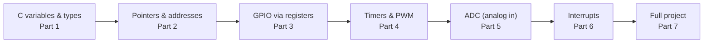
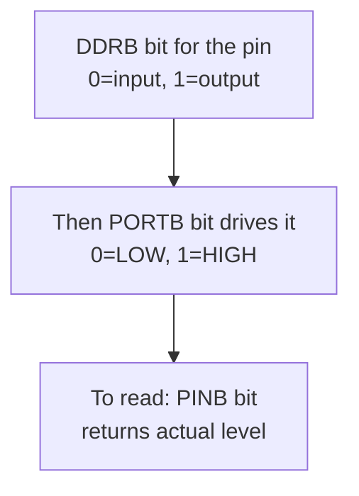
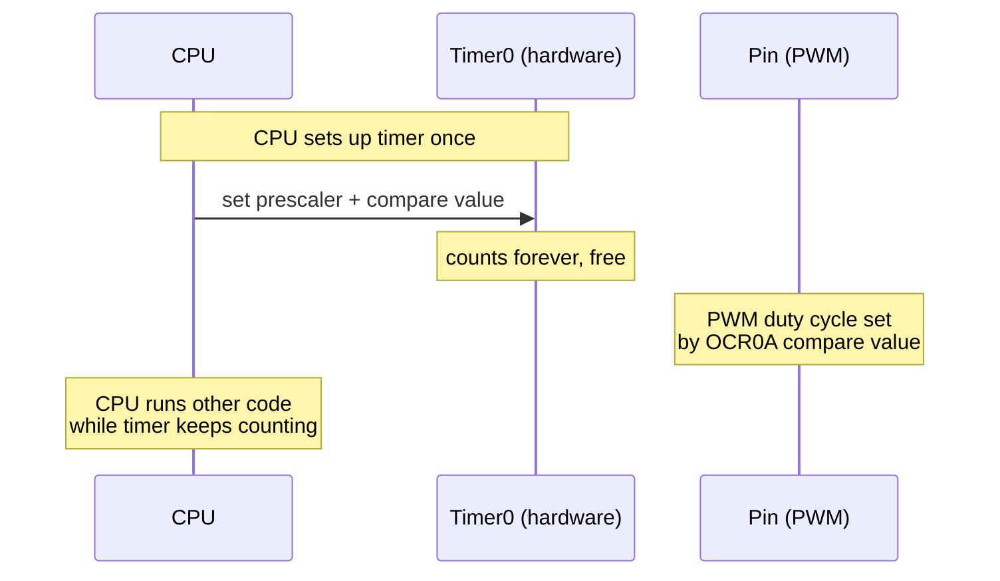
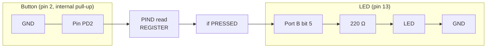

# Arduino in C — Learn C the Way an AVR Actually Thinks

> **Track:** Arduino (AVR) · **Difficulty:** Beginner → Intermediate
> **What you'll get:** C pointers and memory, GPIO via bare registers, timers & PWM, ADC,
> interrupts, and a complete blink + button project you can build on a real Arduino Uno.
> **Prereq:** nothing but a board. If you're brand new, do the [Beginner tutorial](../paths/arduino/beginner.md) first.

The Arduino IDE hides a lot from you. `digitalWrite(13, HIGH)` is friendly, but under the
hood it's a single register write: `PORTB |= _BV(PB5)`. This tutorial teaches C *through*
the hardware — every concept lands on a real byte in a real AVR chip. By the end you'll
understand the single bus of data, addresses, pointers, and pins that every microcontroller
shares. You'll also be able to read the **ATmega328P datasheet** and know exactly which
register to poke to do what you want.

This page is long on purpose: each section is a small standalone lesson with runnable code,
so you can jump to exactly the topic you need.



---

## 🎯 Prerequisites

- An **Arduino Uno** (ATmega328P) or any AVR board, plus a breadboard.
- One **LED** and a **220 Ω resistor**, one **push button** and a **10 kΩ resistor** (optional for the pull-up section).
- [Arduino IDE](https://www.arduino.cc/en/software) installed (or `avr-gcc` if you prefer the terminal — we use Arduino sketches here for clarity).
- The [ATmega328P datasheet](https://ww1.microchip.com/downloads/en/DeviceDoc/Atmel-7810-Automotive-Microcontrollers-ATmega328P_Datasheet.pdf) — keep it bookmarked; we reference it throughout.

> ⚠️ **Before you wire anything:** an LED is not a light bulb you can just clamp to 5 V. It needs a
> **current-limiting resistor** or it will try to draw as much current as the supply can give and
> burn out instantly. The 220 Ω resistor is not optional — it's what keeps the LED (and your pin)
> alive. This is Ohm's law in action; review [components](../concepts/02-components.md) if it's new.

---

## 🧠 Part 1 — The mental model: memory as a row of boxes

Every AVR has a chunk of **RAM** — bytes with addresses. `0x00`, `0x01`, … The CPU reads and
writes those addresses. A **pointer** is just a variable that *holds an address* instead of a
value. Once you see memory as addresses, almost all C on a microcontroller becomes obvious.

```mermaid
flowchart LR
    A["int x = 42;<br/>value 42"] -->|\"&x = 0x100\"| B["x lives at address 0x100"]
    C["int *p = &x;<br/>p holds 0x100"] --> B
    B -->|\"*p dereferences\"| A
    D["OCR0B register<br/>(special IO address)"]
    E["Writing *p = 99<br/>writes 99 into x's box"]
```

**The four ideas that matter (remember these — everything else builds on them):**

- `int *p` — `p` is a variable that *holds an address* (a pointer).
- `&x` — "address-of x": hands you the address where `x` lives.
- `*p` — "dereference": reads (or writes) the value *at that address*.
- `*p = 99` — on a microcontroller this is exactly how you set a pin when that pin is just another memory address.

## 💾 Part 2 — C variables & data types on a small chip

Before pointers make sense, you need to know *what's in the boxes*. A microcontroller has tiny
RAM (the Uno has just **2 KB**), so the size of your types matters more than on a PC. This is
the #1 difference from "desktop C."

| Type | Size | Range | Use it for |
|------|------|-------|------------|
| `uint8_t` | 1 byte | 0–255 | Small counters, pin reads, bytes |
| `int8_t` | 1 byte | −128…127 | Small signed values |
| `uint16_t` | 2 bytes | 0–65535 | `millis()` timestamps, ADC values |
| `int` | 2 bytes on AVR | −32768…32767 | General small math |
| `uint32_t` | 4 bytes | 0–4.29 billion | `micros()`, long timers |
| `float` | 4 bytes | ~7 digits | Sensor math (use sparingly — slow) |
| `char` | 1 byte | a letter | Text, one ASCII character |
| `bool` | 1 byte | true/false | Flags |

Use the explicit-width types from `<stdint.h>` (`uint8_t`, `uint16_t`, …). Why? **`int` is not a
fixed size across compilers** — on the AVR it's 16 bits, on your PC it's 32 bits. If you write
code that depends on how big an `int` is, it will silently misbehave when you move boards. The
explicit types make your intent clear and portable.

**The classic overflow pitfall** — this bites everyone:

```c
// overflow.ino — watch a 16-bit counter wrap around and detect it.
void setup() {
  Serial.begin(9600);
}

void loop() {
  // millis() returns uint32_t. After ~49 days it wraps to 0 — that's fine.
  static uint32_t last = 0;
  uint32_t now = millis();

  // WRONG way to check elapsed time:
  // if (now - last == 500)   // fails if the difference is ever > 1

  // RIGHT way — unsigned subtraction wraps correctly no matter what:
  if (now - last >= 500) {
    Serial.println(now);
    last = now;                // never use == for elapsed-time checks!
  }
}
```

> ⚠️ **Pitfall — never compare `millis()` (or any unsigned counter) with `==`.** Use `>=` and keep
> the *difference* in an unsigned type. Unsigned arithmetic wraps around 0 cleanly, so subtraction
> gives the correct elapsed time even across a wrap. `==` breaks the moment your loop runs more
> than once between polls.

## 🎯 Part 3 — Control flow: making decisions on the chip

C's `if`/`else`, loops, and `switch` do double duty on a microcontroller: they're both your program
logic *and* your state machines. Here are the patterns you'll use constantly.

```c
// control_flow.ino — the everyday decision structures.
#define BUTTON_PIN 2
#define LED_PIN    13

void setup() {
  pinMode(BUTTON_PIN, INPUT_PULLUP);
  pinMode(LED_PIN, OUTPUT);
  Serial.begin(9600);
}

void loop() {
  bool pressed = (digitalRead(BUTTON_PIN) == LOW);  // pull-up => LOW when pressed

  if (pressed) {
    digitalWrite(LED_PIN, HIGH);
  } else {
    digitalWrite(LED_PIN, LOW);
  }

  // switch: great for a finite set of states
  int reading = analogRead(A0);                 // 0..1023 (10-bit ADC)
  switch (reading / 256) {                      // bucket into 0..3
    case 0:   Serial.println("very dark");      break;
    case 1:   Serial.println("some light");     break;
    case 2:   Serial.println("bright");         break;
    default:  Serial.println("blinding");       break;
  }

  // for + delay: a 3-blink burst
  for (int i = 0; i < 3; i++) {
    digitalWrite(LED_PIN, HIGH);
    delay(100);
    digitalWrite(LED_PIN, LOW);
    delay(100);
  }
}
```

**Pitfall — blocking with `delay()`:** `delay()` stops *everything* for the given time, so you can't
blink an LED *and* read a button smoothly with delays alone. When you need to do two things at once,
either use `millis()` (non-blocking timing) or interrupts (Part 7). We'll meet both.

## 🔀 Part 4 — Functions & `volatile`: structuring and guarding your code

Every Arduino sketch already uses functions (`setup`, `loop`), but professionally you'll write
your **own**. Functions keep one idea per block, so a button debounce or a sensor read lives in
one place you can test in isolation.

```c
// functions.ino — structuring reads into reusable functions.
const uint8_t BTN = 2;

// Read a debounced press: returns true on a NEW press only.
bool buttonPressed() {
  static uint8_t last = HIGH;      // remember the previous read
  uint8_t now = digitalRead(BTN);  // LOW when pressed (pull-up)
  if (now != last && now == LOW) { // edge: just went from high to low
    last = now;
    return true;
  }
  last = now;
  return false;
}

void setup() {
  pinMode(BTN, INPUT_PULLUP);
  pinMode(13, OUTPUT);
  Serial.begin(9600);
}

void loop() {
  if (buttonPressed()) {
    Serial.println("Pressed at t = " + String(millis()));
    digitalWrite(13, HIGH);
    delay(200);        // brief "you pressed me" flash
    digitalWrite(13, LOW);
  }
}
```

**`volatile` — the keyword that guards shared data.** When a variable is changed *outside the
normal flow* (in an interrupt handler, or by hardware), the compiler must not cache it in a
register and read a stale copy. Marking it `volatile` forces the compiler to re-read it from
memory every time:

```c
volatile bool flag = false;   // set inside an ISR, read in loop()
```

Without `volatile`, a well-meaning optimizer can turn `while (!flag) {}` into an infinite loop
that only ever checks a cached value. Mark **every** variable shared between an ISR and your main
code as `volatile`. (More in Part 7.)

## ⚡ Part 5 — GPIO without `digitalWrite`: talking to a register

On the ATmega328P, Port B's pins (digital 8–13) are controlled by three registers:

| Register | Name | What it does |
|----------|------|--------------|
| `DDRB`   | **D**ata **D**irection **R**egister | `1` = output, `0` = input |
| `PORTB`  | Output data / pull-up enable | Sets the pin HIGH/LOW when it's an output |
| `PINB`   | Pin input register | Reads the actual pin level |



The AVR toolchain gives you these names for free (they're just `volatile` pointers to fixed
addresses). **This is the whole "blink without `digitalWrite`" trick:**

```c
// blink_register.ino — LED on pin 13 using raw register access.
// No libraries, just the chip's own I/O registers.

#define LED_PIN  PB5            // pin 13 on the Uno == PORTB bit 5

void setup() {
  DDRB |= (1 << LED_PIN);       // set bit 5 of DDRB -> make pin 13 an OUTPUT
  // "(1 << LED_PIN)" is 0b00100000; "DDRB |= ..." ORs that bit on without
  // disturbing the state of the other pins on the port.
}

void loop() {
  PORTB ^= (1 << LED_PIN);      // XOR toggles bit 5: HIGH<->LOW each pass
  delay(500);                   // hold the new state for half a second
}
```

`PORTB ^= (1 << LED_PIN)` flips the pin every loop — a blink with no library calls. Now you
truly *own* the pin.

> ⚠️ **Pitfall — `|=` to set, `&= ~` to clear, `^=` to toggle.** Never do a plain `PORTB = ...`
> that writes the whole byte: you'd clobber every *other* pin on the port. Use bitwise
> read-modify-write so only the one bit you care about changes.

## ⏱️ Part 6 — Timers & PWM: letting the hardware count for you

A *software* delay (`delay()`) makes the CPU spin uselessly. A **timer** is a hardware counter
that counts independently — the CPU is free to do other things. Timers also generate **PWM**
(pulse-width modulation): a pin that switches on/off very fast, whose *duty cycle* (on-time
percentage) controls LED brightness or servo angle.



The Uno's `analogWrite(pin, value)` (0–255) is really setting the timer's **compare register**:

```c
// pwm_fade.ino — fade an LED on pin 9 up and down using PWM (Timer1).
// Pin 9 is one of the PWM-capable pins (3,5,6,9,10,11 on the Uno).

const int LED = 9;

void setup() {
  pinMode(LED, OUTPUT);         // PWM pins are outputs
}

void loop() {
  for (int brightness = 0; brightness <= 255; brightness++) {
    analogWrite(LED, brightness);   // sets duty cycle: 0 = off, 255 = full
    delay(10);
  }
  for (int brightness = 255; brightness >= 0; brightness--) {
    analogWrite(LED, brightness);
    delay(10);
  }
}
```

**Why does PWM dim an LED when the pin is only ever fully-on or fully-off?** Because of *human
persistence of vision* and the LED's average power. At a 50% duty cycle, the LED is on half the
time, so it appears roughly half as bright — the switching is far faster than your eye can see
(typically ~490–980 Hz on the Uno). It's the same trick behind dimmable lights and servo position
control.

To read a timer *without* PWM, you can count overflow events to measure time precisely — the
foundation of accurate `millis()`-style timing. Full timer-register control (`TCCR0A`, `TCNT0`,
`OCR0A`) is the natural next step once you're comfortable here; the datasheet's "Timers/Counters"
section is your map.

## 🌡️ Part 7a — ADC: reading the analog world as a number

The real world is continuous; a chip is digital. The **ADC** (analog-to-digital converter) samples
a voltage on an analog pin and returns a number. On the Uno's 10-bit ADC, that number is **0–1023**,
representing `0 V` to `5 V` (0–3.3 V on a 3.3 V board).

```c
// adc_read.ino — read a potentiometer or photoresistor voltage and print it.
// Wire: center pin of a pot to A0, the outer pins to 5V and GND.

void setup() {
  Serial.begin(9600);
  Serial.println("ADC demo. Turn the pot, watch the number change.");
}

void loop() {
  int raw = analogRead(A0);          // 0..1023
  float volts = raw * (5.0 / 1023.0); // convert count to a real voltage

  Serial.print("ADC = ");
  Serial.print(raw);
  Serial.print("  ->  ");
  Serial.print(volts, 2);            // 2 decimal places
  Serial.println(" V");

  delay(200);
}
```

> ⚠️ **Pitfall — reading a raw sensor directly can be noisy.** For stable readings, average several
> samples (e.g. read 10 times and divide by 10) or add a small capacitor. And remember: `analogRead`
> values are *counts*, not volts — always convert if you want real units.

## 🚨 Part 7b — Interrupts: reacting instantly without polling

Polling (`while (digitalRead(...))`) spends all its time *checking*. An **interrupt** lets the
hardware *tap the CPU on the shoulder* when an event happens, run a short **ISR** (interrupt service
routine), then return to whatever it was doing. This is how you catch a button press *immediately*
even while the main loop is busy.

```c
// interrupt.ino — a button on pin 2 (INT0) fires an ISR on a falling edge.
// The main loop keeps blinking; the interrupt flashes a fast burst.

const int BUTTON_PIN = 2;   // only pins 2 and 3 support external interrupts on the Uno
const int LED_PIN    = 13;

volatile bool pressPending = false;   // MUST be volatile — set in ISR, read in loop

void btnISR() {
  pressPending = true;                // just set a flag; do real work in loop()
}

void setup() {
  pinMode(BUTTON_PIN, INPUT_PULLUP);
  pinMode(LED_PIN, OUTPUT);
  Serial.begin(9600);
  attachInterrupt(digitalPinToInterrupt(BUTTON_PIN), btnISR, FALLING);
  // FALLING = fires when the pin transitions HIGH -> LOW (button press with pull-up)
}

void loop() {
  if (pressPending) {                 // a press was detected
    pressPending = false;             // clear the flag
    Serial.println("Interrupt fired!");
    for (int i = 0; i < 5; i++) {     // flash 5 times fast
      digitalWrite(LED_PIN, HIGH); delay(50);
      digitalWrite(LED_PIN, LOW);  delay(50);
    }
  }
  // ... meanwhile the loop keeps running smoothly ...
}
```

**Three ISR rules that save hours of debugging:**
1. **Keep ISRs short.** Do the real work in `loop()`; the ISR should just set flags/read a byte.
2. **Declare shared variables `volatile`.** Otherwise the compiler may cache a stale value.
3. **No `delay()` and no `Serial.print()` inside an ISR.** They block and/or aren't reentrant-`safe`
   and will corrupt your timing. (You *can* `Serial.write()` a character in modern Arduino, but avoid it while learning.)

## 🧰 Part 8 — The full project: read a button, drive an LED

Grand finale: a button on pin 2 **with an internal pull-up**, and the LED on pin 13. We read
the button through registers and react. Notice how we never call `pinMode` or `digitalRead`.

```c
// button_led.ino — press the button, light the LED; register-level the whole way.

#define BTN     PD2             // button on digital pin 2 == PORTD bit 2
#define LED     PB5             // LED on digital pin 13 == PORTB bit 5
#define PRESSED 0               // with a pull-up, the pin reads LOW (0) when pressed

void setup() {
  DDRB |= (1 << LED);           // LED pin -> OUTPUT
  // If your LED is wired to GND through the 220 ohm resistor, driving the pin
  // LOW lets current flow -> LED on. So start with the pin HIGH = LED off:
  PORTB |= (1 << LED);

  // Button is an INPUT; enable the INTERNAL pull-up resistor.
  DDRD  &= ~(1 << BTN);         // clear the bit -> pin 2 is an input
  PORTD |= (1 << BTN);          // set the bit  -> internal pull-up on pin 2

  Serial.begin(9600);
}

void loop() {
  // Read the button through the PIN register. Extract bit 2, shift it to bit 0:
  uint8_t reading = (PIND >> BTN) & 1;   // 0 = pressed (pulled LOW), 1 = released

  if (reading == PRESSED) {
    PORTB &= ~(1 << LED);       // drive LED pin LOW  -> LED ON (current flows to GND)
    Serial.println("Pressed");
  } else {
    PORTB |= (1 << LED);        // drive LED pin HIGH -> LED OFF
  }

  delay(20);                    // tiny debounce pause so we don't re-read mid-bounce
}
```

**Wiring the button** — with the internal pull-up you need *no* external resistor:

| Button leg | Connect to |
|------------|------------|
| One side   | GND        |
| Other side | Digital pin 2 |

**Wiring the LED:**

| Component | Connect to |
|-----------|------------|
| LED anode (long leg) | 220 Ω resistor → Digital pin 13 |
| LED cathode (short leg) | GND |



## 📐 Why this matters

You've now used every essential C idea that transfers to professional embedded work:

- **Pointers & addresses** — AVR registers are literally fixed addresses the compiler already names.
- **Bit manipulation** — `|`, `&`, `^`, `<<` toggling individual bits without clobbering the others.
- **`volatile`** — AVR registers are declared `volatile` so the compiler re-reads them every time instead of caching a stale copy.
- **Memory-mapped I/O** — the same principle powers every modern chip, from ESP32 to STM32 to RP2040.
- **Timers, PWM & ADC** — the hardware peripherals that make a tiny chip useful beyond blinking.
- **Interrupts** — reacting to the world immediately instead of wasting CPU polling for it.

None of this is Arduino-specific. Registers, timers, ADCs, and interrupts exist on *every*
microcontroller. Learn them here on the simplest chip, and you recognize them instantly on the
expensive ones.

## ▶️ Watch & learn

- [Arduino Getting Started: Your first sketch](https://www.youtube.com/watch?v=gEwMEvUPAco) — get your first sketch flashed to a board.
- [Intro to Pointers in Arduino](https://www.youtube.com/watch?v=MmidT50ElO8) — pointers made visual and concrete.
- [How To Use Digital Input and Output in Arduino](https://www.youtube.com/watch?v=qh5gOgeqzZo) — wiring real pins and reading inputs.
- <https://www.youtube-nocookie.com/embed/bF3OyQ3HwfU> — the multimeter tutorial, for when you need to measure what your pins are actually doing.

## ✅ Next steps

- Switch `delay(500)` to `delayMicroseconds()` and watch the blink speed up.
- Add a second LED and a second button on a different port.
- Read the **ATmega328P datasheet** — the ultimate reference for every register.
- Move up to the [ESP32 path](../paths/esp32/index.md) to see the *same* concepts on a dual-core, Wi-Fi chip.
- Try [Rust on embedded](../synthesized/embedded-rust.md) to see how the compiler can catch the register mistakes C lets you make.

> **New to a term?** Look it up in the [Glossary](../GLOSSARY/README.md).

---

*Intermediate? Continue to [MOSFETs & timers](../concepts/02-components.md) or the [full Arduino path](../paths/arduino/index.md).*
