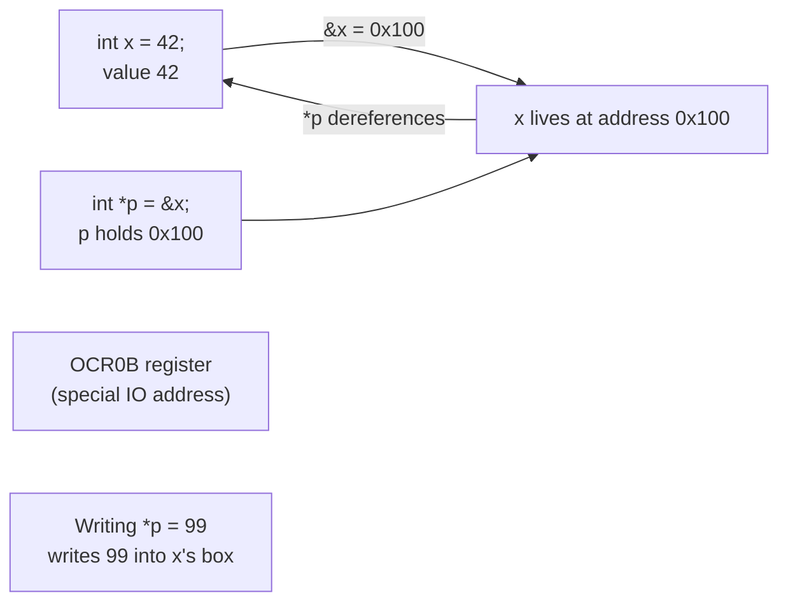

# Arduino in C — Learn C the Way an AVR Actually Thinks

> **Track:** Arduino (AVR) · **Difficulty:** Beginner → Intermediate
> **What you'll get:** C pointers and memory, GPIO via bare registers, and a complete
> blink + button project you can build on a real Arduino Uno.

The Arduino IDE hides a lot from you. `digitalWrite(13, HIGH)` is friendly, but under the
hood it's a single register write: `PORTB |= _BV(PB5)`. This tutorial teaches C *through*
the hardware — every concept lands on a real byte in a real AVR chip. By the end you'll
understand the single bus of data, addresses, pointers, and pins that every microcontroller
shares.

---

## 🎯 Prerequisites

- An **Arduino Uno** (ATmega328P) or any AVR board, plus a breadboard.
- One **LED** and a **220 Ω resistor**, one **push button** and a **10 kΩ resistor**.
- [Arduino IDE](https://www.arduino.cc/en/software) installed (or `avr-gcc` if you prefer the terminal).

## 🧠 First, the mental model: memory as a row of boxes

Every AVR has a chunk of **RAM** — bytes with addresses. `0x00`, `0x01`, … The CPU reads and
writes those addresses. A **pointer** is just a variable that *holds an address* instead of a
value. Once you see memory as addresses, almost all C on a microcontroller becomes obvious.



## 🔬 Part 1 — Variables, addresses, and pointers

Let's start with plain C you can run on your PC or in the Arduino IDE's Serial Monitor.

```c
// pointers.ino — upload to the board and open the Serial Monitor to watch it run.
// Works on any Arduino; no extra parts needed.

void setup() {
  Serial.begin(9600);            // open the serial port at 9600 baud
  int  x = 42;                   // a normal variable: its VALUE is 42
  int *p = &x;                   // p is a POINTER; &x is x's ADDRESS

  Serial.println(x);             // prints the value:        42
  Serial.println((unsigned long)&x); // prints the ADDRESS, e.g. 100 (varies)
  Serial.println((int)*p);       // *p DEREFERENCES p -> reads the value at the address

  *p = 99;                       // write 99 into the box p points at...
  Serial.println(x);             // ...so x is now:          99  <-- it changed!
}

void loop() {
  // nothing to do here
}
```

**The four ideas that matter:**
- `int *p` — p is a variable that *holds an address*.
- `&x` — "address-of x": hands you the address where x lives.
- `*p` — "dereference": reads (or writes) the value *at that address*.
- `*p = 99` — on a microcontroller this is exactly how you set a pin when that pin is just another memory address.

## ⚡ Part 2 — GPIO without `digitalWrite`: talking to a register

On the ATmega328P, Port B's pins (digital 8–13) are controlled by three registers:

| Register | Name | What it does |
|----------|------|--------------|
| `DDRB`   | **D**ata **D**irection **R**egister | `1` = output, `0` = input |
| `PORTB`  | Output data / pull-up enable | Sets the pin HIGH/LOW when it's an output |
| `PINB`   | Pin input register | Reads the actual pin level |

The AVR toolchain gives you these names for free (they're just `volatile` pointers to fixed
addresses). **This is the whole "blink without `digitalWrite`" trick:**

```c
// blink_register.ino — LED on pin 13 using raw register access.
// No libraries, just the chip's own I/O registers.

#define LED_PIN  PB5            // pin 13 on the Uno == PORTB bit 5

void setup() {
  DDRB |= (1 << LED_PIN);       // set bit 5 of DDRB -> make pin 13 an OUTPUT
  // "(1 << LED_PIN)" is 0b00100000; "DDRB |= ..." ORs that bit on without
  // disturbing the state of the other pins on the port.
}

void loop() {
  PORTB ^= (1 << LED_PIN);      // XOR toggles bit 5: HIGH<->LOW each pass
  delay(500);                   // hold the new state for half a second
}
```

`PORTB ^= (1 << LED_PIN)` flips the pin every loop — a blink with no library calls. Now you
truly *own* the pin.

## 🧰 Part 3 — The full project: read a button, drive an LED

Grand finale: a button on pin 2 **with an internal pull-up**, and the LED on pin 13. We read
the button through registers and react. Notice how we never call `pinMode` or `digitalRead`.

```c
// button_led.ino — press the button, light the LED; register-level the whole way.

#define BTN     PD2             // button on digital pin 2 == PORTD bit 2
#define LED     PB5             // LED on digital pin 13 == PORTB bit 5
#define PRESSED 0               // with a pull-up, the pin reads LOW (0) when pressed

void setup() {
  DDRB |= (1 << LED);           // LED pin -> OUTPUT
  // If your LED is wired to GND through the 220 ohm resistor, driving the pin
  // LOW lets current flow -> LED on. So start with the pin HIGH = LED off:
  PORTB |= (1 << LED);

  // Button is an INPUT; enable the INTERNAL pull-up resistor.
  DDRD  &= ~(1 << BTN);         // clear the bit -> pin 2 is an input
  PORTD |= (1 << BTN);          // set the bit  -> internal pull-up on pin 2

  Serial.begin(9600);
}

void loop() {
  // Read the button through the PIN register. Extract bit 2, shift it to bit 0:
  uint8_t reading = (PIND >> BTN) & 1;   // 0 = pressed (pulled LOW), 1 = released

  if (reading == PRESSED) {
    PORTB &= ~(1 << LED);       // drive LED pin LOW  -> LED ON (current flows to GND)
    Serial.println("Pressed");
  } else {
    PORTB |= (1 << LED);        // drive LED pin HIGH -> LED OFF
  }

  delay(20);                    // tiny debounce pause so we don't re-read mid-bounce
}
```

**Wiring the button** — with the internal pull-up you need *no* external resistor:

| Button leg | Connect to |
|------------|------------|
| One side   | GND        |
| Other side | Digital pin 2 |

**Wiring the LED:**

| Component | Connect to |
|-----------|------------|
| LED anode (long leg) | 220 Ω resistor → Digital pin 13 |
| LED cathode (short leg) | GND |

## 📐 Why this matters

You've now used every essential C idea that transfers to professional embedded work:

- **Pointers & addresses** — AVR registers are literally fixed addresses the compiler already names.
- **Bit manipulation** — `|`, `&`, `^`, `<<` toggling individual bits without clobbering the others.
- **`volatile` (bonus)** — AVR registers are declared `volatile` so the compiler re-reads them every time instead of caching a stale copy.
- **Memory-mapped I/O** — the same principle powers every modern chip, from ESP32 to STM32 to RP2040.

## ▶️ Watch & learn

- [Arduino Getting Started: Your first sketch](https://www.youtube.com/watch?v=gEwMEvUPAco) — get your first sketch flashed to a board.
- [Intro to Pointers in Arduino](https://www.youtube.com/watch?v=MmidT50ElO8) — pointers made visual and concrete.
- [How To Use Digital Input and Output in Arduino](https://www.youtube.com/watch?v=qh5gOgeqzZo) — wiring real pins and reading inputs.

## ✅ Next steps

- Switch `delay(500)` to `delayMicroseconds()` and watch the blink speed up.
- Add a second LED and a second button on a different port.
- Read the **ATmega328P datasheet** — the ultimate reference for every register.

> **New to a term?** Look it up in the [Glossary](../GLOSSARY/README.md).
