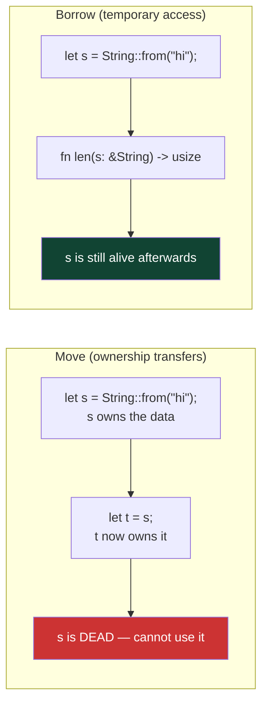

# Rust on Embedded — Ownership, `no_std`, and Hello World on a Chip

> **Track:** Microcontrollers (general) · **Difficulty:** Intermediate
> **What you'll get:** Rust's ownership model explained for hardware, what `no_std` actually
> means, and a real "hello world" (blinking LED) on an MCU via the **esp-rs** and **AVR**
> ecosystems.

Rust is unusual for embedded work in one big way: its **ownership** rules can be checked *at
compile time*, so whole classes of bugs (use-after-free, data races, forgetting to lock a
peripheral) simply don't compile. That's a huge deal when you can't just reboot a robot that
crashes in the field. This tutorial maps Rust's signature concepts onto the microcontroller
world without assuming any prior Rust.

---

## 🎯 Prerequisites

- Some C (the Arduino tutorial) helps but isn't required — a bit of any language is fine.
- A dev board: an **ESP32-C3** (esp-rs ecosystem), an **Arduino Uno / ATmega328P** (AVR ecosystem), or a **Raspberry Pi Pico (RP2040)**.
- [Rust toolchain](https://rustup.rs/) installed (`rustup`, `cargo`), plus `rustup target add` for your chip's target.

## 🧠 Part 1 — Ownership in 60 seconds

Rust's central idea: **every value has exactly one owner**, and when that owner goes out of
scope the value is dropped (freed) automatically. You can *borrow* it with `&` or *move* it.
This replaces both garbage collection *and* manual `free()` — and it means the compiler
catches your memory mistakes before the chip ever runs your code.



**The rule that matters on a chip:** there is exactly **one** owner of any piece of memory or
any peripheral. When a Rust borrow checker says "can't borrow, already moved", it's stopping
the exact class of bug where two pieces of code fight over the same hardware register.

## 🔌 Part 2 — What `no_std` means

Normal Rust programs link the **standard library** (`std`), which assumes a full OS with heap
allocation, threads, files. A tiny MCU has none of that. So embedded Rust uses **`no_std`**:
no `std`, no OS, no heap by default. You get:

- Core types and traits (`core` crate — always available).
- No dynamic allocation unless you add a heap yourself.
- Near-zero runtime and memory footprint — ideal for a chip with 2–32 KB of RAM.

A minimal `no_std` binary looks like this (the classic skeleton):

```rust
// main.rs — the no_std skeleton every embedded Rust program starts from.
#![no_std]          // do NOT link the standard library — we're bare metal
#![no_main]         // no OS calls main() — we define the reset entry point

use core::panic::PanicInfo;

// Called if something panics; on bare metal there is no OS to print to.
// A minimal, silent handler is fine while learning.
#[panic_handler]
fn panic(_info: &PanicInfo) -> ! {
    loop {}
}

// For AVR chips there is no separate runtime to call main(); the compiler
// needs to know the entry symbol. (Cortex-M/ESP32 toolchains handle this a
// little differently — see the "hello world" below.)
#[no_mangle]
pub extern "C" fn main() -> ! {
    loop {}          // an empty program that never returns
}
```

## 💡 Part 3 — Hello world = blink the LED

The embedded "hello world" is a blinking LED. In Rust your main task is *managing who owns
the GPIO register*. The embedded-hal trait `OutputPin` gives a common interface across chips.

Here's a working ESP32-C3 example using the **esp-rs** stack (`esp-hal` + `esp-println`):

```rust
//! blink_led.rs — blink the onboard LED on an ESP32-C3 (no_std, esp-rs).
//! Build with:  cargo build --target riscv32imc-unknown-none-elf
#![no_std]
#![no_main]

use esp_backtrace as _;
use esp_hal::clock::ClockControl;
use esp_hal::gpio::IO;
use esp_hal::peripherals::Peripherals;
use esp_hal::system::SystemControl;
use esp_hal::{delay::Delay, prelude::*};

#[entry]                          // the esp-rs macro marks the entry point
fn main() -> ! {
    let peripherals = Peripherals::take();      // take OWNERSHIP of the chip's memory map
    let system = SystemControl::new(peripherals.SYSTEM);
    let clocks = ClockControl::boot_defaults(system.clock_control).freeze();

    // Ownership in action: `IO::new` is the ONLY way to get the GPIO pins,
    // and there is exactly one `IO` instance per chip. The borrow checker
    // guarantees you can't create two handles to the same pin.
    let io = IO::new(peripherals.GPIO, peripherals.IO_MUX);
    let mut led = io.pins.gpio8.into_output();  // GPIO8 is the on-board LED on C3 devkits

    let mut delay = Delay::new(&clocks);

    loop {
        led.toggle().ok();        // Flip the pin — the LED blinks!
        delay.delay_millis(500u32);
    }
}
```

**The AVR equivalent** (Arduino Uno) is nearly identical thanks to the shared `embedded-hal`
traits — swap the board crate and the pin, keep the loop:

```rust
//! For an Arduino Uno (ATmega328P) using the avr-hal ecosystem:
#![no_std]
#![no_main]

use arduino_hal::prelude::*;
use arduino_hal::port::portb;
use arduino_hal::Delay;

#[arduino_hal::entry]
fn main() -> ! {
    let dp = arduino_hal::Peripherals::take().unwrap();
    let pins = arduino_hal::pins!(dp);
    let mut led = pins.d13.into_output();    // pin 13 onboard LED
    let mut delay = Delay::new();

    loop {
        led.toggle();
        delay.delay_ms(500);
    }
}
```

Whichever target you use, the *shape* is identical: take the peripherals once, set a pin as an
output, toggle forever. Ownership keeps one task per peripheral, so your loop can't corrupt
itself.

## 🗺️ Choosing an ecosystem

| Board | Ecosystem / crate | Target | Notes |
|-------|-------------------|--------|-------|
| ESP32 / ESP32-C3 | **esp-rs** (`esp-hal`) | riscv32 / xtensa | Official Espressif support, first-class |
| Arduino Uno (ATmega328P) | **avr-hal** | avr-unknown-* | Great for learning, small RAM |
| Raspberry Pi Pico (RP2040) | **embassy-rp** / `rp-hal` | thumbv6m | Embassy gives async |

## 📐 Why this matters

- **Ownership prevents data races at compile time** — a whole class of embedded crashes disappears before you flash.
- **`no_std`** keeps your binary tiny and OS-free — the same reason C has ruled embedded for decades.
- **`embedded-hal`** abstracts GPIO/timers/SPI/I²C so your code moves between chips with minimal edits.

## ▶️ Watch & learn

- [From 0 to `no_std` in one session (Rust Linz)](https://www.youtube.com/watch?v=Pu4MZmB0E28) — a live walk from nothing to a no_std binary.
- [How to Do Embedded Development with Rust — Steve Klabnik (GOTO)](https://www.youtube.com/watch?v=7lHtXkYnip8) — the big picture from a Rust core-team member.
- [Intro to Embassy: embedded development with async Rust](https://www.youtube.com/watch?v=pDd5mXBF4tY) — the modern async layer on top of all this.

## ✅ Next steps

- Add an **async** Blink with Embassy and watch how `#[embassy_executor::main]` changes the structure.
- Read a button using `embedded-hal`'s `InputPin` trait.
- Explore the Espressif **no_std training** (official docs) — it is the best free deep-dive.

> **New to a term?** Look it up in the [Glossary](../GLOSSARY/README.md).
