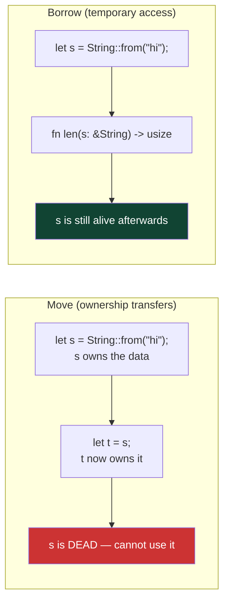
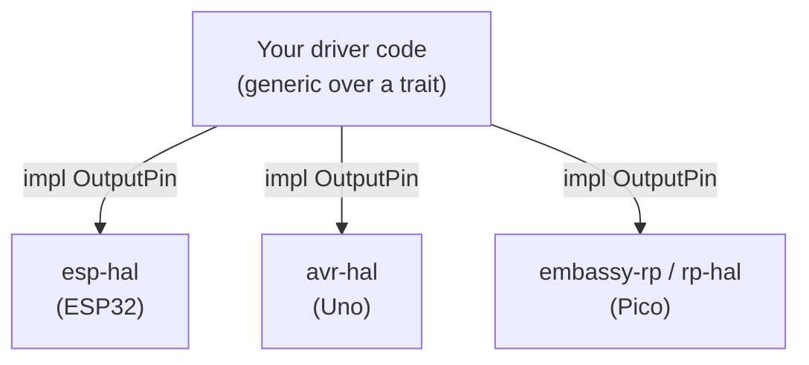

# Rust on Embedded — Ownership, `no_std`, and Hello World on a Chip

> **Track:** Microcontrollers (general) · **Difficulty:** Intermediate
> **What you'll get:** Rust's ownership model explained for hardware, what `no_std` actually
> means, the `embedded-hal` traits, a real "hello world" (blinking LED) on an MCU via the
> **esp-rs**, **AVR**, and **Embassy** ecosystems, and the borrow-checker pitfalls that bite
> every Rust-on-hardware newcomer.
> **Prereq:** some C helps (the [Arduino tutorial](../synthesized/arduino-c.md)) but isn't required — a bit of any language is fine.

Rust is unusual for embedded work in one big way: its **ownership** rules can be checked *at
compile time*, so whole classes of bugs (use-after-free, data races, forgetting to lock a
peripheral) simply don't compile. That's a huge deal when you can't just reboot a robot that
crashes in the field. This tutorial maps Rust's signature concepts onto the microcontroller
world without assuming any prior Rust.

If you've been through [Arduino in C](../synthesized/arduino-c.md), you already understand
registers, GPIO, timers, and interrupts — Rust's job is to make the *mistakes* in that world
impossible. If you come from [MicroPython](../synthesized/micropython.md), Rust is the "polish
the winner for production" step.


---

## 🎯 Prerequisites

- Some C (the Arduino tutorial) helps but isn't required — a bit of any language is fine.
- A dev board: an **ESP32-C3** (esp-rs ecosystem), an **Arduino Uno / ATmega328P** (AVR ecosystem), or a **Raspberry Pi Pico (RP2040)**.
- [Rust toolchain](https://rustup.rs/) installed (`rustup`, `cargo`), plus `rustup target add` for your chip's target.
- Familiarity with the [Microcontroller concepts](../concepts/04-microcontrollers.md) (GPIO, registers) helps a lot.

> ⚠️ **First-time setup pitfall:** "Rust on embedded" actually means several different toolchains.
> An ESP32-C3 targets `riscv32imc-unknown-none-elf`; an Arduino Uno targets `avr-unknown-none`; a
> Pico targets `thumbv6m-none-eabi`. Install *your* chip's target with `rustup target add …`, and
> check the ecosystem's own quickstart (e.g. `espup` for esp-rs) for the right `cargo run`/flash
> command. Copying a C3 setup to an Uno won't compile, and that's expected, not a bug.

## 🧠 Part 1 — Ownership in 60 seconds

Rust's central idea: **every value has exactly one owner**, and when that owner goes out of
scope the value is dropped (freed) automatically. You can *borrow* it with `&` or *move* it.
This replaces both garbage collection *and* manual `free()` — and it means the compiler
catches your memory mistakes before the chip ever runs your code.



**The rule that matters on a chip:** there is exactly **one** owner of any piece of memory or
any peripheral. When a Rust borrow checker says "can't borrow, already moved", it's stopping
the exact class of bug where two pieces of code fight over the same hardware register.

**A tiny, runnable example** (works on your PC with plain `cargo` — no hardware needed):

```rust
fn main() {
    let mut channel = String::from("uart");
    // Borrow it (read-only) — fine, and `channel` still lives:
    println!("{}", inspect(&channel));
    // Move it — `channel` is now gone:
    let other = channel;
    // println!("{}", channel);  // ERROR: value moved. This is the compiler saving you.
    println!("{}", other);
}

fn inspect(s: &String) -> usize {
    s.len()
}
```

> 💡 **Why this isn't a nuisance here:** on a microcontroller, "you can't have two owners of the
> same UART" isn't a stylistic preference — two code paths writing to the same UART *will*
> corrupt each other's bytes. Rust turns that whole category of bug into a compile error instead
> of a flaky runtime glitch.

## 🔌 Part 2 — What `no_std` means

Normal Rust programs link the **standard library** (`std`), which assumes a full OS with heap
allocation, threads, files. A tiny MCU has none of that. So embedded Rust uses **`no_std`**:
no `std`, no OS, no heap by default. You get:

- Core types and traits (`core` crate — always available).
- No dynamic allocation unless you add a heap yourself.
- Near-zero runtime and memory footprint — ideal for a chip with 2–32 KB of RAM.

A minimal `no_std` binary looks like this (the classic skeleton):

```rust
// main.rs — the no_std skeleton every embedded Rust program starts from.
#![no_std]          // do NOT link the standard library — we're bare metal
#![no_main]         // no OS calls main() — we define the reset entry point

use core::panic::PanicInfo;

// Called if something panics; on bare metal there is no OS to print to.
// A minimal, silent handler is fine while learning.
#[panic_handler]
fn panic(_info: &PanicInfo) -> ! {
    loop {}
}

// For AVR chips there is no separate runtime to call main(); the compiler
// needs to know the entry symbol. (Cortex-M/ESP32 toolchains handle this a
// little differently — see the "hello world" below.)
#[no_mangle]
pub extern "C" fn main() -> ! {
    loop {}          // an empty program that never returns
}
```

> ⚠️ **Pitfall — `no_std` has no heap by default.** `String`, `Vec`, and `Box` come from `std`'s
> allocator and won't compile in plain `no_std`. If you need dynamic collections, you must add a
> heap allocator (`alloc` crate + a global allocator) — a conscious, explicit step. Until you do,
> you work with fixed-size `[u8; N]` arrays and stack data, which is exactly what a small chip
> prefers. This constraint is a feature: it forces allocations to be the exception, not the rule.

## 💡 Part 3 — Hello world = blink the LED

The embedded "hello world" is a blinking LED. In Rust your main task is *managing who owns
the GPIO register*. The embedded-hal trait `OutputPin` gives a common interface across chips.

Here's a working ESP32-C3 example using the **esp-rs** stack (`esp-hal` + `esp-println`):

```rust
//! blink_led.rs — blink the onboard LED on an ESP32-C3 (no_std, esp-rs).
//! Build with:  cargo build --target riscv32imc-unknown-none-elf
#![no_std]
#![no_main]

use esp_backtrace as _;
use esp_hal::clock::ClockControl;
use esp_hal::gpio::IO;
use esp_hal::peripherals::Peripherals;
use esp_hal::system::SystemControl;
use esp_hal::{delay::Delay, prelude::*};

#[entry]                          // the esp-rs macro marks the entry point
fn main() -> ! {
    let peripherals = Peripherals::take();      // take OWNERSHIP of the chip's memory map
    let system = SystemControl::new(peripherals.SYSTEM);
    let clocks = ClockControl::boot_defaults(system.clock_control).freeze();

    // Ownership in action: `IO::new` is the ONLY way to get the GPIO pins,
    // and there is exactly one `IO` instance per chip. The borrow checker
    // guarantees you can't create two handles to the same pin.
    let io = IO::new(peripherals.GPIO, peripherals.IO_MUX);
    let mut led = io.pins.gpio8.into_output();  // GPIO8 is the on-board LED on C3 devkits

    let mut delay = Delay::new(&clocks);

    loop {
        led.toggle().ok();        // Flip the pin — the LED blinks!
        delay.delay_millis(500u32);
    }
}
```

**The AVR equivalent** (Arduino Uno) is nearly identical thanks to the shared `embedded-hal`
traits — swap the board crate and the pin, keep the loop:

```rust
//! For an Arduino Uno (ATmega328P) using the avr-hal ecosystem:
#![no_std]
#![no_main]

use arduino_hal::prelude::*;
use arduino_hal::port::portb;
use arduino_hal::Delay;

#[arduino_hal::entry]
fn main() -> ! {
    let dp = arduino_hal::Peripherals::take().unwrap();
    let pins = arduino_hal::pins!(dp);
    let mut led = pins.d13.into_output();    // pin 13 onboard LED
    let mut delay = Delay::new();

    loop {
        led.toggle();
        delay.delay_ms(500);
    }
}
```

Whichever target you use, the *shape* is identical: take the peripherals once, set a pin as an
output, toggle forever. Ownership keeps one task per peripheral, so your loop can't corrupt
itself.

## 🎛️ Part 4 — Reading a button with `InputPin`

Reading digital *input* is the mirror image, via the `InputPin` trait. And here's a genuinely
Rust-y advantage: the pull-up state is **part of the pin's type**, so you literally cannot wire
up a button and forget whether its pull-up is on.

```rust
//! button.rs — read a button with an internal pull-up via embedded-hal.
//! (ESP32-C3, esp-rs flavour.)
#![no_std]
#![no_main]

use esp_backtrace as _;
use esp_hal::clock::ClockControl;
use esp_hal::gpio::{IO, Pull};
use esp_hal::peripherals::Peripherals;
use esp_hal::system::SystemControl;
use esp_hal::{delay::Delay, prelude::*};

#[entry]
fn main() -> ! {
    let peripherals = Peripherals::take();
    let system = SystemControl::new(peripherals.SYSTEM);
    let clocks = ClockControl::boot_defaults(system.clock_control).freeze();
    let io = IO::new(peripherals.GPIO, peripherals.IO_MUX);

    // Pull::Up is part of the type — the compiler KNOWS this pin has a pull-up.
    let mut btn = io.pins.gpio9.into_pull_up_input();
    let mut led = io.pins.gpio8.into_output();
    let mut delay = Delay::new(&clocks);

    loop {
        // is_low() with a pull-up == button pressed (same convention as Arduino).
        if btn.is_low().unwrap() {
            led.set_high().ok();
        } else {
            led.set_low().ok();
        }
        delay.delay_millis(20u32);   // tiny debounce pause
    }
}
```

> 💡 **The type carries the safety.** On an Arduino, miscalculating whether a pin is pulled up
> produces a button that *mostly* works but glitches. In Rust, the pull direction is baked into
> the type (`into_pull_up_input()` returns a distinct type from `into_floating_input()`), so the
> compiler refuses to let you treat them interchangeably. Bugs that would lurk for weeks in C
> become compile errors in seconds.

## 🧩 Part 5 — `embedded-hal`: write once, run on any chip

`embedded-hal` is the trait *glue* that makes Rust-on-embedded portable. Instead of writing
`digitalWrite` (Uno), `gpio_set_level` (ESP-IDF), and `HAL_GPIO_WritePin` (STM32) for each chip,
you write your driver against a *trait* (`OutputPin`, `InputPin`, `I2c`, `Spi`, `DelayMs`, …),
and it compiles on any hardware whose HAL implements that trait.



**A portable driver** — the same `fn blink_forever<P: OutputPin>` works for all three boards:

```rust
//! driver.rs — a truly portable blink routine, generic over any OutputPin.

use embedded_hal::digital::OutputPin;

/// Blink `pin` on/off forever. Works on ANY chip whose HAL implements OutputPin.
pub fn blink_forever<P, D>(mut pin: P, delay: &mut D) -> !
where
    P: OutputPin,
    D: embedded_hal::delay::DelayNs,
{
    loop {
        let _ = pin.toggle();
        delay.delay_ms(500);
    }
}
```

> ⚠️ **Pitfall — generic traits need explicit error handling.** Notice the `.ok()`, `.unwrap()`,
> and `let _ =` scattered through these examples. `embedded-hal` methods return `Result` because
> a real HAL can report a hardware failure. In `no_std` you often ignore the error with `let _ =
> …`, but *deliberately* — the compiler forces you to choose, so you can't silently swallow a
> failure you actually care about.

## 🐛 Part 5½ — The three borrow-checker errors every embedded beginner hits

If you're coming from C (where the compiler happily lets you write bugs), Rust's denials feel
mystifying at first. Here are the three errors that account for ~90% of first-week struggles,
what they actually mean, and the fix. This section is your "when the compiler says no" decoder
ring.

**1. "value moved here … use after move"** — you handed a peripheral away and then tried to use it.

```rust
let io = IO::new(peripherals.GPIO, peripherals.IO_MUX);
let _led_in = io.pins.gpio8.into_input();      // move: gpio8 no longer in `io`
// let _led = io.pins.gpio9.into_output();      // ERROR commonly: use of moved `io`
```

**What's really happening:** `into_input()` *consumes* that pin (and, on some HALs, `io` too),
moving ownership. **Fix:** take each pin you need *once* and bind it to a variable — don't reach
back through `io` after a pin it owns has been moved. Order doesn't matter; each pin is consumed
exactly once into its own binding.

**2. "cannot borrow `x` as mutable more than once at a time"** — two tasks/handlers both want
to write the same peripheral.

```rust
// A classic: one struct + two async tasks each wanting to drive the same UART.
```
**What's really happening:** two owners of one physical device = a real race on the bench. **Fix:**
share one mutable owner behind a `Mutex` (a *critical-section* mutex, not a threads mutex) or a
channel (Embassy has `mpsc`), so exactly one task owns the peripheral at any instant. The compiler
is enforcing the rule you'd write in C by "don't touch UART from two places."

**3. "expected `&mut`, found `&`" / mutability confusions** — you wrote a `&` where the API wants
to be able to change the pin.

```rust
fn toggle_twice(pin: &impl OutputPin) { /* can't toggle — needs &mut */ }
```
**What's really happening:** toggling changes state, so toggling requires *mutable* access (`&mut
impl OutputPin`). **Fix:** ask for `&mut` when you mutate ("toggles" change state) and `&` when you
only read (`is_low`, `is_set_high`) — and let the compiler tell you which is right.

> 💡 **The reframe that makes Rust click:** these "errors" are the C bugs you'd otherwise chase
> with a logic analyzer, surfaced *before* the code exists. The compiler is a junior engineer who
> checks your hardware wiring reasoning on every compile — annoying at first, invaluable on a
> $5 robot you can't reboot from the field.

## ⚡ Part 6 — Async with Embassy

Embassy sits on top of `embedded-hal` and adds **async/await** concurrency without a C-style
RTOS — Rust's equivalent of the MicroPython `asyncio` from the
[MicroPython tutorial](../synthesized/micropython.md), but at native speed and with no heap by
default in the async form.

```rust
//! async_blink.rs — an async blink with Embassy on a Raspberry Pi Pico.
//! The shape is identical to a task-based RTOS, but in Rust's async model.

#![no_std]
#![no_main]

use embassy_executor::Spawner;
use embassy_rp::gpio::{Level, Output};
use embassy_time::{Duration, Timer};
use {defmt_rtt as _, panic_probe as _};

#[embassy_executor::main]
async fn main(_spawner: Spawner) {
    let p = embassy_rp::init(Default::default());
    let mut led = Output::new(p.PIN_25, Level::Low);  // Pico onboard LED

    loop {
        led.toggle();
        Timer::after(Duration::from_millis(500)).await;  // yield, don't block
    }
}
```

**What changed vs. the bare `no_std` blink?** `#[embassy_executor::main]` is an async task and
`Timer::after(...).await` yields to a scheduler instead of blocking the CPU — so other tasks can
run between blinks. Add a second task to read a button or poll a sensor and the executor
time-slices them, just like an RTOS. This is the modern, memory-safe path to "many things at
once on one tiny core."

## 🗺️ Choosing an ecosystem

| Board | Ecosystem / crate | Target | Notes |
|-------|-------------------|--------|-------|
| ESP32 / ESP32-C3 | **esp-rs** (`esp-hal`) | riscv32 / xtensa | Official Espressif support, first-class |
| Arduino Uno (ATmega328P) | **avr-hal** | avr-unknown-* | Great for learning, small RAM |
| Raspberry Pi Pico (RP2040) | **embassy-rp** / `rp-hal` | thumbv6m | Embassy gives async |
| STM32 (Blue Pill, etc.) | **stm32-hal** / `embassy-stm32` | thumbv7m/thumbv7em | Huge ecosystem |

**Which should a beginner pick?** If you're new to Rust *and* embedded, an **Arduino Uno via
avr-hal** or a **Pico via embassy-rp** keeps setup minimal. If you want the ESP32's Wi-Fi story in
Rust, the **ESP32-C3 with esp-rs** is where the async documentation is richest. All of them share
the same ownership rules and `embedded-hal` traits you've just learned, so switching boards later
is mostly a matter of swapping the HAL import and pin names.

## 📐 Why this matters

- **Ownership prevents data races at compile time** — a whole class of embedded crashes disappears before you flash.
- **`no_std`** keeps your binary tiny and OS-free — the same reason C has ruled embedded for decades.
- **`embedded-hal`** abstracts GPIO/timers/SPI/I²C so your code moves between chips with minimal edits.
- **Async/Embassy** gives you RTOS-grade concurrency in the language itself — no separate RTOS to learn.
- **The compiler is the safety net** — where C lets you write a bug and discover it on the bench, Rust tells you before it ever runs.

## ▶️ Watch & learn

- [From 0 to `no_std` in one session (Rust Linz)](https://www.youtube.com/watch?v=Pu4MZmB0E28) — a live walk from nothing to a no_std binary.
- [How to Do Embedded Development with Rust — Steve Klabnik (GOTO)](https://www.youtube.com/watch?v=7lHtXkYnip8) — the big picture from a Rust core-team member.
- [Intro to Embassy: embedded development with async Rust](https://www.youtube.com/watch?v=pDd5mXBF4tY) — the modern async layer on top of all this.
- <https://www.youtube-nocookie.com/embed/MmidT50ElO8> — the same pointer/ownership intuition, taught visually against the C world you already know.

## ✅ Next steps

- Add an **async** Blink with Embassy and watch how `#[embassy_executor::main]` changes the structure.
- Read a button using `embedded-hal`'s `InputPin` trait.
- Explore the Espressif **no_std training** (official docs) — it is the best free deep-dive.
- Compare the ergonomics with [C++ classes on the ESP32](../synthesized/esp32-cpp.md) — the same hardware, a very different safety contract.

> **New to a term?** Look it up in the [Glossary](../GLOSSARY/README.md).

---

*Intermediate → Advanced: continue with the [MCU path](../paths/mcu/index.md) or back to the [ESP32 path](../paths/esp32/index.md).*

---

<div class="quiz" data-title="Quick check: embedded Rust">

<div class="q" data-type="choice">
  <p class="question">What does the embedded Rust HAL (hardware abstraction layer) provide?</p>
  <ul class="options">
    <li data-correct>Safe typed access to peripheral registers</li>
    <li>A full operating system</li>
    <li>The C standard library</li>
    <li>Prebuilt device drivers for every sensor</li>
  </ul>
</div>

<div class="q" data-type="choice">
  <p class="question">Which crate generates code from a device's SVD (system view description) file?</p>
  <ul class="options">
    <li data-correct>svd2rust</li>
    <li>embedded-hal</li>
    <li>cortex-m-rt</li>
    <li>panic-halt</li>
  </ul>
</div>

<div class="q" data-type="tf">
  <p class="question">True or false: Rust's type system can encode that a GPIO pin is in input mode vs output mode at compile time.</p>
  <ul class="options">
    <li data-correct>True</li>
    <li>False</li>
  </ul>
</div>

<div class="q" data-type="fill">
  <p class="question">The embedded Rust trait set that standardizes peripheral APIs across chips is called ____-hal.</p>
  <input class="answer" data-answers="embedded, embedded hal, ehal">
</div>

</div>

## 🧪 Exercises & Projects

> **Estimated total time:** ~2–3 hours. You'll need the Rust toolchain (`rustup`, `cargo`)
> with your chip's target added, plus a dev board (ESP32-C3, Arduino Uno via avr-hal, or a
> Pico via embassy-rp). Some exercises check on your PC with plain `cargo`; the project
> needs the board.

### 📝 Exercises

**🟢 Easy — ownership in 60 seconds.** These can be answered by reading Part 1; no board.

- [ ] In `let t = s;` where `s` owns a `String`, can you still use `s` afterwards?
      *(No — ownership moved to `t`; `s` is dead.)*
- [ ] What does the borrow checker do that prevents two code paths from fighting over one
      UART? *(It refuses to compile code with two owners of the same peripheral.)*
- [ ] True or false: `no_std` gives you `String` and `Vec` by default. *(False — they need
      an explicit heap allocator.)*

**🟡 Medium — read the code.** Apply Parts 3–5 to these scenarios.

- [ ] In the ESP32-C3 blink, `IO::new(peripherals.GPIO, ...)` is described as the *only*
      way to get the pins. What guarantee does that enforce? *(Exactly one `IO` per chip —
      you can't create two handles to the same pin.)*
- [ ] `into_pull_up_input()` returns a *different type* than `into_floating_input()`.
      What bug does this turn into a compile error? *(Treating a floating input as pulled
      up — the classic flaky button.)*
- [ ] Name the two error-handling idioms you'll see on `embedded-hal` `Result`s and say
      when ignoring with `let _ =` is acceptable. *(`.unwrap()` vs `let _ =`; ignoring is
      fine for a toggling LED, not for a real failure you care about.)*

**🔴 Hard — fix the borrow errors.** These are the three lines from Part 5½. State the
error and the one-line principle that fixes it.

- [ ] `io.pins.gpio8.into_input()` then later `io.pins.gpio9.into_output()` → "use of
      moved `io`". Fix? *(Take each pin once into its own binding; don't reach back through
      `io` after a pin it owns moved.)*
- [ ] Two async tasks both want mutable access to one UART. Fix? *(Share one owner behind
      a critical-section `Mutex` or an Embassy channel.)*
- [ ] `fn toggle_twice(pin: &impl OutputPin)` won't compile — toggling mutates. Fix?
      *(Ask for `&mut impl OutputPin` when you mutate; `&` only when you read.)*

### 🛠️ Mini-Project: A `no_std` blink, owned by the compiler

**Goal:** write (or adapt) a real `no_std` blink for *your* board, then prove the compiler
is catching hardware mistakes for you — the whole point of Rust on embedded.

**Time:** ~60–90 minutes. **Components:** your chosen board + USB toolchain. No breadboard
strictly required (onboard LED) — add an external LED + resistor if you like.

**Build steps:**

1. **Pick your board** and add its target, e.g. for an ESP32-C3:
   `rustup target add riscv32imc-unknown-none-elf`, then set up the esp-rs quickstart
   (`espup`) — or use the avr-hal/higher-level setup from your ecosystem's docs.
2. **Flash the blink** from Part 3 (use the example matching your board — esp-rs for C3,
   avr-hal for Uno, embassy for Pico). Confirm the onboard LED blinks. Check it off:

- [ ] `cargo build` succeeds for your chip's target.
- [ ] The board flashes and the LED blinks at ~500 ms.
- [ ] You can change the delay to 200 ms, rebuild, reflash, and it blinks faster.

3. **Break it on purpose.** Now the teaching moment. Try each of these and watch *where*
   the compiler stops you *before* you ever flash (this is what makes Rust different):

- [ ] Create a second `IO` from `peripherals.GPIO` again and try to use both — expect a
      borrow/move error.
- [ ] Call `led.set_high()` where the API wants `&mut` — expect a mutability error.
- [ ] (If you're on an esp-rs/embassy board) try to use a `String` without an allocator —
      expect a `no_std` "not found" error.

**The lesson:** on Arduino, "two handles to one pin" is a silent, flaky bench bug. Here
the compiler refuses to compile it. You've now felt the entire value proposition of Rust
on embedded in one session — and you've got a working blink to extend into a button read
(Part 4) or an async Embassy build (Part 6).

> **Tips:** build *before* flashing every time — the toolchain is your safety net. If
> `cargo` can't find your target, you forgot `rustup target add` (Part Prereqs). The `let _ =`
> on `toggle()` is deliberate: the HAL returns `Result`, and ignoring it is fine for a demo
> LED but not for a sensor you depend on. When moving boards later, only the HAL import and
> pin name change — the ownership rules and `embedded-hal` traits stay the same.
