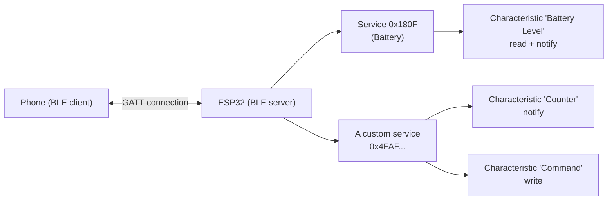
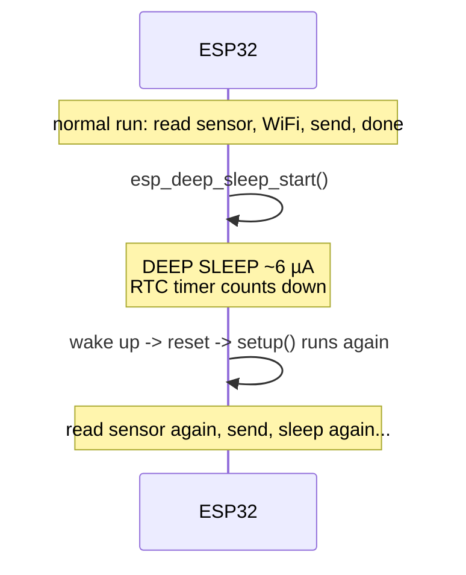

# ESP32 Advanced — Wi-Fi, HTTP Server, BLE, and Deep Sleep

> **Track:** ESP32 · **Difficulty:** Intermediate
> **What you'll get:** connecting an ESP32 to Wi-Fi properly (with timeouts), serving a web
> page from the chip and handling HTTP requests, Bluetooth Low Energy (BLE) as a
> server/peripheral, and putting the chip to sleep to save battery. Ends with a battery-friendly
> connected sensor project.
> **Prereq:** you should already blink an LED and read a button on an ESP32 — the
> [ESP32 C++ tutorial](../synthesized/esp32-cpp.md) or the [Arduino C tutorial](../synthesized/arduino-c.md)
> cover that baseline.

First you got an ESP32 to blink. Then maybe toggled a pin from a browser. Now it's time to
make it *real*: robust Wi-Fi that doesn't hang, an HTTP server you actually understand, BLE so
a phone can talk to it without any network at all, and **deep sleep** so it runs for months on
a battery. These four are the letters a professional IoT firmware engineer writes every day.


---

## 🎯 Prerequisites

- An **ESP32 devkit** (classic ESP32, or an ESP32-S3/C3/Azure Sphere dev board — the Wi-Fi,
  BLE, and sleep APIs below are shared).
- The **esp32 board package** in the Arduino IDE, or **ESP-IDF** if you prefer the native
  framework (the concepts map directly).
- A **2.4 GHz** Wi-Fi network (ESP32 classic Wi-Fi does **not** do 5 GHz).
- For the BLE parts: a phone with [nRF Connect](https://play.google.com/store/apps/details?id=no.nordicsemi.android.mcp)
  (Android) or [LightBlue](https://apps.apple.com/us/app/lightblue/id557428110) (iOS) — the
  defacto debugging tools.
- For deep sleep: a way to measure current (a multimeter in mA mode in series, or a USB power
  meter) if you want to *verify* the savings.

> ⚠️ **Voltage & pin warning from the sibling tutorial (it bears repeating):** ESP32 GPIO
> runs at **3.3 V**, not 5 V. And avoid the boot-strapping pins (GPIO 0, 2, 12 on many boards)
> for permanent I/O or your board may fail to boot. Check your exact board's pinout before
> committing signal pins.

---

## 📡 Part 1 — Wi-Fi that doesn't hang forever

The naive `WiFi.begin(); WiFi.mode(STA)` + "spin until connected" pattern **blocks forever**
if the router is down or the password is wrong — your board bricks until you power-cycle it.
Professional code connects **with a timeout** and reports failure gracefully.

```cpp
// wifi_connect.ino — robust Wi-Fi connect with a timeout + retry.
#include <WiFi.h>

const char* ssid     = "YourSSID";
const char* password = "YourPassword";

// Try to connect; return true if connected, false if we timed out.
bool connectWithTimeout(uint32_t timeout_ms, uint32_t attempt_ms = 3000) {
  WiFi.mode(WIFI_STA);                // station mode: join an existing network
  WiFi.begin(ssid, password);

  uint32_t start = millis();
  while (WiFi.status() != WL_CONNECTED) {
    if (millis() - start >= timeout_ms) {
      Serial.println("WiFi connect timed out.");
      return false;
    }
    delay(attempt_ms);                // give it a beat between status checks
    Serial.print(".");
  }
  Serial.println();
  Serial.print("Connected! IP: ");
  Serial.println(WiFi.localIP());
  return true;
}

void setup() {
  Serial.begin(115200);
  delay(500);
  // Try reconnecting for up to 15 seconds. If it fails, keep the device alive
  // and let the user reset — far better than a permanently hung boot.
  if (!connectWithTimeout(15000)) {
    Serial.println("Will keep running; press reset to try again.");
  }
}

void loop() {
  // If the link drops mid-run, re-establish it (issue a reconnect attempt).
  if (WiFi.status() != WL_CONNECTED) {
    Serial.println("Link lost — reconnecting...");
    connectWithTimeout(15000);
  }
  delay(2000);
}
```

**Three lessons in that small function:**
1. **Timeout everything.** `millis()` (not `delay` forever) bounds how long you'll block.
2. **Self-heal.** The `loop()` re-connect means a router reboot won't brick the device — it
   reconnects on its own. This is the habit that separates toy projects from deployed ones.
3. **`delay()` is okay here** inside setup; the ESP32 is single-tasking this connection step.
   Once you use an RTOS (see the [RTOS tutorial](../synthesized/rtos-on-mcu.md)) you'd replace
   it with `vTaskDelay()`.

> ⚠️ **Pitfall — 5 GHz network.** If the ESP32 never connects but your phone does, the router
> is almost certainly 5 GHz-only or the bands are split. ESP32 classic Wi-Fi is **2.4 GHz
> only** — configure a 2.4 GHz SSID (or combine bands).

---

## 🖥️ Part 2 — An HTTP server you control from a browser

The ESP32 can *serve web pages*, so your phone (on the same network) can control it with no
cloud, no account, nothing but a browser. Here's a server with three routes: the home page,
`/on` (LED on), and `/off` (LED off).

```cpp
// http_led.ino — serve a web page and control an LED from a browser.
#include <WiFi.h>
#include <WebServer.h>

// ... (reuse wifi_connect.ino's ssid/password + connectWithTimeout here) ...

WebServer server(80);                 // standard HTTP port
const int LED = 2;

void handleRoot() {
  // Send an HTML page with two links that hit /on and /off.
  String html = "<!DOCTYPE html><html><body>"
    "<h1>ESP32 LED</h1>"
    "<a href='/on'><button>Turn ON</button></a> "
    "<a href='/off'><button>Turn OFF</button></a>"
    "</body></html>";
  server.send(200, "text/html", html);
}

void handleOn() {
  digitalWrite(LED, HIGH);
  server.send(200, "text/plain", "LED is ON");
}

void handleOff() {
  digitalWrite(LED, LOW);
  server.send(200, "text/plain", "LED is OFF");
}

void setup() {
  Serial.begin(115200);
  pinMode(LED, OUTPUT);
  connectWithTimeout(15000);

  // Register each path with a handler function.
  server.on("/",     handleRoot);
  server.on("/on",   handleOn);
  server.on("/off",  handleOff);
  server.begin();
  Serial.println("HTTP server started.");
}

void loop() {
  server.handleClient();   // processes ONE incoming request per call
}
```

**Key idea — routing:** each URL path (`/`, `/on`, `/off`) is "routed" to a handler function.
A request to `http://<ip>/on` triggers `handleOn()`. This is exactly how web frameworks work
in general — you just learned the skeleton of every web server.

> ⚠️ **Pitfall — `server.send()` content-length / quoting.** If your HTML has a `"` character
> you must escape it in the C++ string, or the page arrives malformed. Copy the example's
> quoting style closely and test by actually viewing the page.

> ⚠️ **Pitfall — `loop()` must keep calling `handleClient()`.** If a blocking `delay()` (or a
> long sensor read) calls home while a request is in flight, the browser shows "waiting"
> until the loop returns. Keep the loop responsive, or the server appears dead.

---

## ⚡ Part 3 — Async updates & JSON: talking data, not just toggles

A web page that toggles an LED is a demo. Real devices **send data** — sensor readings, status
— in a machine-readable format. **JSON** is the universal choice. The ESP32 can produce and
parse JSON and the browser can fetch it with a little JavaScript.

```cpp
// http_json.ino — expose sensor data as JSON; the page fetches it live.
// Add:  #include <ArduinoJson.h>  (Library Manager)

// Mock a sensor reading you'd replace with analogRead() etc.
float readTemperature() { return millis() % 1000 / 10.0 + 21.0; }

void handleData() {
  StaticJsonDocument<256> doc;        // small fixed-size JSON document (fits in RAM)
  doc["temp_c"] = readTemperature();
  doc["uptime_s"] = millis() / 1000;
  doc["rssi"] = WiFi.RSSI();          // signal strength — fun to watch

  String out;
  serializeJson(doc, out);            // {"temp_c":27.4,"uptime_s":12,"rssi":-58}
  server.send(200, "application/json", out);
}

// In setup(), add:  server.on("/data", handleData);
```

The page can then poll `/data` with JavaScript every second and update `<div id="temp">`
without reloading. That's the full pattern behind live dashboards, weather widgets, and most
"smart home" panels.

> ⚠️ **Pitfall — document size.** `StaticJsonDocument<256>` reserves 256 bytes *once*,
> fixed at compile time — safe but wasteful if you rarely need that much, and a crash if you
> ever serialize *more* than 256 bytes. Use `DynamicJsonDocument` and an appropriate size, or
> size the static one to your worst case.

> ⚠️ **Pitfall — never build HTML/JSON with `String` concatenation in a hot loop.** Repeatedly
> doing `html += "..."` fragments the heap over time and can eventually crash the ESP32
> (low-free-heap resets). For a page served once per request it's tolerable; for data you send
> frequently, use `snprintf` into a fixed buffer or `serializeJson`.

---

## 📶 Part 4 — Bluetooth Low Energy (BLE): talk to a phone with no network

Wi-Fi needs a network. **BLE needs nothing** — a phone connects directly to the ESP32 over
Bluetooth. BLE is built around **GATT**: a server (our ESP32) exposes **services**, each with
**characteristics** that have properties (read, write, notify). Think of it as a structured
notebook the phone can read from and write into.



Here's a complete, minimal BLE server that advertises itself, exposes a
writeable "command" characteristic (control an LED), and notifies a counter every
second. It uses the **Bluedroid** stack bundled with the ESP32 Arduino core.

```cpp
// ble_server.ino — a BLE peripheral: an LED you control from a phone app.
#include <BLEDevice.h>
#include <BLEServer.h>
#include <BLEUtils.h>
#include <BLE2902.h>

BLEServer* pServer = NULL;
BLEService* pService = NULL;
BLECharacteristic* pCmdChar = NULL;
const int LED = 2;

// A unique (made-up) 128-bit UUIDs for our service and characteristic.
#define SERVICE_UUID "4fafc201-1fb5-459e-8fcc-c5c9c331914b"
#define CMD_UUID     "beb5483e-36e1-4688-b7f5-ea07361b26a8"

// Called when the phone WRITES to our characteristic.
class Callbacks : public BLECharacteristicCallbacks {
  void onWrite(BLECharacteristic* c) override {
    String value = c->getValue();          // read what the phone sent
    if (value == "1") { digitalWrite(LED, HIGH); Serial.println("LED ON"); }
    if (value == "0") { digitalWrite(LED, LOW);  Serial.println("LED OFF"); }
  }
};

void setup() {
  Serial.begin(115200);
  pinMode(LED, OUTPUT);

  BLEDevice::init("ESP32 Demo");           // the device name a phone will see
  pServer = BLEDevice::createServer();
  pService = pServer->createService(SERVICE_UUID);

  pCmdChar = pService->createCharacteristic(
      CMD_UUID,
      BLECharacteristic::PROPERTY_WRITE | BLECharacteristic::PROPERTY_NOTIFY);
  pCmdChar->setCallbacks(new Callbacks());
  pCmdChar->addDescriptor(new BLE2902());  // required so a phone can enable NOTIFY

  pService->start();
  // Advertise the service so the phone can find & connect:
  BLEAdvertising* pAdv = BLEDevice::getAdvertising();
  pAdv->addServiceUUID(SERVICE_UUID);
  pAdv->setScanResponse(true);
  BLEDevice::startAdvertising();
  Serial.println("BLE server advertising...");
}

void loop() {
  // Optional: notify a counter every second. Sleep otherwise.
  static uint32_t last = 0;
  if (millis() - last > 1000) {
    last = millis();
    String s = String(last);
    pCmdChar->setValue(s.c_str());         // becomes the value a phone NOTIFYs
    pCmdChar->notify();                    // push it to any connected phone
  }
}
```

**Test it:** open nRF Connect on your phone, scan for **ESP32 Demo**, connect, find the
`4faf…` service, and write `1` / `0` to the `beb5483e…` characteristic. (For NOTIFY, tap the
subscriber icon.) That's a phone controlling your hardware with **zero** network.

> ⚠️ **Pitfall — BLE needs `BLE2902` on a NOTIFY characteristic.** Without the characteristic
> descriptor, phones refuse to subscribe to notifications. Add `addDescriptor(new BLE2902())`
> to every characteristic that will *notify*.
>
> ⚠️ **Pitfall — MASSIVE data in one write.** BLE packets are small (~20 bytes per write with
> classic MTU). Chunk long strings. And remember only characters/bytes your app defines mean
> anything — there's no "HTTP layer"; you decide the protocol (here: "1" / "0").

---

## 🔋 Part 5 — Deep sleep: months on a battery

An ESP32 left running with Wi-Fi draws **~90–200 mA**. In **deep sleep** the CPU and most
peripherals are powered down; only the RTC stays on, drawing **~5–10 µA**. That's a ~20,000×
drop. The tradeoff: the *program restarts from scratch* when it wakes — RAM is lost, and you
must re-do setup (including Wi-Fi).



```cpp
// deep_sleep.ino — wake every 30 s, take a reading, send it, go back to sleep.
#include <WiFi.h>
extern "C" { void app_main(); }   // not needed on Arduino — included for clarity

// (wifi_connect.ino's connectWithTimeout goes here)

void sendReading(float temp) {
  if (connectWithTimeout(15000)) {
    Serial.print("Sending temp: "); Serial.println(temp);
    // ... POST to a server, or send over MQTT — for now we just print ...
  }
}

void setup() {
  Serial.begin(115200);
  delay(500);

  float temp = 21.0 + (millis() % 1000) / 100.0;   // mock reading
  Serial.print("Woke up, temp="); Serial.println(temp);

  sendReading(temp);

  // Tell the ESP32 to sleep for 30 seconds, then power everything off.
  // Waking triggers a full restart (setup runs again).
  esp_sleep_enable_timer_wakeup(30 * 1000000ULL);  // microseconds: 30,000,000
  Serial.println("Sleeping 30 s...");
  esp_deep_sleep_start();   // never returns
}

void loop() {
  // Unreachable in deep-sleep mode — setup() never lets us get here.
}
```

**The two things that trip everyone up:**
1. **Sleep time is in microseconds** — `30 * 1000000ULL` for 30 seconds. Forgetting the
   `ULL` (unsigned long long) can overflow on some chips and sleep far too long (or
   instantly).
2. **Wi-Fi must be re-init after every wake.** Because deep sleep wipes RAM, you *always* run
   your connect routine fresh in `setup()`. Think of wake as "power on" — nothing from before
   survives (except a tiny bit you opt to keep in RTC memory with
   `esp_sleep_get_wakeup_cause` and the RTC data segment).

You can also wake on a **GPIO** instead of a timer: `esp_sleep_enable_ext0_wakeup(GPIO_NUM_4,
HIGH)` wakes when that pin goes high — perfect for a physical trigger like a door sensor.

> ⚠️ **Pitfall — running Wi-Fi for the whole sleep.** The point of deep sleep is *powering
> down the radio*. Never keep Wi-Fi connected and *then* sleep "for battery." Connect, send,
> disconnect, sleep.
>
> ⚠️ **Pitfall — the onboard regulator & LED waste power.** Even "sleeping," a devkit with an
> always-on power LED and a linear regulator wastes more than a bare module would. For true
> ultra-low-power, use a battery-friendly ESP32 module and measure (don't guess) your actual
> sleep current with a multimeter in series.

---

## 🧰 Part 6 — The full project: battery-friendly connected sensor

Now let's combine everything: a temperature sensor that wakes every 60 seconds, connects to
Wi-Fi, publishes its reading as JSON over HTTP (or prints it), then deep-sleeps. This is the
exact architecture of thousands of battery-powered IoT sensors.

```cpp
// battery_sensor.ino — the full connect-read-send-sleep cycle.
#include <WiFi.h>
#include <WebServer.h>

const char* ssid = "YourSSID";
const char* password = "YourPassword";

bool connectWithTimeout(uint32_t ms) {
  WiFi.mode(WIFI_STA);
  WiFi.begin(ssid, password);
  uint32_t start = millis();
  while (WiFi.status() != WL_CONNECTED) {
    if (millis() - start >= ms) { Serial.println("WiFi timeout."); return false; }
    delay(1000); Serial.print(".");
  }
  Serial.print("\nIP: "); Serial.println(WiFi.localIP());
  return true;
}

void setup() {
  Serial.begin(115200);
  delay(500);

  // 1) read the sensor
  float tempC = 21.0 + (analogReadMilliVolts(34) / 100.0);  // e.g. a thermistor on ADC
  Serial.print("Temp: "); Serial.println(tempC);

  // 2) connect + send (print as a stand-in for an HTTP POST / MQTT publish)
  if (connectWithTimeout(20000)) {
    Serial.print("Publishing temp=");
    Serial.println(tempC);
    // In real life: HTTP POST to an endpoint, or MQTT publish here, then:
  }
  WiFi.disconnect(true);        // power down the radio

  // 3) deep sleep until the next wake
  esp_sleep_enable_timer_wakeup(60 * 1000000ULL);   // 60 s
  Serial.println("Deep sleep 60 s...");
  esp_deep_sleep_start();                            // never returns
}

void loop() { /* unreachable in deep sleep */ }
```

Conceptually, that's the whole recipe. To *really* publish over HTTP you'd add
`HTTPClient http; http.begin("http://your-endpoint/api/temp"); http.POST(json);` between the
connect and the sleep — the structure above is the frame everything hangs on.

```cpp
// What you should see in the Serial console, roughly:
//   Temp: 23.4
//   ..IP: 192.168.1.42
//   Publishing temp=23.40
//   Deep sleep 60 s...
//   (power dips to µA) ... 60 s later ...
//   Temp: 23.4
//   ..IP: 192.168.1.42
//   ...
```

---

## 📐 Why this matters

- **Robust connectivity** — timeout + self-heal Wi-Fi is the difference between a demo and a
  deployable device.
- **HTTP + JSON** — the universal language of the internet of things; you can talk to
  dashboards, cloud services, and phones.
- **BLE** — direct, zero-network peer communication with a phone; ideal for configuration and
  local control.
- **Deep sleep** — the single biggest battery lever on an ESP32, turning milliamps into
  microwatts.
- **Combining them** — a sensor that sleeps, wakes, talks, and sleeps again is a
  production-ready IoT architecture you can repurpose for almost any battery project.

## ▶️ Watch & learn

- [ESP32 Deep Sleep Mode Tutorial — Save Battery Life](https://www.youtube.com/watch?v=OUwTBQAQ1go) — the practical deep-sleep walkthrough including measuring the savings.
- [How to Configure the ESP32 for Light and Deep Sleep Modes](https://www.youtube.com/watch?v=kgtsSNjnzSI) — multiple wake sources (timer + GPIO) in one project, with NTP/Wi-Fi in between sleeps.
- [BLE with ESP32 tutorial part 1: the Server](https://www.youtube.com/watch?v=0Yvd_k0hbVs) — build exactly the BLE server from Part 4 and test it with nRF Connect.
- [ESP32 BLE Beacon Tutorial — Build with ESP-IDF & VS Code](https://www.youtube.com/watch?v=PasaGWMPkK8) — go deeper into BLE advertising and NimBLE.
- <https://www.youtube-nocookie.com/embed/OUwTBQAQ1go> — follow along to see deep sleep measured live on a benchtop meter.
- <https://www.youtube-nocookie.com/embed/kgtsSNjnzSI> — light & deep sleep with multiple wake sources, plus NTP between sleeps.
- <https://www.youtube-nocookie.com/embed/0Yvd_k0hbVs> — build the BLE server from Part 4 and test it with nRF Connect.
- <https://www.youtube-nocookie.com/embed/PasaGWMPkK8> — go deeper into BLE advertising with a beacon.

## ✅ Next steps

- Add **MQTT** instead of raw HTTP — the standard IoT publish/subscribe protocol
  (the `PubSubClient` library over the same Wi-Fi).
- Move BLE/Wi-Fi logic into **FreeRTOS tasks** so a slow network call can't block your UI —
  see [RTOS on a microcontroller](../synthesized/rtos-on-mcu.md).
- Use **OTA (over-the-air) updates** to flash the device over Wi-Fi, not USB.
- Investigate **ESP-NOW** for power-efficient direct peer-to-peer between ESP32s.

> **New to a term?** Look it up in the [Glossary](../GLOSSARY/README.md).

---

*Explore the software side more in [MicroPython on the ESP32](../synthesized/micropython.md), or the full [ESP32 path](../paths/esp32/index.md).*

---

## 🧪 Exercises & Projects

> **Estimated total time:** ~3–4 hours. You'll need an ESP32 devkit, USB cable, Arduino IDE
> with the **esp32** package, a 2.4 GHz Wi-Fi network, a phone running nRF Connect/LightBlue,
> and (for the deep-sleep lab) a multimeter or USB power meter. One external LED + 220 Ω helps.

### 📝 Exercises

**🟢 Easy — connectivity vocabulary.** Reinforce Parts 1–2.

- [ ] Why does the naive "`WiFi.begin` then spin until connected" block forever, and what
      does `connectWithTimeout` add? *(It bounds the wait with `millis()` and reports
      failure instead of hanging.)*
- [ ] What does "routing" mean in the HTTP server example? *(Mapping URL paths to handler
      functions — `/on` → `handleOn`, etc.)*
- [ ] True or false: ESP32 classic Wi-Fi connects to 5 GHz networks. *(False — 2.4 GHz only.)*

**🟡 Medium — server & BLE.** Apply Parts 3–4.

- [ ] Why must `loop()` keep calling `server.handleClient()` frequently?
      *(Each call processes one request; a blocking delay makes the browser wait.)*
- [ ] What's the purpose of the `BLE2902` descriptor on a NOTIFY characteristic?
      *(Required for a phone to enable notifications — without it, notify silently
      doesn't work.)*
- [ ] A phone writes a 100-byte string to a BLE characteristic. What's the risk and the fix?
      *(Writes are chunked/~20 bytes; send in small pieces or define a proper protocol.)*

**🔴 Hard — the power & robustness traps.**

- [ ] Your deep-sleep code wakes after 30 s as designed, but on a random board it sleeps
      for 20 minutes. What's the most likely cause and the fix?
      *(Timer value in µs with overflow/missing `ULL` — use `30 * 1000000ULL`.)*
- [ ] After waking from deep sleep, Wi-Fi won't connect though it worked before sleep. Why,
      and what must every `setup()` do? *(Deep sleep wipes RAM; re-run the connect routine
      fresh on every wake.)*
- [ ] Your BLE server advertises but phones can't enable notifications. Name the missing
      piece. *(The `BLE2902` characteristic descriptor.)*

### 🛠️ Mini-Project: Battery-friendly phone-controlled sensor

**Goal:** bring Wi-Fi, an HTTP/JSON endpoint, BLE, and deep sleep together into one device
that a phone can both *read from* and *configure* — then prove it really sips power.

**Time:** ~75–105 minutes. **Components:** ESP32 devkit, LED + 220 Ω, optional thermistor on
an ADC pin, multimeter/USB power meter.

**Build steps:**

1. **Wi-Fi door:** start from `wifi_connect.ino`. Add your SSID/password, flash it, and
   verify the IP prints and the board self-heals when you reboot the router.
2. **HTTP + JSON:** add the `/data` JSON endpoint (Part 3). From a browser on the same
   network, open `http://<ip>/data` and see temp/uptime/RSSI as JSON. Check each box:

- [ ] `http://<ip>/` serves the control page.
- [ ] `http://<ip>/data` returns clean JSON.
- [ ] The `loop()` stays responsive while `/data` is being served.

3. **BLE control:** add the BLE server (Part 4) *alongside* Wi-Fi. Use nRF Connect on your
   phone, connect to **ESP32 Demo**, and write `1`/`0` to toggle the LED. Check each box:

- [ ] Phone scans and finds **ESP32 Demo**.
- [ ] Writing `1` lights the LED, writing `0` turns it off.
- [ ] A counter characteristic notifies (subscribed in the app).

4. **Deep sleep:** replace the `loop()` with the sleep/wake cycle (Part 6): wake, take a
   reading, connect, send, sleep. Measure with a multimeter in the **mA** range in series
   with the USB power: check each box:

- [ ] Running current ≈ tens of mA with Wi-Fi active.
- [ ] Sleep current ≈ single-digit µA (measure for a few seconds).
- [ ] The device wakes, sends, and re-sleeps on its own (watch the Serial console).

**Extend it (pick at least one):**
- [ ] Add a **momentary button** on a wake GPIO (`esp_sleep_enable_ext0_wakeup`) so pressing
      it wakes the sensor on demand in addition to the timer.
- [ ] Report **battery level** in the JSON by reading a voltage-divided battery on an ADC pin.
- [ ] Publish to a real **MQTT** broker (`PubSubClient`) instead of just printing, so your
      reading lands on a dashboard.

**The lesson:** you just built a real IoT sensor node — sleeps for months, wakes on a timer or
trigger, publishes data, and can be controlled locally over BLE. That's the architecture of
commercial battery sensors, and it transfers almost unchanged to a weather station, a mailbox
notifier, or a soil-moisture monitor.

> **Tips:** measure current in the **mA** mode and allow the meter to settle — deep-sleep
> current is tiny and readings jump around. Avoid a devkit's always-on power LED if you care
> about the last few µA. And when a Wifi-era "bug" happens, ask whether it's actually
> *sleep-related* (RAM wiped) versus a genuine logic error — it usually is the former.
