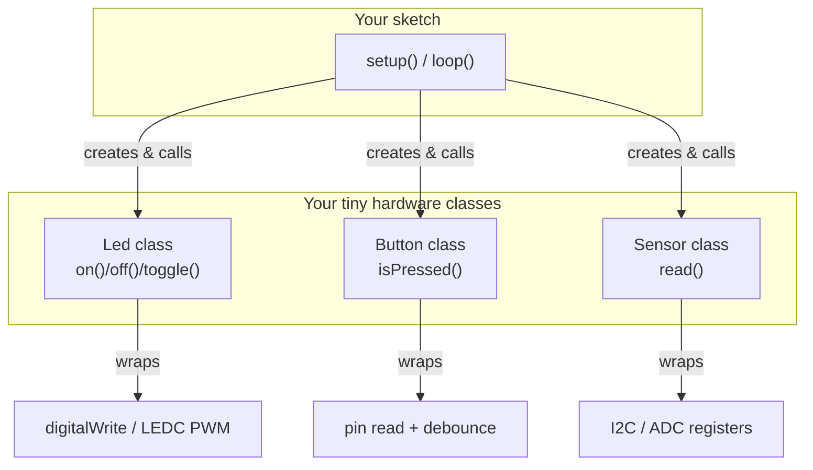
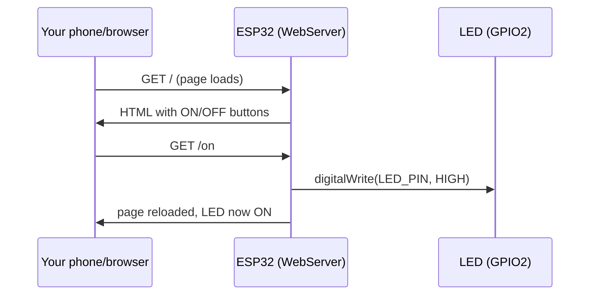

# ESP32 in C/C++ — Classes for Sensors, Pins, and Wi-Fi

> **Track:** ESP32 (Xtensa/RISC-V) · **Difficulty:** Intermediate
> **What you'll get:** C++ classes that wrap sensors and pins the way pros do, plus a real
> Wi-Fi + HTTP server example that turns the ESP32 into a tiny web dashboard.

The ESP32 is a dual-core SoC with built-in Wi-Fi and Bluetooth. The Arduino-style C++ layer
lets you write it almost like an Arduino, but if you only write `Blink.ino` you'll miss the
language feature that makes large projects manageable: **classes**. This tutorial shows how
C++ objects become clean, reusable ways to talk to hardware — then we use that to build a
Wi-Fi web server you can control from your phone.

---

## 🎯 Prerequisites

- An **ESP32 DevKit** (esp32-devkitc-v1 or similar).
- One **LED** and a **220 Ω resistor**, one **push button**.
- [Arduino IDE](https://www.arduino.cc/en/software) with the **esp32 board package**
  installed (Tools → Board → Boards Manager → search "esp32" → install).
- Or [ESP-IDF](https://docs.espressif.com/projects/esp-idf/en/latest/esp32/) if you prefer the native framework.

## 🧱 Part 1 — Why classes fit hardware so naturally

A pin *is* an object: it has state (input/output, HIGH/LOW) and behavior (read, write).
A sensor *is* an object: it has registers and a way to read a value. Classes mirror that.
Compare this C-style snippet to the C++ version that follows.

```cpp
// The naive way — globals, no structure, easy to break.
int ledPin = 13;
int sensorVal = 0;

void setup() {
  pinMode(ledPin, OUTPUT);
}
void loop() {
  digitalWrite(ledPin, HIGH);
}
```

Once a project grows past a few pins, flat code turns into a tangle. Encapsulating hardware
behind a small class keeps the *what* (the API) separate from the *how* (the register or pin
tricks) — so callers stay simple and you can swap hardware without rewriting everything.



## 💡 Part 2 — A `Led` and `Button` class

Here's a self-contained, reusable `Led` class — click-in-and-go:

```cpp
// led_class.ino — a small reusable class that owns one output pin.

class Led {
  int _pin;
public:
  Led(int pin) : _pin(pin) {}   // constructor stores which pin this Led owns
  void begin() { pinMode(_pin, OUTPUT); }
  void on()    { digitalWrite(_pin, HIGH); }
  void off()   { digitalWrite(_pin, LOW); }
  void toggle(){ digitalWrite(_pin, !digitalRead(_pin)); }
};

// One global instance per physical LED (the ESP32 has ~25 usable pins).
Led builtin(2);          // GPIO2 is the classic on-board blue LED on many devkits

void setup() {
  builtin.begin();
}

void loop() {
  builtin.toggle();      // nice and readable — the pin detail is hidden
  delay(500);
}
```

And a debounced `Button` class, because real buttons bounce:

```cpp
// button_class.ino — a Button class with software debounce built in.

class Button {
  int _pin;
  unsigned long _last;
  bool _state;
public:
  Button(int pin) : _pin(pin), _state(HIGH) {}
  void begin() { pinMode(_pin, INPUT_PULLUP); }  // internal pull-up, no resistor needed
  bool isPressed() {
    bool raw = digitalRead(_pin);
    if (raw != _state) {                          // state changed -> possible bounce
      _last = millis();                           // remember when
      _state = raw;                               // latch the new value
    }
    return (millis() - _last < 25) ? false : (raw == LOW);  // ignore a 25 ms bounce window
  }
};
```

## 🌐 Part 3 — The full project: a Wi-Fi HTTP server you control from your phone

Now let's combine classes with the ESP32's party trick: Wi-Fi. This sketch runs a tiny web
server; visiting `http://<your-esp32-ip>/on` or `/off` flips the LED. This is a simplified
version of the "control your ESP32 from anywhere" pattern.

```cpp
// wifi_led_server.ino — turn an LED on/off from a browser over Wi-Fi.
// Replace the two credential lines with your own network.

#include <WiFi.h>
#include <WebServer.h>

const char* ssid     = "YOUR_WIFI_NAME";      // <-- change me
const char* password = "YOUR_WIFI_PASS";      // <-- change me

const int LED_PIN = 2;                        // on-board LED on many ESP32 devkits

WebServer server(80);                         // listen on the default HTTP port

// A tiny HTML page served to any browser that connects. Note the two links
// that hit /on and /off — those are what flip the LED via HTTP GET.
const char* PAGE = R"rawliteral(
  <!DOCTYPE html>
  <html><body style="font-family:sans-serif;text-align:center;margin-top:5rem">
    <h1>ESP32 LED Control</h1>
    <a href="/on"><button style="font-size:2rem">Turn ON</button></a>
    <a href="/off"><button style="font-size:2rem">Turn OFF</button></a>
  </body></html>
)rawliteral";

void setup() {
  Serial.begin(115200);
  pinMode(LED_PIN, OUTPUT);
  digitalWrite(LED_PIN, LOW);

  Serial.print("Connecting to Wi-Fi");
  WiFi.begin(ssid, password);
  while (WiFi.status() != WL_CONNECTED) {     // block until we're online
    delay(500);
    Serial.print(".");
  }
  Serial.println("\nWi-Fi connected!");
  Serial.print("Open this URL in your browser: http://");
  Serial.println(WiFi.localIP());             // e.g. 192.168.1.42

  server.on("/", []() { server.send(200, "text/html", PAGE); });
  server.on("/on",  []() { digitalWrite(LED_PIN, HIGH); server.send(200, "text/html", PAGE); });
  server.on("/off", []() { digitalWrite(LED_PIN, LOW ); server.send(200, "text/html", PAGE); });

  server.begin();                             // start listening for requests
}

void loop() {
  server.handleClient();                      // answer any incoming HTTP request
}
```

**How it works:**



**Wiring:** none needed if you use the on-board LED. To use an external LED, connect it via a
220 Ω resistor from GPIO2 to GND exactly like the Arduino example — the ESP32 is 3.3 V logic,
so keep the resistor in place.

## 🔎 Reading the serial output

Upload, open the **Serial Monitor at 115200 baud**, and you'll see:

```
Connecting to Wi-Fi......
Wi-Fi connected!
Open this URL in your browser: http://192.168.1.42
```

Point a browser at that IP and the buttons work. That's end-to-end: C++, a class-free simple
server, and network I/O — all on one $5 chip.

## 📐 Why this matters

- **Classes** keep hardware-specific details in one place; your `loop()` stays readable.
- **Wi-Fi + HTTP** is the modern "hello world" of IoT — blink, but blink from a browser.
- **3.3 V logic** — remember the ESP32 is not 5 V tolerant on inputs; that detail breaks countless first projects.

## ▶️ Watch & learn

- [A beginner's guide to ESP32 — hardware & coding basics + Wi-Fi server demo](https://www.youtube.com/watch?v=UuxBfKA3U5M)
- [How to Setup and Program the ESP32 — complete guide](https://www.youtube.com/watch?v=xPlN_Tk3VLQ)
- [ESP32 HTTPS Secure Web Server & WiFi GPIO remote control](https://www.youtube.com/watch?v=4bS5ktABELE)

## ✅ Next steps

- Read the button over Wi-Fi: send the button state in the `/` page so it shows "pressed".
- Add a sensor (DHT22 temperature) and display it on the web page.
- Learn the native **ESP-IDF** framework — the layer below Arduino that the ESP32 ecosystem is really built on.

> **New to a term?** Look it up in the [Glossary](../GLOSSARY/README.md).
