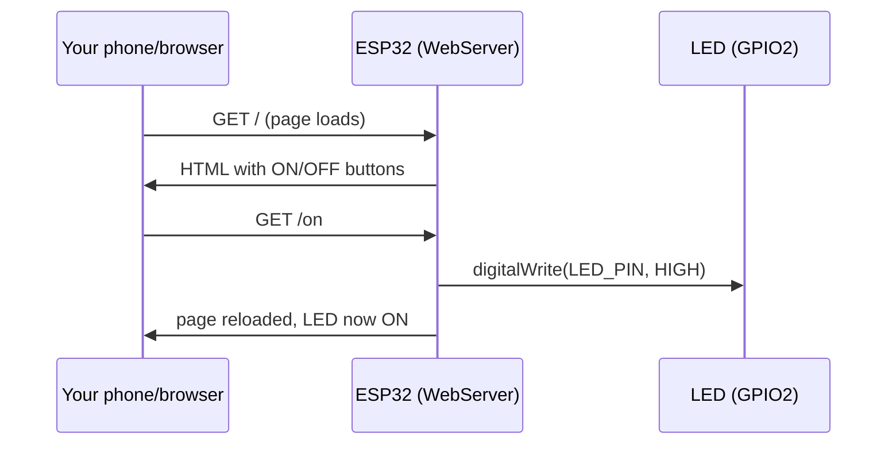

# ESP32 in C/C++ — Classes for Sensors, Pins, and Wi-Fi

> **Track:** ESP32 (Xtensa/RISC-V) · **Difficulty:** Intermediate
> **What you'll get:** C++ classes that wrap sensors and pins the way pros do, references & move
> semantics, timers/PWM/ADC in C++, and a real Wi-Fi + HTTP server example that turns the ESP32
> into a tiny web dashboard you can control from your phone.
> **Prereq:** the [Arduino path](../paths/arduino/index.md) or equivalent — you should already blink and read a button.

The ESP32 is a dual-core SoC with built-in Wi-Fi and Bluetooth. The Arduino-style C++ layer
lets you write it almost like an Arduino, but if you only write `Blink.ino` you'll miss the
language feature that makes large projects manageable: **classes**. This tutorial shows how
C++ objects become clean, reusable ways to talk to hardware — then we use that to build a
Wi-Fi web server you can control from your phone.

This page is structured as a mini-course: the C++ you need (Part 1–2), wrapping real hardware
in classes (Part 3–4), peripherals (Part 5), and the connected project (Part 6). Feel free to
jump to the section you need; each stands alone.


---

## 🎯 Prerequisites

- An **ESP32 DevKit** (esp32-devkitc-v1 or similar).
- One **LED** and a **220 Ω resistor**, one **push button**.
- [Arduino IDE](https://www.arduino.cc/en/software) with the **esp32 board package**
  installed (Tools → Board → Boards Manager → search "esp32" → install).
- Or [ESP-IDF](https://docs.espressif.com/projects/esp-idf/en/latest/esp32/) if you prefer the native framework.
- The [ESP32 pinout diagram](https://raw.githubusercontent.com/espressif/arduino-esp32/master/docs/esp32_pinmap.png)
  for your exact board — you'll need it to avoid the boot/strapping pins.

> ⚠️ **Voltage warning — read before wiring anything:** ESP32 GPIO pins run at **3.3 V**, not
> 5 V. Sending 5 V into a GPIO pin can permanently damage the chip. Convert signals if you ever
> mix 5 V boards (like an Arduino Uno) with an ESP32. Double-check your LED's series resistor too —
> at 3.3 V logic the same 220 Ω you used at 5 V is still fine, but don't copy a 5 V hookup blindly.

> ⚠️ **Avoid the boot-strapping pins.** On many ESP32 devkits, GPIO 0, 2, and 12 affect boot mode
> or flash voltage at reset. If your project "works then randomly hangs on power-up," a pin used
> for both I/O and boot is a top suspect. Check the pinout before committing a pin.

## 🧱 Part 1 — Why classes fit hardware so naturally

A pin *is* an object: it has state (input/output, HIGH/LOW) and behavior (read, write).
A sensor *is* an object: it has registers and a way to read a value. Classes mirror that.
Compare this C-style snippet to the C++ version that follows.

```cpp
// The naive way — globals, no structure, easy to break.
int ledPin = 13;
int sensorVal = 0;

void setup() {
  pinMode(ledPin, OUTPUT);
}
void loop() {
  digitalWrite(ledPin, HIGH);
}
```

Once a project grows past a few pins, flat code turns into a tangle. Encapsulating hardware
behind a small class keeps the *what* (the API) separate from the *how* (the register or pin
tricks) — so callers stay simple and you can swap hardware without rewriting everything.

```mermaid
flowchart TB
    subgraph App["Your sketch"]
        A["setup() / loop()"]
    end
    subgraph Lib["Your tiny hardware classes"]
        B["Led class<br/>on()/off()/toggle()"]
        C["Button class<br/>isPressed()"]
        D["Sensor class<br/>read()"]
    end
    A -->|\"creates & calls\"| B
    A -->|\"creates & calls\"| C
    A -->|\"creates & calls\"| D
    B -->|\"wraps\"| P["digitalWrite / LEDC PWM"]
    C -->|\"wraps\"| Q["pin read + debounce"]
    D -->|\"wraps\"| R["I2C / ADC registers"]
```

**The three C++ keywords that make classes work (and that you'll use today):**

- `class` — declares a new type that bundles data (members) and functions (methods).
- `public:` / `private:` — controls what callers can touch. Keep internals `private` so nobody
  accidentally breaks your pin state.
- `Led(int pin) : _pin(pin) {}` — the **constructor** with an *initializer list*, which sets up
  the object the moment it's created. One physical LED = one object.

## 🔗 Part 2 — References & memory: passing objects without copying

C++ gives you **references** (`Type&`), which are like pointers you can't mess up. On a
memory-tiny MCU, passing a big object by *copy* wastes RAM; passing by **reference** hands the
callee the same object. This is the difference between:

```cpp
void changeByCopy(int x) { x = 99; }        // caller's value unchanged
void changeByRef(int &x) { x = 99; }        // caller's value CHANGED

void setup() {
  int v = 1;
  changeByCopy(v);   // v is still 1
  changeByRef(v);    // v is now 99
  Serial.println(v); // prints 99
}
```

For objects, prefer **const references** when you only read:

```cpp
// Pass the sensor by const reference: read it without copying or modifying it.
void printTemp(const Sensor &s) {
  Serial.println(s.readCelsius());
}
```

> 💡 **Pitfall — references must be initialized at creation and can't be re-seated.** Unlike a
> pointer, you can't make a reference point somewhere else later. In an embedded context, decide
> which pin an object owns at construction and keep it fixed — that's exactly the stability you
> want when wiring hardware.

**Dynamic memory — avoid `new` in the loop.** Getting a fresh object with `new` pulls from the
heap, and the ESP32's heap *fragments* over time. Prefer **stack** objects (created in a function —
they live on the stack and are freed automatically) or a single `new` in `setup()`. Repeated
allocate/free in `loop()` is a slow leak waiting to happen.

## 💡 Part 3 — A `Led` and `Button` class

Here's a self-contained, reusable `Led` class — click-in-and-go:

```cpp
// led_class.ino — a small reusable class that owns one output pin.

class Led {
  int _pin;
public:
  Led(int pin) : _pin(pin) {}   // constructor stores which pin this Led owns
  void begin() { pinMode(_pin, OUTPUT); }
  void on()    { digitalWrite(_pin, HIGH); }
  void off()   { digitalWrite(_pin, LOW); }
  void toggle(){ digitalWrite(_pin, !digitalRead(_pin)); }
};

// One global instance per physical LED (the ESP32 has ~25 usable pins).
Led builtin(2);          // GPIO2 is the classic on-board blue LED on many devkits

void setup() {
  builtin.begin();
}

void loop() {
  builtin.toggle();      // nice and readable — the pin detail is hidden
  delay(500);
}
```

And a debounced `Button` class, because real buttons bounce:

```cpp
// button_class.ino — a Button class with software debounce built in.

class Button {
  int _pin;
  unsigned long _last;   // last time the state changed (for debounce)
  bool _state;           // last latched raw reading
public:
  Button(int pin) : _pin(pin), _last(0), _state(HIGH) {}
  void begin() { pinMode(_pin, INPUT_PULLUP); }  // internal pull-up, no resistor needed
  bool isPressed() {
    bool raw = digitalRead(_pin);
    if (raw != _state) {                          // state changed -> possible bounce
      _last = millis();                           // remember when
      _state = raw;                               // latch the new value
    }
    return (millis() - _last < 25) ? false : (raw == LOW);  // ignore a 25 ms bounce window
  }
};
```

**Why debounce lives *inside* the class:** the `Button` now carries its own timing state (`_last`,
`_state`) as member variables. Every button you make from this class debounces itself — you never
have to remember the timing trick again. That's encapsulation paying off: the complexity is hidden
behind `isPressed()`.

## 🎛️ Part 4 — Timers, PWM, and ADC on the ESP32

The ESP32 has richer peripherals than a Uno: **LEDC** (a hardware PWM controller with multiple
channels), **hardware timers**, and a 12-bit **ADC**. Here's PWM dimming with the Arduino-style
API, which the ESP32 core maps onto LEDC for you:

```cpp
// pwm_fade.ino — fade an LED on GPIO4 using analogWrite (maps to LEDC PWM).
const int LED = 4;

void setup() {
  pinMode(LED, OUTPUT);
  // On ESP32, analogWrite resolution is configurable; this gives us 0..255 like a Uno.
  analogWriteResolution(8);
}

void loop() {
  for (int b = 0; b <= 255; b++) { analogWrite(LED, b); delay(6); }
  for (int b = 255; b >= 0; b--) { analogWrite(LED, b); delay(6); }
}
```

**Reading analog on the ESP32 is a common gotcha** — the ADC's defaults are different from a
Uno's. You often need to set attenuation explicitly to get a full 0–3.3 V range:

```cpp
// adc_esp32.ino — read a pot on GPIO34 with proper attenuation.
void setup() {
  Serial.begin(115200);
  analogReadResolution(12);        // 0..4095
  analogSetPinAttenuation(34, ADC_11db);  // allow full 0-3.3V range on this pin
}

void loop() {
  int raw = analogRead(34);        // 0..4095
  float volts = raw / 4095.0 * 3.3;
  Serial.printf("raw=%4d  %.2f V\n", raw, volts);
  delay(200);
}
```

> ⚠️ **Pitfall — ESP32 ADC is not linear near the rails, and reads can be noisy.** Don't trust
> absolute voltage precision from the raw ADC without calibration. For measurements that must be
> accurate, sample multiple times and average, or use an external ADC — but for "is it roughly
> half bright" sensing, the built-in is plenty.

**Hardware timers** go beyond `millis()` and can fire an interrupt at precise intervals. The
ESP32 Arduino core wraps these nicely:

```cpp
// timer.ino — a hardware timer fires an ISR every 1 second, toggling an LED
// without any delay() in the main loop.
#include <Ticker.h>

Ticker ticker;
volatile bool heartbeat = false;

void flash() {
  heartbeat = !heartbeat;   // runs in a timer ISR — keep it short!
  digitalWrite(2, heartbeat);
}

void setup() {
  pinMode(2, OUTPUT);
  ticker.attach(1.0, flash);    // call flash() every 1.0 s
}

void loop() {
  // The main loop is FREE — do Wi-Fi, reading, whatever.
  delay(1000);
}
```

## 🌐 Part 5 — The full project: a Wi-Fi HTTP server you control from your phone

Now let's combine classes with the ESP32's party trick: Wi-Fi. This sketch runs a tiny web
server; visiting `http://<your-esp32-ip>/on` or `/off` flips the LED. This is a simplified
version of the "control your ESP32 from anywhere" pattern.

```cpp
// wifi_led_server.ino — turn an LED on/off from a browser over Wi-Fi.
// Replace the two credential lines with your own network.

#include <WiFi.h>
#include <WebServer.h>

const char* ssid     = "YOUR_WIFI_NAME";      // <-- change me
const char* password = "YOUR_WIFI_PASS";      // <-- change me

const int LED_PIN = 2;                        // on-board LED on many ESP32 devkits

WebServer server(80);                         // listen on the default HTTP port

// A tiny HTML page served to any browser that connects. Note the two links
// that hit /on and /off — those are what flip the LED via HTTP GET.
const char* PAGE = R"rawliteral(
  <!DOCTYPE html>
  <html><body style="font-family:sans-serif;text-align:center;margin-top:5rem">
    <h1>ESP32 LED Control</h1>
    <a href="/on"><button style="font-size:2rem">Turn ON</button></a>
    <a href="/off"><button style="font-size:2rem">Turn OFF</button></a>
  </body></html>
)rawliteral";

void setup() {
  Serial.begin(115200);
  pinMode(LED_PIN, OUTPUT);
  digitalWrite(LED_PIN, LOW);

  Serial.print("Connecting to Wi-Fi");
  WiFi.begin(ssid, password);
  while (WiFi.status() != WL_CONNECTED) {     // block until we're online
    delay(500);
    Serial.print(".");
  }
  Serial.println("\nWi-Fi connected!");
  Serial.print("Open this URL in your browser: http://");
  Serial.println(WiFi.localIP());             // e.g. 192.168.1.42

  server.on("/", []() { server.send(200, "text/html", PAGE); });
  server.on("/on",  []() { digitalWrite(LED_PIN, HIGH); server.send(200, "text/html", PAGE); });
  server.on("/off", []() { digitalWrite(LED_PIN, LOW ); server.send(200, "text/html", PAGE); });

  server.begin();                             // start listening for requests
}

void loop() {
  server.handleClient();                      // answer any incoming HTTP request
}
```

**How it works:**



**Wiring:** none needed if you use the on-board LED. To use an external LED, connect it via a
220 Ω resistor from GPIO2 to GND exactly like the Arduino example — the ESP32 is 3.3 V logic,
so keep the resistor in place.

## 🔎 Part 6 — Reading the serial output & making it robust

Upload, open the **Serial Monitor at 115200 baud**, and you'll see:

```
Connecting to Wi-Fi......
Wi-Fi connected!
Open this URL in your browser: http://192.168.1.42
```

Point a browser at that IP and the buttons work. That's end-to-end: C++, a class-free simple
server, and network I/O — all on one $5 chip.

**Making the Wi-Fi connect robust** — the blocking `while` loop above hangs forever if the
router is unreachable. A production sketch should time out and retry:

```cpp
#include <WiFi.h>

bool connectWithTimeout(const char* ssid, const char* pass, unsigned long timeout_ms) {
  WiFi.begin(ssid, pass);
  unsigned long start = millis();
  while (WiFi.status() != WL_CONNECTED) {
    if (millis() - start > timeout_ms) return false;  // give up & report failure
    delay(250);
  }
  return true;
}

void setup() {
  Serial.begin(115200);
  if (!connectWithTimeout("YOUR_WIFI_NAME", "YOUR_WIFI_PASS", 15000)) {
    Serial.println("Wi-Fi FAILED — check credentials/range");
    // fall back to offline mode or restart
  } else {
    Serial.print("IP: "); Serial.println(WiFi.localIP());
  }
}
void loop() {}
```

> 💡 **Pitfall — Wi-Fi connect must not block forever.** Same rule as MicroPython: always give
> network operations a timeout and a graceful failure path, or a dead router turns your device
> into a brick that hangs on boot. The `connectWithTimeout` pattern above is the fix.

## 📐 Why this matters

- **Classes** keep hardware-specific details in one place; your `loop()` stays readable.
- **References & scoping** let you pass objects without copying them, saving scarce RAM.
- **Timers/PWM/ADC** are the same peripherals you met in [Arduino C](../synthesized/arduino-c.md), but richer on the ESP32 (12-bit ADC, hardware PWM channels).
- **Wi-Fi + HTTP** is the modern "hello world" of IoT — blink, but blink from a browser.
- **3.3 V logic** — remember the ESP32 is not 5 V tolerant on inputs; that detail breaks countless first projects.

## ▶️ Watch & learn

- [A beginner's guide to ESP32 — hardware & coding basics + Wi-Fi server demo](https://www.youtube.com/watch?v=UuxBfKA3U5M)
- [How to Setup and Program the ESP32 — complete guide](https://www.youtube.com/watch?v=xPlN_Tk3VLQ)
- [ESP32 HTTPS Secure Web Server & WiFi GPIO remote control](https://www.youtube.com/watch?v=4bS5ktABELE)
- <https://www.youtube-nocookie.com/embed/Zy64kZEM_bg> — see the same "prototype fast" workflow from the MicroPython side of the same chip.

## ✅ Next steps

- Read the button over Wi-Fi: send the button state in the `/` page so it shows "pressed".
- Add a sensor (DHT22 temperature) and display it on the web page.
- Learn the native **ESP-IDF** framework — the layer below Arduino that the ESP32 ecosystem is really built on.
- See the memory-safe alternative in [Rust on embedded](../synthesized/embedded-rust.md).

> **New to a term?** Look it up in the [Glossary](../GLOSSARY/README.md).

---

*Intermediate? Go deeper with [MicroPython on the ESP32](../synthesized/micropython.md) or the [full ESP32 path](../paths/esp32/index.md).*

---

## 🧪 Exercises & Projects

> **Estimated total time:** ~2–3 hours. You'll need an ESP32 devkit, its USB cable, the
> Arduino IDE with the **esp32** board package installed, and (for the lab) one LED, a
> 220 Ω resistor, maybe a push button, and a Wi-Fi network you can join.

### 📝 Exercises

**🟢 Easy — classes & objects.** Reinforce Part 1's vocabulary.

- [ ] Name the three C++ keywords that make a class, and say what each does.
      *(`class` declares it; `public:`/`private:` control access; the constructor with an
      initializer list sets it up.)*
- [ ] In `Led builtin(2);`, what is `2` and what method does the object call to set up
      the pin? *(The pin number; `begin()` → `pinMode`.)*
- [ ] True or false: `digitalWrite(_pin, !digitalRead(_pin))` in `toggle()` flips the pin
      state. *(True.)*

**🟡 Medium — references & memory.** Apply Part 2.

- [ ] `void f(int x)` vs `void f(int &x)` — which one *changes the caller's* variable,
      and why?
- [ ] On an ESP32, why should you **avoid `new` inside `loop()`**? *(Heap fragments over
      time → slow leak / allocation failure.)*
- [ ] When you pass a `Sensor` object you only *read*, why use `const Sensor &s` instead
      of passing by value? *(No copy ≈ saves RAM; `const` says you won't modify it.)*

**🔴 Hard — ESP32-specific gotchas.** These are the real-world traps from the page.

- [ ] A project "works then randomly hangs at power-up." Name the single most likely
      cause and the habit that prevents it. *(A boot-strapping pin (0/2/12) used for I/O;
      check the pinout before committing a pin.)*
- [ ] Something is sending 5 V into a GPIO pin. What's the risk and the fix?
      *(The ESP32 is 3.3 V, not 5 V tolerant — potentially permanent damage; convert with
      a voltage divider.)*
- [ ] The Wi-Fi connect code blocks forever when the router is down. Write the fix and
      the one helper pattern that solves it. *(A timeout + graceful fallback, e.g. the
      `connectWithTimeout` function.)*

### 🛠️ Mini-Project: Wi-Fi LED control (control it from your phone)

**Goal:** build the tutorial's `wifi_led_server` project end-to-end, then extend it —
you'll control a real LED from a phone browser over your Wi-Fi network.

**Time:** ~60–90 minutes. **Components:** ESP32 devkit, one external LED + a 220 Ω
resistor (or rely on the onboard LED), a Wi-Fi network, and a phone/computer on the same
network.

**Build steps:**

1. **Prepare:** install the **esp32** board package, select *ESP32 Dev Module*, and plug
   in the board. Run the `blink`-style test to confirm uploads work before networking.
2. **External LED (optional):** wire it from a free GPIO (say GPIO2 or GPIO4) through
   220 Ω to GND — long leg toward the pin. Note: **check your board's pinout first** to
   avoid boot-strapping pins.
3. **Upload `wifi_led_server`** from Part 5, replacing the two credential lines with your
   network. Open Serial Monitor at **115200 baud** and watch for the IP address.
4. **Control it:** on a phone/PC on the same network, open `http://<your-esp32-ip>` in a
   browser. Click **Turn ON / Turn OFF** and watch the LED respond. Check each box:

- [ ] The page loads and shows the two buttons.
- [ ] `/on` lights the LED and `/off` turns it off.
- [ ] The Serial Monitor shows the board connected with a valid IP.

**Extend it (pick at least one):**

- [ ] Add a **third route** `/blink` that makes the LED blink 5 times fast, then returns
      to off. *(Reuse the `for`-loop blink idea from the Arduino tutorial; call
      `digitalWrite` in a loop inside a lambda handler.)*
- [ ] Make the page **report button state**: add a `/state` route that returns the
      current LED level, and fetch it from the page with inline JS.
- [ ] Replace the on/off with **PWM brightness** — `/dim?level=128` sets `analogWrite`
      (remember `analogWriteResolution(8)`).

**The lesson:** you've now crossed the biggest threshold in the tutorial — a class-wrapped
C++ object plus the ESP32's Wi-Fi peripheral, talking to a browser. This is the exact
pattern behind every "control your device from anywhere" IoT project; from here, adding a
sensor page or publishing data is the same skeleton with different handlers.

> **Tips:** if the page loads but buttons "do nothing," verify the LED is on a pin that
> survives reboot and that `/on` vs `/off` route strings match exactly. If Wi-Fi never
> connects, check the SSID/password and that the router runs 2.4 GHz (ESP32 classic Wi-Fi
> doesn't do 5 GHz). And always put the `connectWithTimeout` pattern in place before you
> trust the device unattended — a router reboot shouldn't brick your board.
