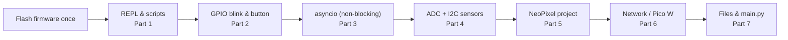
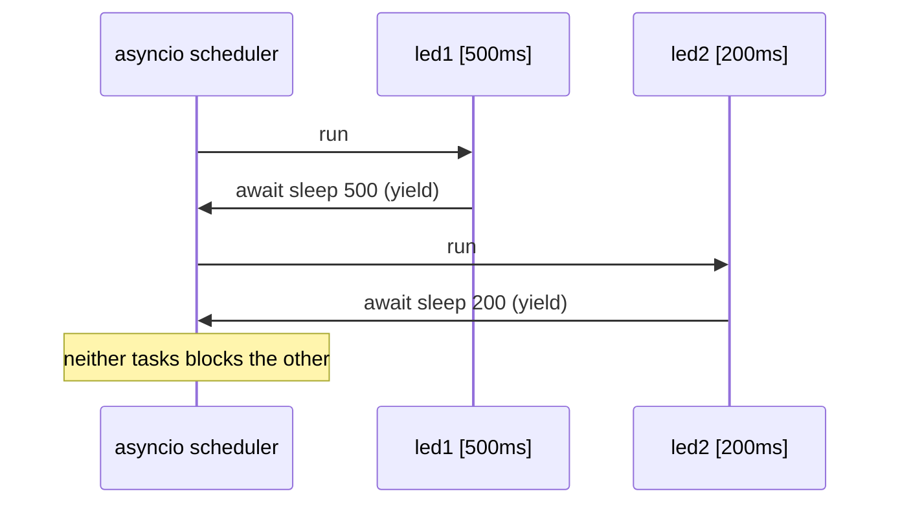
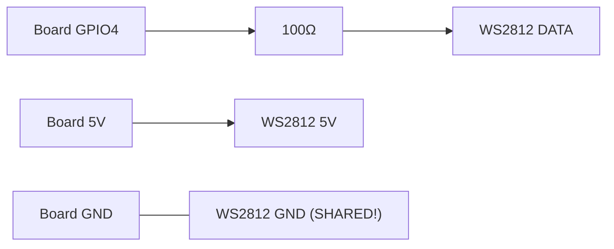

# MicroPython — Fast Prototyping with a REPL

> **Track:** Microcontrollers (general) · **Difficulty:** Beginner
> **What you'll get:** the MicroPython REPL, hardware access from plain Python, non-blocking
> `asyncio`, analog & I²C sensors, a working WS2812 / NeoPixel project, and networking on the
> Pico W — the fastest way to "make something glow" and then make it talk to the internet.

MicroPython is a lean reimplementation of Python 3 that runs *directly on* microcontrollers —
no OS, no cloud, no compile step. You plug in a board, hit the **REPL**, and type
`led.value(1)` and an LED lights up *immediately*. It is the fastest feedback loop in
embedded electronics, which makes it perfect for prototyping, learning, and art projects.

The trade-off to know up front: Python is **slower and larger** than C or Rust. On an ESP32 or
Pico with hundreds of KB of RAM that's usually irrelevant for a hobby project. But it's exactly
why the pros prototype in MicroPython and *port the winner* to C/Rust for production. That
"prototype fast, polish in C" workflow is the single most practical lesson in this tutorial.



---

## 🎯 Prerequisites

- A board that runs MicroPython: **Raspberry Pi Pico / Pico W**, **ESP32**, or **ESP8266**.
- The [Thonny](https://thonny.org/) editor (it bundles a MicroPython installer and REPL) or `mpremote`.
- A **WS2812B / NeoPixel** LED strip or ring (30 LEDs is plenty to start), plus a **100 Ω or 220 Ω resistor** and a decent **5 V power source** if your strip is long.
- Optional for the analog/I²C parts: a **potentiometer** and a **BME280 or DHT22** sensor.

> ⚠️ **First-time flash:** different boards need different firmware images. Download the right
> `.uf2` (Pico) or `.bin` (ESP) for your exact board from the [official MicroPython downloads](https://micropython.org/download/).
> For a Pico, hold the BOOTSEL button while plugging into USB and drag the `.uf2` onto the drive
> that appears. For an ESP32, use `esptool` or the Thonny installer — do *not* drag-and-drop a `.bin`.
> This is the number-one first-timer stall point.

## 🚀 Part 1 — The REPL: your board is a Python shell

Unlike C's compile-upload-count loop, MicroPython drops you into an interactive prompt. Flash
the firmware once, connect a serial terminal (Thonny does this), and you're in:

```
MicroPython v1.20.0 on 2023-04-26; Raspberry Pi Pico with RP2040
Type "help()" for more information.
>>> import machine
>>> led = machine.Pin(25, machine.Pin.OUT)   # GPIO25 is the Pico's on-board LED
>>> led.value(1)                              # turn it on
>>> led.value(0)                              # turn it off
```

No `main()` needed — each line executes the instant you press Enter. That immediacy is the
whole point of the language track.

```mermaid
flowchart LR
    A["Open Thonny<br/>connect board"] --> B["Firmware already flashed"]
    B --> C["REPL prompt >>>"]
    C -->|\"type a line\"| D["executes instantly"]
    D -->|\"see the LED / print\"| C
    C -->|\"done? save as main.py\"| E["runs on every boot"]
```

**Your first battery of useful REPL commands:**

```python
>>> import sys, machine, gc
>>> sys.implementation          # which MicroPython version / platform
>>> machine.freq()              # CPU clock in Hz
>>> gc.mem_free()               # how much RAM is left
>>> print(dir(machine))         # list everything in the machine module
```

> 💡 **Helpful habit:** when you don't know what a module offers, type `dir(module)`. MicroPython
> modules are small, so the list is usually short and readable. When unsure what an object can do,
> `help(object)` often prints its methods.

## 💡 Part 2 — Blink, then read a button

**Blink** — save this as `main.py` (Thonny: View → Files, right-click → New, then save as
`main.py`). It runs automatically on power-up:

```python
# main.py — the classic blink, three lines of logic.
from machine import Pin
from time import sleep

led = Pin(25, Pin.OUT)          # Pico's onboard LED on GPIO25 (ESP32: use Pin(2))

while True:
    led.toggle()                # flip the pin HIGH<->LOW
    sleep(0.5)                  # half a second pause
```

**Button** — with MicroPython's `machine`, even a debounced button is short:

```python
# button.py — read a button on GPIO14 with an internal pull-up.
from machine import Pin
from time import sleep_ms

btn = Pin(14, Pin.IN, Pin.PULL_UP)   # input + enable the internal pull-up
led = Pin(25, Pin.OUT)

while True:
    # pull-up means the pin reads LOW (False) when pressed.
    if not btn.value():
        led.value(1)
    else:
        led.value(0)
    sleep_ms(20)                # tiny debounce pause
```

> ⚠️ **Pitfall — pull directions are board-specific.** Just because the Pico's pull-up buttons
> read `LOW` when pressed, the same wiring on another board may be reversed. Always check whether
> YOUR board's pins have internal pull-ups and which way "pressed" reads before you spend an hour
> wondering why your button logic is inverted.

## ⏱️ Part 3 — `asyncio`: doing several things at once without `sleep` blocking

`time.sleep()` blocks *everything* for the duration, exactly like Arduino's `delay()`. The moment
you want to blink an LED *and* read a button *and* poll a sensor smoothly, blocking sleeps make it
janky. MicroPython ships a stripped-down **`asyncio`**, letting you run several cooperative tasks
in one "virtual" loop:

```python
# async_demo.py — blink an LED and blink a second LED at a different rate,
# both at the same time, without one blocking the other.
import asyncio
from machine import Pin

led1 = Pin(25, Pin.OUT)   # Pico onboard LED
led2 = Pin(14, Pin.OUT)   # add an external LED on GPIO14 via a resistor

async def blinker(pin, period_ms, name):
    while True:
        pin.toggle()
        print(name, "toggled")
        await asyncio.sleep_ms(period_ms)   # yield control; don't block

async def main():
    # Run both blinkers "simultaneously" (cooperatively interleaved)
    t1 = asyncio.create_task(blinker(led1, 500, "led1"))
    t2 = asyncio.create_task(blinker(led2, 200, "led2"))
    await asyncio.gather(t1, t2)            # run until both finish (never here)

asyncio.run(main())
```

**How it works:** `await asyncio.sleep_ms(...)` hands control back to the scheduler instead of
blocking the whole CPU. Each `blinker` is a *task*; the scheduler time-slices between them so
both LEDs blink at their own rates. This is MicroPython's answer to Arduino's "can't do two
things at once" problem — and it maps directly onto the RTOS concept from the
[MCU path](../paths/mcu/index.md).



> 💡 **Pitfall — cooperative, not parallel.** `asyncio` only switches tasks at `await` points. If
> one task runs a long, CPU-bound loop *without* an `await`, it will hog the CPU and the others
> starve. Keep each task's between-`await` work short.

## 🌡️ Part 4 — Analog (ADC) & I²C sensors: reading the real world

**ADC** — read a potentiometer's voltage as a number. On the Pico `ADC(26)` reads the first of
its three ADC pins; on an ESP32 use `ADC(Pin(36))`-style with `atten`.

```python
# adc.py — read a pot on ADC26 and convert the count to a 0-3.3V voltage.
from machine import ADC, Pin
from time import sleep

adc = ADC(Pin(26))                 # Pico's ADC pin 0 is on GPIO26
while True:
    raw = adc.read_u16()           # 0..65535 (16-bit on Pico)
    volts = raw / 65535 * 3.3      # scale to the board's reference voltage
    pct = raw / 65535 * 100
    print(f"{raw:5d} counts  {volts:.2f} V  {pct:5.1f}%")
    sleep(0.2)
```

**I²C sensors** — a single two-wire bus (SCL + SDA) can host many sensors. The classic first
example is a BME280 (temperature, humidity, pressure):

```python
# i2c_bme280.py — read a BME280 on the Pico's default I2C0 (GPIO 16=sda, 17=scl).
from machine import Pin, I2C
from time import sleep

i2c = I2C(0, sda=Pin(16), scl=Pin(17), freq=400_000)  # 400 kHz
print("I2C devices:", [hex(d) for d in i2c.scan()])    # should show 0x76 / 0x77

import bme280                 # a common third-party driver; install via pip/thonny
while True:
    data = bme280.BME280(i2c=i2c).read_compensated_data()
    print(f"{data[0]/100:.2f} C  {data[2]/25600:.1f}% RH")
    sleep(2)
```

> ⚠️ **Pitfall — watch the pin numbers.** MicroPython drivers print a **pin number**, not a
> friendly name. `Pin(16)` means GPIO16, and on a Pico that's physically pin 21 on the header.
> Double-check against the board's pinout diagram before wiring, or you'll get nothing on the bus
> and assume the sensor is dead (it's usually just the wrong pin).

## 🌈 Part 5 — The project: a WS2812 / NeoPixel color loop

WS2812 "NeoPixel" LEDs are individually addressable — one data wire, and each LED in the
chain can be its own color. MicroPython has a built-in `neopixel` module, so this is
surprisingly easy.

```python
# neopixel_rainbow.py — sweep a rainbow across a strip of WS2812 LEDs.
from machine import Pin
import neopixel
import time

N = 30                          # how many LEDs are in your strip
PIN = 4                         # data pin on the Pico (ESP32: try GPIO4 too)

strip = neopixel.NeoPixel(Pin(PIN, Pin.OUT), N)  # one object owns the whole strip

def wheel(pos):
    """Map a 0..255 position to an RGB color (the classic 'color wheel')."""
    if pos < 85:
        return (pos * 3, 255 - pos * 3, 0)          # red -> green
    if pos < 170:
        pos -= 85
        return (255 - pos * 3, 0, pos * 3)          # green -> blue
    pos -= 170
    return (0, pos * 3, 255 - pos * 3)              # blue -> red

while True:
    for start in range(N):                          # shift the rainbow along
        for i in range(N):
            strip[i] = wheel((start + i) * 255 // N)  # color depends on position
        strip.write()                               # push all colors to the strip
        time.sleep_ms(20)
```

**Wiring the WS2812 strip** (critical — get this wrong and nothing lights):

| WS2812 wire | Connect to |
|-------------|------------|
| Data (green) | 100 Ω resistor → GPIO4 |
| 5 V (red)   | 5 V (USB VBus on Pico is fine for ~30 LEDs) |
| GND (white/yellow) | GND — **shared** with the board |

**Two gotchas to save you an hour:**
1. **Shared ground is mandatory.** The strip and the board must share GND or the data signal
   has no reference and the LEDs will blink garbage (or nothing).
2. **A series resistor on the data line** kills ringing/overshoot that corrupts the signal on
   longer wires. Add the 100–220 Ω in series close to the board.



**Pitfall — power, not just data.** A 30-LED strip at full white can draw ~1.8 A. The USB port on
a computer often can't supply that. For longer strips, power the strip from its own 5 V supply and
**share the ground** with the board — data comes from the GPIO, power comes from the supply. This is
why the series resistor and shared GND matter so much.

## 🌐 Part 6 — Networking on the Pico W (or ESP32)

The Pico **W** adds Wi-Fi (the plain Pico has none). The API is standard MicroPython `network`,
identical on an ESP32. Here's a minimal web server that reports the board's temperature:

```python
# webserver.py — a tiny WebREPL-free HTTP server on a Pico W.
import network, socket
import machine

ssid     = "YOUR_WIFI_NAME"     # <-- change me
password = "YOUR_WIFI_PASS"     # <-- change me

wlan = network.WLAN(network.STA_IF)
wlan.active(True)
wlan.connect(ssid, password)

# Wait (with a timeout) for the connection to come up
import time
for _ in range(30):
    if wlan.isconnected():
        break
    time.sleep(1)
print("connected:", wlan.ifconfig())

addr = socket.getaddrinfo("0.0.0.0", 80)[0][-1]
s = socket.socket()
s.bind(addr)
s.listen(1)
print("listening on http://%s" % wlan.ifconfig()[0])

while True:
    cl, addr = s.accept()
    cl.recv(1024)                          # read the (ignored) HTTP request
    cl.send(b"HTTP/1.0 200 OK\r\nContent-Type: text/html\r\n\r\n")
    cl.send(b"<html><h1>Hello from MicroPython!</h1><p>CPU temp: ")
    cl.send(str(machine.freq() // 1_000_000).encode())  # prints MHz, just a demo value
    cl.send(b" MHz</p></html>")
    cl.close()
```

> ⚠️ **Pitfall — don't block forever on connect.** If you never check `isconnected()`, a failed
> network join hangs the whole board. Always poll with a timeout, and handle the "no network"
> case (fall back to doing something offline) so the device stays usable.

**Prototype-on-the-web workflow:** now that a board can open a socket, the path to "phone
controls the LED" is the same pattern you saw in the [ESP32 in C++](../synthesized/esp32-cpp.md)
tutorial — but written in 10 lines instead of 50.

## 💾 Part 7 — Files, `main.py`, and deploying your project

Unlike Arduino (which compiles everything into one image), MicroPython uses a tiny **filesystem**
on the board. Your project is just files in the device root.

- **`main.py`** — runs automatically on every boot/power-up. This is your entry point.
- **`boot.py`** — runs *before* `main.py`; good for quick hardware setup (rarely needed).
- Helper `.py` files are just importable modules, exactly like on a PC:
  `import my_sensor` picks up `my_sensor.py` from the device root.

**A clean project layout idea:**

```
/  (device root)
├── main.py            # entry point: imports and starts your app
├── driver.py          # your reusable module (sensor class, LED effects)
└── secrets.py         # Wi-Fi credentials (import & use, don't hardcode everywhere)
```

**Secrets hygiene:** put Wi-Fi passwords in a `secrets.py` you import, and never commit it. When
you move to [Rust](../synthesized/embedded-rust.md) or C, the same "one config module" habit pays
off — but be aware that unlike you maybe assume, on the bare filesystem *anything* you store is
readable, so don't put real secrets on a board you hand to someone.

**To run a script now (not on boot):** in Thonny, just open it and press the **Run** button — it
executes immediately regardless of `main.py`. Save it as `main.py` only once you're happy, so it
survives a reboot.

## 🧩 Part 7½ — Making your own reusable module (a class)

Once a project grows, you'll want to wrap a piece of hardware in a small **class** and reuse it —
exactly the same instinct as the [ESP32 C++ classes](../synthesized/esp32-cpp.md), but in Python.
Here's a self-contained, reusable LED that knows how to blink at its own rate; save it as
`led.py` and `import` it from anywhere.

```python
# led.py — a tiny reusable "Blinker" class you can import from your projects.
from machine import Pin

class Blinker:
    """Owns one GPIO output pin and blinks it on a schedule."""
    def __init__(self, pin_num, period_ms=500):
        self.pin = Pin(pin_num, Pin.OUT)
        self.period_ms = period_ms

    def on(self):
        self.pin.value(1)

    def off(self):
        self.pin.value(0)

    def toggle(self):
        self.pin.toggle()

    def blink_times(self, n, wait_ms=None):
        """Blink `n` times (blocking). Good for a boot 'hello' pattern."""
        w = wait_ms or self.period_ms
        for _ in range(n):
            self.toggle()
            time.sleep_ms(w)

# To use it from main.py:
#   from led import Blinker
#   status = Blinker(25, period_ms=250)
#   status.blink_times(3)      # 3 blinks on the onboard LED
```

Python classes are lightweight here — no header files, no separate declaration, just
`self.` everywhere. This is a great place to start if you've never written a class: the
`__init__` is the constructor that runs when you build a `Blinker(...)`, and each method
(`on`, `off`, `toggle`) is just a named chunk of behavior attached to the object.

> 💡 **Pitfall — remember `import time` inside a module that uses it.** Python modules don't
> auto-share imports, so if `led.py` calls `time.sleep_ms`, it must `import time` itself. A
> missing import inside a helper module shows up as a confusing `NameError` at *runtime*, not
> at flash time — the single most common bug when splitting code across files.

## 📐 Why this matters

- **REPL-first development** — you test ideas in seconds, not minutes.
- **`machine` + device modules** (`machine`, `neopixel`, `esp`, `onewire`) are the standard portable API across Pico/ESP32/ESP8266.
- **`asyncio` gives concurrency** without threads or a full RTOS — the same scheduling idea scales up to the [RTOS world](../synthesized/embedded-rust.md).
- **Perfect for prototyping** — build the logic in Python, then port the winner to C/Rust for production.
- **WS2812 is the gateway drug** to IoT art, clocks, and desktop builds — all without touching a compiler.

## ▶️ Watch & learn

- [Raspberry Pi Pico — Control the (I/O) World](https://www.youtube.com/watch?v=Zy64kZEM_bg) — the Pico's I/O from MicroPython.
- [Raspberry Pi Pico Full Guide — Beginner to Pro](https://www.youtube.com/watch?v=4S0_BulQp20) — a thorough all-in-one walkthrough.
- [NeoPixel LED Ring with ESP32 using MicroPython](https://www.youtube.com/watch?v=p5dFbF2WVNM) — see the color loop live on real hardware.
- <https://www.youtube-nocookie.com/embed/gEwMEvUPAco> — the same "first flash" workflow the Arduino path uses, for comparing workflows.

## ✅ Next steps

- Move the rainbow into a `main.py` so it runs on boot, then add a button to change the effect.
- Read an analog sensor with `machine.ADC` and drive the brightness of a pixel.
- Try the Pico **W**'s Wi-Fi: `import network` and post sensor data to a web service.
- When your prototype works and you want it faster/smaller, port it to [Rust on embedded](../synthesized/embedded-rust.md) or revisit the [C fundamentals](../synthesized/arduino-c.md).

> **New to a term?** Look it up in the [Glossary](../GLOSSARY/README.md).

---

*Choose your next step: [Microcontrollers path](../paths/mcu/index.md) or back to the [ESP32 path](../paths/esp32/index.md).*

---

## 🧪 Exercises & Projects

> **Estimated total time:** ~2–3 hours. You'll need a MicroPython board (Pico, Pico W, or
> ESP32) and the Thonny editor (or `mpremote`). For the project you'll also want a
> **WS2812B / NeoPixel** strip or ring of ~30 LEDs, a 100 Ω resistor, and a 5 V supply.

### 📝 Exercises

**🟢 Easy — REPL fluency.** Do all of these *live in the REPL* — the fastest way to learn
the tool.

- [ ] At the `>>>` prompt, run `import sys` then `sys.implementation` and note the
      MicroPython version. What board/version do you have?
- [ ] Run `print(dir(machine))` and name two modules/functions you recognize from the
      tutorial.
- [ ] Turn the onboard LED on and off by typing two lines (no file, just the REPL):
      `led = machine.Pin(25, machine.Pin.OUT)` then `led.value(1)` / `led.value(0)`.
      *(ESP32: use `Pin(2)`.)*

**🟡 Medium — write the code.** Read these and predict before running.

- [ ] `while True: led.toggle(); sleep(0.5)` — roughly how many blinks per second?
      *(One full on-off cycle per second → ~1 blink/sec.)*
- [ ] In `button.py`, the pull-up button reads `LOW` when pressed. Rewrite the one `if`
      condition so the LED is on when the button is *released* instead.
- [ ] Rewrite the two-LED `async_demo` so the first blinks at 200 ms and the second at
      500 ms. Which `await asyncio.sleep_ms` value goes in which task?

**🔴 Hard — the gotchas.** These hit the page's traps.

- [ ] `Pin(16)` on a Pico — does that mean the 16th pin on the header? *(No — it's GPIO16,
      which is physically a different header pin; always check the pinout.)*
- [ ] Your WS2812 strip shows garbage or nothing. Name *two* likely causes from the
      wiring section. *(Shared ground missing; no series resistor on data → ringing.)*
- [ ] A 30-LED strip at full white draws ~1.8 A. Why shouldn't you power that from your
      computer's USB, and what's the wiring fix? *(USB can't reliably supply it; power the
      strip from its own 5 V supply and share ground with the board.)*

### 🛠️ Mini-Project: REPL + NeoPixel — make the strip dance

**Goal:** combine the REPL's instant feedback with the `neopixel` module to drive a
WS2812 strip — first interactively, then from a saved script. This is the tutorial's
"gateway drug" project turned into a graded lab.

**Time:** ~60 minutes. **Components:** MicroPython board, a NeoPixel strip/ring (~30
LEDs), a 100 Ω resistor (data line), jumper wires, 5 V for the strip.

**Build steps:**

1. **Wire the strip** exactly as in Part 5: data → 100 Ω → GPIO4; strip 5 V → 5 V; strip
   GND → GND **shared** with the board. Connect only the *board's* USB until verification.
2. **REPL first.** Flash a known strip length and light a single pixel — instantly:

   ```python
   from machine import Pin
   import neopixel
   strip = neopixel.NeoPixel(Pin(4, Pin.OUT), 30)   # 30 = your LED count
   strip[0] = (255, 0, 0)    # red
   strip.write()             # push to the strip
   ```

   Check each box:

- [ ] One LED lights red. *(First LED may be the strip's second physical pixel on some
      strips — that's normal.)*
- [ ] `strip[5] = (0, 255, 0)` lights pixel 5 green, then `.write()`.
- [ ] Setting `strip[0] = (0, 0, 0)` turns it off.

3. **Save it.** Turn your REPL experiment into `main.py` using the `wheel()` rainbow from
   Part 5, so it runs on boot. Confirm it survives a power cycle (unplug/replug).
4. **Extend it (pick at least one):**

- [ ] Add a **button** that cycles between red / green / blue when pressed (reuse the
      pull-up button pattern).
- [ ] Use `machine.ADC` to map a potentiometer to the rainbow position — turn the pot and
      the hue shifts.
- [ ] Caps the brightness so the strip never exceeds ~33% (multiply RGB by 0.33) — a
      handy habit that keeps your USB happy.

**The lesson:** you've done REPL-first development *and* a full `main.py` deploy — the
two halves of MicroPython's workflow — driving real, individually-addressable LEDs. That's
the entire skill set you need for IoT art, clocks, and desktop builds, and the same
`import machine` API carries straight into the Pico W networking step.

> **Tips:** shared GND is non-negotiable — no shared ground, no data. If only the first
> pixel works oddly or colors bleed, suspect the data-line resistor/value. Never type Wi-Fi
> credentials in a prompt entered through a shell-history tool; keep passwords in a
> `secrets.py` you import — and remember anything you store on the board is readable, so
> don't put real secrets on hardware you hand to someone.
