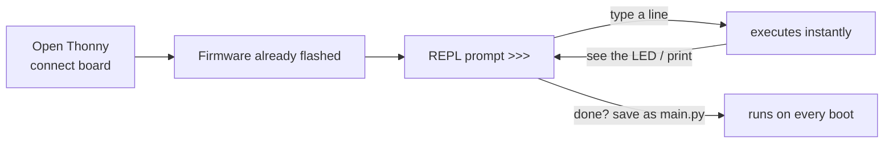

# MicroPython — Fast Prototyping with a REPL

> **Track:** Microcontrollers (general) · **Difficulty:** Beginner
> **What you'll get:** the MicroPython REPL, hardware access from plain Python, and a
> working WS2812 / NeoPixel LED project that's the fastest way to "make something glow".

MicroPython is a lean reimplementation of Python 3 that runs *directly on* microcontrollers —
no OS, no cloud, no compile step. You plug in a board, hit the **REPL**, and type
`led.value(1)` and an LED lights up *immediately*. It is the fastest feedback loop in
embedded electronics, which makes it perfect for prototyping, learning, and art projects.

---

## 🎯 Prerequisites

- A board that runs MicroPython: **Raspberry Pi Pico / Pico W**, **ESP32**, or **ESP8266**.
- The [Thonny](https://thonny.org/) editor (it bundles a MicroPython installer and REPL) or `mpremote`.
- A **WS2812B / NeoPixel** LED strip or ring (30 LEDs is plenty to start), plus a **100 Ω or 220 Ω resistor** and a decent **5 V power source** if your strip is long.

## 🚀 Part 1 — The REPL: your board is a Python shell

Unlike C's compile-upload-count loop, MicroPython drops you into an interactive prompt. Flash
the firmware once, connect a serial terminal (Thonny does this), and you're in:

```
MicroPython v1.20.0 on 2023-04-26; Raspberry Pi Pico with RP2040
Type "help()" for more information.
>>> import machine
>>> led = machine.Pin(25, machine.Pin.OUT)   # GPIO25 is the Pico's on-board LED
>>> led.value(1)                              # turn it on
>>> led.value(0)                              # turn it off
```

No `main()` needed — each line executes the instant you press Enter. That immediacy is the
whole point of the language track.



## 💡 Part 2 — Blink, then read a button

**Blink** — save this as `main.py` (Thonny: View → Files, right-click → New, then save as
`main.py`). It runs automatically on power-up:

```python
# main.py — the classic blink, three lines of logic.
from machine import Pin
from time import sleep

led = Pin(25, Pin.OUT)          # Pico's onboard LED on GPIO25 (ESP32: use Pin(2))

while True:
    led.toggle()                # flip the pin HIGH<->LOW
    sleep(0.5)                  # half a second pause
```

**Button** — with MicroPython's `machine`, even a debounced button is short:

```python
# button.py — read a button on GPIO14 with an internal pull-up.
from machine import Pin
from time import sleep_ms

btn = Pin(14, Pin.IN, Pin.PULL_UP)   # input + enable the internal pull-up
led = Pin(25, Pin.OUT)

while True:
    # pull-up means the pin reads LOW (False) when pressed.
    if not btn.value():
        led.value(1)
    else:
        led.value(0)
    sleep_ms(20)                # tiny debounce pause
```

## 🌈 Part 3 — The project: a WS2812 / NeoPixel color loop

WS2812 "NeoPixel" LEDs are individually addressable — one data wire, and each LED in the
chain can be its own color. MicroPython has a built-in `neopixel` module, so this is
surprisingly easy.

```python
# neopixel_rainbow.py — sweep a rainbow across a strip of WS2812 LEDs.
from machine import Pin
import neopixel
import time

N = 30                          # how many LEDs are in your strip
PIN = 4                         # data pin on the Pico (ESP32: try GPIO4 too)

strip = neopixel.NeoPixel(Pin(PIN, Pin.OUT), N)  # one object owns the whole strip

def wheel(pos):
    """Map a 0..255 position to an RGB color (the classic 'color wheel')."""
    if pos < 85:
        return (pos * 3, 255 - pos * 3, 0)          # red -> green
    if pos < 170:
        pos -= 85
        return (255 - pos * 3, 0, pos * 3)          # green -> blue
    pos -= 170
    return (0, pos * 3, 255 - pos * 3)              # blue -> red

while True:
    for start in range(N):                          # shift the rainbow along
        for i in range(N):
            strip[i] = wheel((start + i) * 255 // N)  # color depends on position
        strip.write()                               # push all colors to the strip
        time.sleep_ms(20)
```

**Wiring the WS2812 strip** (critical — get this wrong and nothing lights):

| WS2812 wire | Connect to |
|-------------|------------|
| Data (green) | 100 Ω resistor → GPIO4 |
| 5 V (red)   | 5 V (USB VBus on Pico is fine for ~30 LEDs) |
| GND (white/yellow) | GND — **shared** with the board |

**Two gotchas to save you an hour:**
1. **Shared ground is mandatory.** The strip and the board must share GND or the data signal
   has no reference and the LEDs will blink garbage (or nothing).
2. **A series resistor on the data line** kills ringing/overshoot that corrupts the signal on
   longer wires. Add the 100–220 Ω in series close to the board.

## 📐 Why this matters

- **REPL-first development** — you test ideas in seconds, not minutes.
- **`machine` + device modules** (`machine`, `neopixel`, `esp`, `onewire`) are the standard portable API across Pico/ESP32/ESP8266.
- **Perfect for prototyping** — build the logic in Python, then port the winner to C/Rust for production.
- **WS2812 is the gateway drug** to IoT art, clocks, and desktop builds — all without touching a compiler.

## ▶️ Watch & learn

- [Raspberry Pi Pico — Control the (I/O) World](https://www.youtube.com/watch?v=Zy64kZEM_bg) — the Pico's I/O from MicroPython.
- [Raspberry Pi Pico Full Guide — Beginner to Pro](https://www.youtube.com/watch?v=4S0_BulQp20) — a thorough all-in-one walkthrough.
- [NeoPixel LED Ring with ESP32 using MicroPython](https://www.youtube.com/watch?v=p5dFbF2WVNM) — see the color loop live on real hardware.

## ✅ Next steps

- Move the rainbow into a `main.py` so it runs on boot, then add a button to change the effect.
- Read an analog sensor with `machine.ADC` and drive the brightness of a pixel.
- Try the Pico **W**'s Wi-Fi: `import network` and post sensor data to a web service.

> **New to a term?** Look it up in the [Glossary](../GLOSSARY/README.md).
