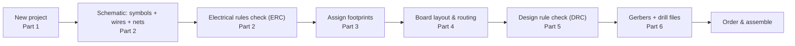
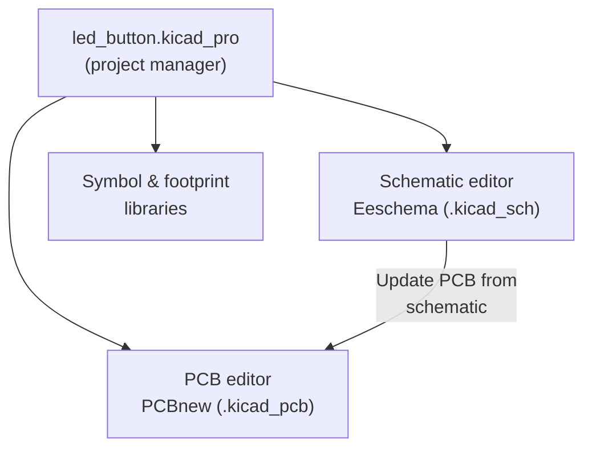
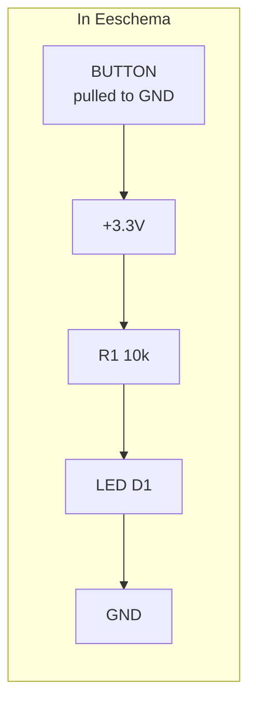
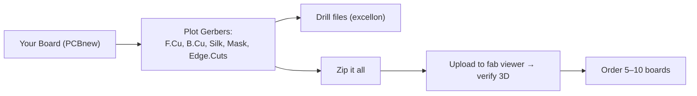

# PCB Design in KiCad — From Schematic to Ordered Boards

> **Track:** Circuits & PCB · **Difficulty:** Beginner → Intermediate
> **What you'll get:** the complete KiCad workflow — project setup, schematic capture,
> assigning footprints, board layout & routing, design rule checks, and exporting Gerbers
> you can send to a fab house. You'll finish with a real, orderable board.
> **Prereq:** some electronics knowledge — you should be comfortable reading a schematic and
> with Ohm's law. The [Circuits & Schematics path](../paths/circuits/index.md) and
> [concepts/02-components](../concepts/02-components.md) are ideal prep.

A breadboard is great for a prototype, but the moment you want something that won't come
unplugged, will fit in an enclosure, or looks professional, you **design a PCB**. The
industry-standard free tool is **KiCad**: a complete open-source suite that takes you from a
blank project all the way to manufacturing files. This tutorial walks the entire pipeline,
step by step, on a simple real circuit — an LED on a button, expanded into something you'd
actually order.

The golden rule of PCB design is the **one-directional flow**: everything starts in the
*schematic* (what's connected to what), flows into *footprints* (the physical shape of each
part), and only then into the *board* (where things sit and how copper joins them). You never
design the board "from scratch" — you pull it from the schematic.

---

## 🎯 Prerequisites

- [KiCad](https://www.kicad.org/) installed (free; the "Ice Cream Sundae"-era 7/8/9 releases
  all follow this tutorial's steps — menus may shift slightly between versions).
- A **schematic to copy**: the classic "LED that lights when a button is pressed" — one push
  button, one LED, one resistor, one power source. Optionally a real breadboard prototype to
  copy from.
- A fab house in mind for later (JLCPCB, PCBWay, and OSH Park are common hobbyist choices) —
  their minimum clearances/widths will set your design rules in Part 5.

> ⚠️ **The single most important mindset shift:** the schematic is **not** a picture of the
> physical board. It only records *electrical connectivity*. Two components can be drawn a
> mile apart on the schematic and sit right next to each other on the board — or vice versa.
> Keep these ideas separate and everything else flows easily.

---

## 🗂️ Part 1 — Create a project & meet the editors

Open KiCad. **File → New Project**, give it a name (e.g. `led_button`), and KiCad creates a
project folder containing several linked files. The two you'll use most are the schematic
editor (Eeschema) and the PCB editor (PCBnew).

**What each editor does:**

| Editor | Questions it answers | Files |
|--------|---------------------|-------|
| Eeschema | What's connected to what? What are the values? | `.kicad_sch`, symbols |
| PCBnew | Where does each part sit? How does copper join the pads? | `.kicad_pcb`, footprints |
| Symbol editor | Draw the schematic *symbol* of a part | symbol library |
| Footprint editor | Draw the physical *footprint* (pads, outline) of a part | footprint library |

The project manager is just a launcher. Most of your time lives in the schematic and PCB
editors, and you'll bounce between them constantly as you iterate.

---

## 🧮 Part 2 — Schematic capture (and rules-check it)

In the schematic editor, you place **symbols** (the logical pictures of components) and
connect their pins with **wires** to make **nets** (a named electrical path). A net is the
*real* thing — it's what the PCB router and the fab house care about.

**Step-by-step for our LED-on-a-button:**
1. Press **A** (Add Symbol) and search the built-in libraries:
   - `Switch` → pick a push button symbol.
   - `R` → a resistor (set its value to, say, `10k`).
   - `LED` → an LED symbol.
   - `Device` → `Battery_Cell` or use a `PWR_FLAG`/`GND` symbol for power.
2. Press **W** (Draw Wire) and click pin-to-pin to connect them. A small green **dot** at a
   junction means a real connection; a crossing with *no* dot is **not** connected.
3. Add power symbols (the `GND` triangle, and a `+3.3V`/`+5V` port) so every pin that needs
   power gets it without a tangled wire cross-country.

Here's the literal netlist idea in table form — this is what the schematic *really* encodes:

| Pin | Connected to |
|-----|--------------|
| R1 pin 1 | +3.3V net |
| R1 pin 2 | LED anode (D1) |
| D1 cathode | GND net |
| Button one side | GND |
| Button other side | +3.3V net |

> ⚠️ **Visual wires don't connect unless there's a junction dot or a shared name.** Two wires
> that merely *cross* with no dot are electrically separate. When you think something should
> be connected but it isn't working in the rules check, this is the #1 cause.

**Run the Electrical Rules Check (ERC):** **Inspect → Electrical Rules Check**. Fix or
understand every error and warning. ERC catches the classic mistakes — unconnected pins,
pins that should be outputs driving each other, missing power, and so on. A clean ERC is your
green light to assign footprints.

> ⚠️ **No-Connect markers.** If a pin is intentionally unused (like an unneeded pin on an IC),
> place a **No Connect (X) marker** on it rather than leaving it floating. Floating pins make
> ERC scream and can behave unpredictably on real hardware.

---

## 📦 Part 3 — Assign footprints: giving parts a physical body

A schematic symbol is logical. A **footprint** is the physical reality: the solder pads, their
spacing, and the outline of the actual component on the board. Every symbol must be paired
with exactly one footprint before you can move to the board.

**Tools → Assign Footprints.** For each component, choose the matching footprint. Common ones
for through-hole parts: `Resistor_THT:R_Axial_DIN0207_L6.3mm_D2.5mm_P10.16mm_Horizontal`,
`LED_THT:LED_D5.0mm`, `Button_Switch_SMD` or a `SW_Push`. For a beginner board, **through-hole
(THT)** parts are easier to solder by hand; **surface mount (SMD)** parts (0603, 0805, SOIC)
are how production boards are actually made.

| Part | Example footprint | Notes |
|------|-------------------|-------|
| Resistor | `R_Axial_..._P10.16mm` (THT) / `0603` (SMD) | Match to what you'll buy! |
| LED | `LED_D5.0mm` (THT 5 mm) / `LED_0805` (SMD) | An LED's pads are not symmetric — polarity matters |
| Button | `Button_Switch_SMD:SW_SPST` or a THT tactile | Leave room to press it |
| Decoupling cap | `C_Disc_D3.0mm_W2.5_P2.5mm` | Place **right next to** the power pin it serves |

> ⚠️ **Pitfall — footprint must match the real part.** If you assign a 0603 SMD footprint but
> buy a through-hole resistor, the physical part won't fit the board. Decide **which parts
> you own / will order**, then pick footprints to match — not the other way around.

> ⚠️ **Pitfall — missing or wrong pin count.** When you click *Update PCB from schematic* and
> get an error like "footprint has 2 pads but symbol has 3 pins," you picked the wrong
> footprint. Go back, assign the correct one, and try again.

---

## 🧭 Part 4 — Board layout & routing

Now the fun part. In the **PCB editor**, click **Update PCB from schematic** (Tools menu or
the icon). KiCad imports every footprint and draws a **rat's nest** — faint lines showing
which pads *must* be connected. Your job is to arrange parts and replace those lines with real
copper **traces**.

**Layer quick tour** (turn these on/off in the right-hand layers panel):

| Layer | Color (default) | What it's for |
|-------|-----------------|----------------|
| `F.Cu` / `B.Cu` | Red / Blue | Front & back copper — the traces |
| `F.SilkS` / `B.SilkS` | Yellow | Silkscreen text & outlines |
| `F.Mask` | — | Solder mask (where it's *not* green, pads are open) |
| `Edge.Cuts` | — | The physical outline of your board |

**The two-layer rule of thumb for beginners:** route most traces on one side. When you can't
squeeze a trace past another, drop a **via** (a plated hole connecting front to back) — press
**V** while routing — and continue on the other layer.

**Routing steps:**
1. Set a **track width** that fits current + fab limits (0.2 mm signal, 0.5 mm+ for power —
   see Part 5). Press **X** for Route Track.
2. Click the rat's-nest lines and draw copper to connect the pads, leaving a few mm around,
   planning component positions so traces don't tangle.
3. Use **Design → Fill All Zones** (or **B**) after adding a **Zone** on `B.Cu` for a ground
   plane — that single zone connects every GND pad at once (huge simplification).

**Where to place things (the physics part):**
- **Decoupling capacitors right next to the power pins** of every IC — a 0.1 µF cap within a
  few mm of a chip's VCC/GND is the #1 professional habit.
- **LED near the edge** where it's visible; **button** where a finger reaches it.
- **Keep analog and digital thoughtfully separated** if you have both.

> ⚠️ **Pitfall — rush the placement.** Badly placed/rotated parts make routing a nightmare
> and force you to redo hours of traces (the `djBMQhjfbys` video shows exactly this painful
> rework). Spend real time on placement *before* routing a single trace.

> ⚠️ **Pitfall — a plain `= ` write of an entire register.** (Analog to the AVR lesson: never
> blindly set a whole byte and clobber neighboring traces.) Think in terms of *adding* and
> *connecting* copper, and let the DRC (next part) tell you where you've collided.

---

## ✅ Part 5 — Design Rule Check (DRC): the health check

Before you order, run **Inspect → Design Rule Check (DRC)**. This compares your board against
the **design rules** you set in Board Setup — minimum track width, minimum clearance between
copper features, minimum hole size, and so on. DRC errors are things a fab house would reject
or that would be electrically broken.

**Start from the fab house's capabilities.** Every fab publishes a table like this (JLCPCB's
standard):

| Setting | Typical min | Why it matters |
|---------|-------------|----------------|
| Min track/space | 0.15 mm (6 mil) | Grounds/clearances |
| Min drill size | 0.3 mm | Drill bits break below this |
| Min annular ring | 0.13 mm | Solder reliability around vias |
| Board size | 5×5 mm to 40×40 cm | Quoting & minimum order |

Set these in **Board Setup → Design Rules**, then chase DRC to **zero errors**. Warnings are
your call — understand each one before you ignore it.

**Two DRC concepts every designer should name:**
- **Clearance** is the minimum *gap* between two pieces of copper (trace-to-trace,
  trace-to-pad, pad-to-pad). Tighten it and you can route denser boards — but stay within the
  fab's ability, or two traces can short together in manufacture.
- **Annular ring** is the copper *rim* around a drilled via/pad. Too thin and the drill
  "breaks out" of the pad, leaving an unreliable or broken connection. Fab houses quote a
  minimum; keep your vias well above it.

One of the handiest DRC habits: set up **net classes** so that, say, your power traces are a
different (wider) width than signal traces, and DRC will *enforce* that automatically instead
of trusting you to remember per-net.

**A pre-flight checklist to run manually, even when DRC passes:**
- Every net is connected — the "unrouted" count is 0.
- Power isn't under-rated: the trace/zone carrying your LED current is sized for it.
- Decoupling caps actually sit beside the power pins.
- Your **Edge.Cuts** outline is a clean, closed rectangle/circle (with nice rounded corners).
- Silkscreen text isn't sitting on solder pads and isn't upside down/overlapping badly.

> ⚠️ **Pitfall — DRC passes but the board won't work.** DRC checks *geometry*, not
> electronics. It won't warn you that you forgot a pull-up resistor or wired the LED
> backwards. Your schematic's ERC and your own review are what catch *those*. DRC + ERC +
> human review = a board that works.

---

## 🛠️ Part 6 — Gerbers: handing the board to a factory

**Gerber files** are the universal manufacturing format — a standard set of files that tells
any fab house exactly what to make: each copper layer, the solder mask, the silkscreen, and
the board outline, plus a separate **drill file** for the holes.

**File → Plot** (or File → Fabrication Outputs → Gerbers):
1. Choose a folder, select **Gerber** format, and the layers your design uses
   (`F.Cu`, `B.Cu`, `F.SilkS`, `B.SilkS`, `F.Mask`, `B.Mask`, `Edge.Cuts`).
2. **Plot**, then click **Generate Drill Files** (excellon) — one drill file, plus optionally
   the map.
3. **Zip the whole folder** — most fab houses accept a single `.zip`.

Typical fab houses have a **free Gerber viewer** on their site — upload your zip and it renders
a 3D/2D preview. *Always* verify that preview: it's your last chance to catch a missing layer,
an upside-down silkscreen, or a wrong outline before real money is spent.

**Drill files vs Gerbers:** the Gerbers describe *copper*, the drill file describes *where the
holes are and how big*. Both are required — a board with no drill file has no holes.

> ⚠️ **Pitfall — forgot the drill file, or the outline layer.** A fab house can't build your
> board without a complete set. Double-check your zip contains: copper layers + mask + silk +
> *edge cuts* + *drill*. The free viewers make this obvious — if something's missing on
> screen, it's missing from your files.

---

## 📐 Why this matters

- **Schematic-first discipline** — you design connectivity independent of geometry; this is
  how every real EDA tool works.
- **Footprints** — bridging logical symbols and physical parts is the skill that survives
  every new tool.
- **Rule checks (ERC + DRC)** — catching errors *before* fab saves you days and dollars.
- **Gerbers** — the lingua franca of manufacturing; you can order your design from literally
  any PCB house on Earth.
- **Iteration** — boards are made to be revised. Rev A → Rev B is normal and expected.

Now go design something, stare at the 3D render, and mail a zip to a fab. There's almost
nothing more satisfying than soldering a board you designed.

## ▶️ Watch & learn

- [How to make your First PCB! Beginner KiCad Design Tutorial (Bitesize)](https://www.youtube.com/watch?v=TJPyqRnhytA) — a friendly end-to-end walkthrough from breadboard to design.
- [KiCad for Beginners | Step-by-Step Tutorial to get started | 2025](https://www.youtube.com/watch?v=d9_-lQq8ShE) — the full workflow with modern menus, including Gerber export.
- [How To Make Your Own Printed Circuit Boards (PCB) (Bitesize)](https://www.youtube.com/watch?v=djBMQhjfbys) — recreates the Arduino Nano, and demonstrates why good *placement* prevents routing pain.
- [KiCad Tutorial — A to Z of PCB Design for Beginners](https://www.youtube.com/watch?v=7vs7-pJzWf8) — a complete walkthrough aimed squarely at first-time board designers.
- <https://www.youtube-nocookie.com/embed/d9_-lQq8ShE> — follow along with the step-by-step KiCad video to see the exact clicks described above.
- <https://www.youtube-nocookie.com/embed/TJPyqRnhytA> — Bitesize's beginner first-PCB walkthrough, breadboard to design.
- <https://www.youtube-nocookie.com/embed/djBMQhjfbys> — schematic-to-Gerbers with a great lesson on placement.
- <https://www.youtube-nocookie.com/embed/7vs7-pJzWf8> — a complete A-to-Z walkthrough for first-time board designers.

## ✅ Next steps

- **Draw and order** your own LED-button board from this tutorial — even a 10×10 mm board
  teaches the whole pipeline.
- Add a **microcontroller** (ATmega328P or an ESP32) to your board — you'll need crystal,
  decoupling, and a programming header, all great practice.
- Learn to **make your own symbol/footprint** for a part not in the library.
- Read the [Microcontrollers path](../paths/mcu/index.md) for how the chip at the heart of
  your board actually works.

> **New to a term?** Look it up in the [Glossary](../GLOSSARY/README.md).

---

*Want the software inside your board? See [RTOS on a microcontroller](../synthesized/rtos-on-mcu.md) or [Arduino in C](../synthesized/arduino-c.md).*

---

## 🧪 Exercises & Projects

> **Estimated total time:** ~3–4 hours. You'll need KiCad installed (free), and ideally a fab
> order (a few dollars) or at least the fab's design-rule table at hand. No soldering gear
> needed to complete the design exercises.

### 📝 Exercises

**🟢 Easy — vocabulary & flow.** Reinforce Parts 1–2.

- [ ] What's the difference between a **schematic symbol** and a **footprint**?
      *(Symbol = logical; footprint = physical pads/outline.)*
- [ ] Two wires cross on a schematic with **no dot**. Are they connected? *(No.)*
- [ ] What's the single piece of connection information a schematic actually encodes?
      *(Nets — named electrical paths between pins.)*

**🟡 Medium — layout & rules.** Apply Parts 4–5.

- [ ] Why must a decoupling capacitor sit *right next to* an IC's power pin rather than
      across the board? *(To supply instant current and reduce noise/inductance — a few mm
      vs. several cm makes the difference.)*
- [ ] You pick a footprint with 3 pads for a symbol with 5 pins. What happens at
      *Update PCB*, and what do you do? *(An error — reassign the correct footprint.)*
- [ ] Name two things DRC checks and two things it *doesn't*. *(Checks: clearance, track
      width, hole size. Doesn't: missing pull-up, reversed LED, missing power.)*

**🔴 Hard — the manufacturing gotchas.**

- [ ] You export Gerbers but forget the drill file. What can't the fab do? *(Drill any
      holes.)* How do you catch it? *(Verify in the fab's free Gerber viewer.)*
- [ ] A 0603 footprint is assigned but the resistor you own is through-hole. What breaks,
      and the habit that prevents it? *(Part won't fit; pick footprints to match the parts
      you already have.)*
- [ ] DRC passes but the LED is wired backwards on the board. Why didn't DRC catch it, and
      what does? *(DRC is geometry-only; ERC + your own review catch wiring errors.)*

### 🛠️ Mini-Project: Design and order your first board

**Goal:** take the tutorial's LED-on-a-button through the *entire* pipeline and — if you can —
order the bare boards and solder it.

**Time (design):** ~60–90 minutes, plus optional fab turnaround.
**Components to order:** a bare PCB (5 for a few dollars), a push button, one LED, one
10 kΩ resistor, a battery holder or power pins.

**Build steps:**

1. **Project:** create `led_button`, draw the schematic (symbol, wire, power symbols), and
   run **ERC** until clean.
2. **Footprints:** assign a THT resistor, THT LED, and a tactile button; run *Update PCB*.
3. **Layout & route:** place parts logically, route the few traces (this board is mostly
   feeding + through the button to the LED), add a GND zone on `B.Cu`. Draw a clean
   **Edge.Cuts** rectangle. Check each box:

- [ ] Unrouted connections = 0.
- [ ] DRC reports **zero errors**.
- [ ] 3D viewer shows everything sensible (LED visible, button reachable).
- [ ] Silkscreen labels (R1, D1, SW1, and your name/rev) are on the board.

4. **Gerbers:** plot copper+mask+silk+edge + drill, zip, upload to a fab's free viewer.
   Confirm the preview looks right. Check each box:

- [ ] All copper layers present in the viewer.
- [ ] Drill holes visible and correctly sized.
- [ ] Outline exactly your intended board shape.

5. **(Optional) Order:** submit, wait, solder it, and light it up.

**Extend it (pick at least one):**
- [ ] Add a **second LED** (different color) on its own button for a two-mode board.
- [ ] Add **two mounting holes** (corner `MountingHole_3.2mm` footprints) so it can be
      screwed into an enclosure with standoffs.
- [ ] Convert the design to **SMD** (0603 resistor, 0805 LED) to practice the surface-mount
      workflow and see how much smaller the board gets.

**The lesson:** you've run the exact pipeline a professional uses — schematic → footprint →
board → rules check → Gerbers → fab. Every PCB you'll ever design, from a blink board to a
quad-core router, is this same flow scaled up. Getting that first real order into your hands
is the milestone that makes all the theory stick.

> **Tips:** keep the design *simple* for the first order — fewer parts = fewer chances to
> err. Read the fab's design rules *before* you set yours, not after. And when the view of
> your ordered board shows up, celebrate — you've officially made hardware.
