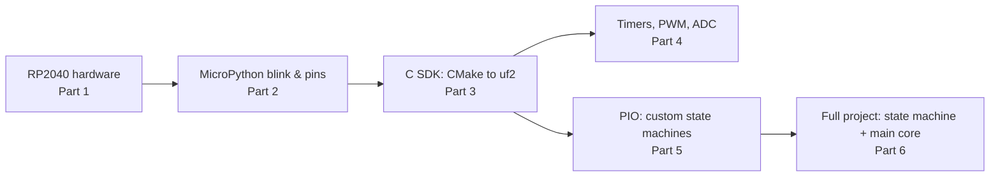
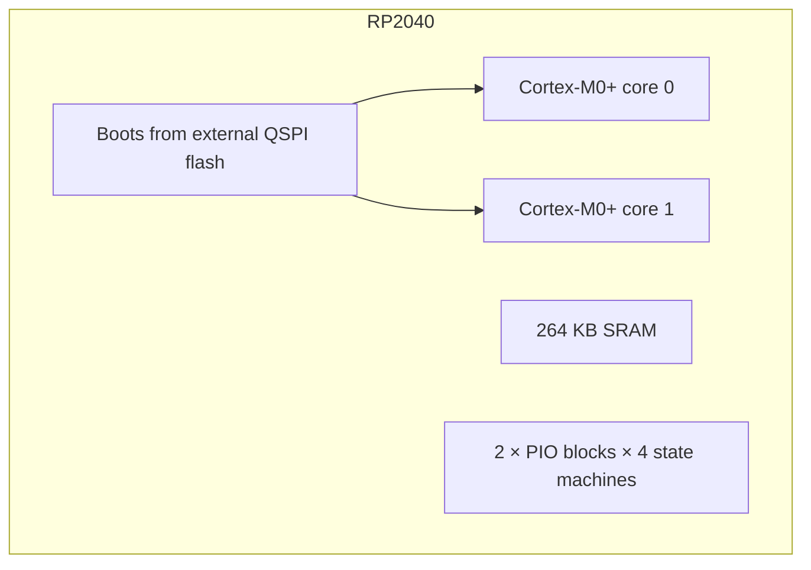

# Raspberry Pi Pico — RP2040, MicroPython, the C SDK, and PIO

> **Track:** Microcontrollers (RP2040) · **Difficulty:** Beginner → Intermediate
> **What you'll get:** the RP2040 mental model, flashing and blinking in **MicroPython**,
> making the leap to the **C/C++ SDK**, and the chip's superpower — **Programmable I/O
> (PIO)** — where tiny state machines generate precise signals with no CPU help.
> **Prereq:** no prior microcontroller experience required to start, though the
> [Microcontrollers path](../paths/mcu/index.md) helps. Comfort with basic Python or C syntax
> makes Parts 2–4 smoother.

The Raspberry Pi Pico is built around the **RP2040**, a chip with two cores, a generous
264 KB of RAM, and one thing almost nothing else has: **two PIO blocks**, each with four tiny
programmable state machines. That PIO lets the Pico generate ultra-precise signals
(NeoPixels, DVI video, custom protocols) *in hardware* while the main CPU does something else.
This tutorial starts where everyone starts (blinking), then climbs to the part that makes the
Pico special — and that no Arduino board can do.



---

## 🎯 Prerequisites

- A **Raspberry Pi Pico** (RP2040) — a Pico W (Wi-Fi added) or plain Pico both work for this
  tutorial. Plus a **micro-USB** cable.
- [MicroPython UF2 firmware](https://micropython.org/download/rp2-pico/) for the Pico, and the
  **Thonny** IDE (easiest MicroPython editor).
- For the C SDK parts: a PC with **CMake** and the **ARM GNU toolchain**, plus
  [pico-sdk](https://github.com/raspberrypi/pico-sdk) cloned — or just the
  [official MicroPython + C getting-started docs](https://www.raspberrypi.com/documentation/microcontrollers/c_sdk.html).
- One **LED** (or use the onboard one on GPIO 25), a **220 Ω resistor**, and optionally a
  push button.

> ⚠️ **First-time flashing tip:** to enter the Pico's **bootloader mode** (a USB "drag-and-drop"
> drive), hold the **BOOTSEL button** while plugging in USB. Drop a `.uf2` file onto the drive
> and it flashes. Don't panic if it shows up as a generic 8 MB drive — that's normal; it's
> *not* a damaged USB stick.

---

## 🧠 Part 1 — The RP2040 in ten seconds

The RP2040 is Raspberry Pi's own microcontroller: a **dual-core ARM Cortex-M0+** (
`core0` and `core1`), **264 KB SRAM**, no internal flash (it boots from external QSPI flash —
your 2 MB "Pico" flash), and a bunch of standard peripherals (UART, SPI, I²C, PWM, ADC,
timers). The headline feature is **PIO**.



Don't worry about "dual-core" yet — most examples run on core0 while core1 sits idle. The
bigger mental shift vs. an Arduino is **PIO**, which we'll reach in Part 5. For now, know
that the onboard **LED lives on GPIO 25**.

> ⚠️ **Pitfall — no internal flash.** Unlike an AVR, the RP2040 can't execute directly from
> internal flash; it runs from SRAM and reads programs from the external flash chip. This is
> why programming is "copy a `.uf2` over USB" rather than a traditional `avrdude` flash — and
> why PIO timing works the way it does. It doesn't change how you *code*, it just explains
> the weird bootloader.

---

## 🐍 Part 2 — MicroPython: blink, pins, and the interactive REPL

With MicroPython running, programming the Pico feels like a giant instant-feedback Python
interpreter with hardware. The onboard LED is **GPIO 25**.

```python
# blink.py — the classic, in MicroPython.
from machine import Pin
import time

led = Pin(25, Pin.OUT)   # GPIO 25 is the onboard LED on a plain Pico

while True:
    led.toggle()          # flip HIGH <-> LOW
    time.sleep(0.5)       # hold for half a second
```

Save it as **`main.py`** and the Pico runs it automatically on boot. That's it — your first
programmed microcontroller.

**Reading a button** is equally short. Connect one button leg to a GPIO (say **14**) and the
other to **GND**, and use the internal pull-up:

```python
# button.py — read a button with an internal pull-up (LOW when pressed).
from machine import Pin
import time

btn = Pin(14, Pin.IN, Pin.PULL_UP)   # pull-up: reads 1 normally, 0 when pressed
led = Pin(25, Pin.OUT)

while True:
    if btn.value() == 0:             # pressed (pulled to GND)
        led.value(1)                 # LED on
    else:
        led.value(0)
    time.sleep_ms(20)                # small debounce/refresh pause
```

**The REPL bonus:** in Thonny, type commands directly in the bottom pane and they execute
*instantly* on the hardware. `pin.value(1)` lights the LED with no program at all. That
interactive flow is the fastest way to experiment ever invented for a microcontroller.

> ⚠️ **Pitfall — `main.py` vs `boot.py`.** Anything in `main.py` runs on reset. If `main.py`
> crashes at boot (say, a `SyntaxError`), the Pico can appear "dead." In Thonny, stop the
> program (the stop button) to break out to the REPL, then fix `main.py`. Always keep a
> version that at least runs — a broken `main.py` is the classic "my Pico stopped working"
> cause that's really just a typo.

> ⚠️ **Pitfall — Underscore vs. MHz:** Pico ADC (`machine.ADC`) is 16-bit capable but noisy;
> for precision reads, average samples. And remember GPIO levels are **3.3 V** — don't feed a
> Pico pin from a 5 V source without a divider.

---

## 🔧 Part 3 — The C/C++ SDK: from `printf` to a `.uf2`

MicroPython is effortless but slow and RAM-hungry. For speed, memory control, or PIO work,
you use the **C/C++ SDK**. You write C, build with **CMake** + the **ARM GCC** toolchain, and
get a `.uf2` you drop onto the board. Here's the entire "hello world" pipeline.

`hello.c`:

```c
// hello.c — the minimal SDK program, blinking via gpio + sleep.
#include "pico/stdlib.h"     // SDK header: pins, time, UART (printf)

int main(void) {
    // Bring up the system clock and (optionally) UART for printf.
    stdio_init_all();
    gpio_init(25);            // init GPIO 25
    gpio_set_dir(25, GPIO_OUT);
    while (true) {
        gpio_put(25, 1);      // LED on
        sleep_ms(500);
        gpio_put(25, 0);      // LED off
        sleep_ms(500);
    }
}
```

`CMakeLists.txt`:

```cmake
cmake_minimum_required(VERSION 3.13)
include(pico_sdk_import.cmake)   # pulls in the SDK (set PICO_SDK_PATH)
project(hello)

# Initialize the SDK:
pico_sdk_init()

# Build an executable from hello.c:
add_executable(hello hello.c)
# Generate .uf2 (and .bin/.hex) in addition to the .elf:
pico_add_extra_outputs(hello)
# Link against the standard SDK libraries:
target_link_libraries(hello pico_stdlib)
```

**Build & flash (Linux/macOS or Git-Bash):**

```bash
mkdir build && cd build
cmake ..                 # configure using the SDK
make                     # builds hello.uf2
# Hold BOOTSEL + plug in -> a USB drive appears; copy build/hello.uf2 to it.
cp hello.uf2 /media/$USER/RPI-RP2/   # or drag-and-drop on Windows
```

**The `.uf2` magic:** the SDK's `pico_add_extra_outputs` produces a single `.uf2` file the boot
ROM understands. Everything from the schematic-level C to the drop-and-go flash is there —
blinking at the speed of C, not Python.

> ⚠️ **Pitfall — missing `PICO_SDK_PATH`.** `pico_sdk_import.cmake` needs to find the SDK.
> Either set the env var, or pass `-DPICO_SDK_PATH=/path/to/pico-sdk` to `cmake`. A confusing
> "could not find pico/stdlib.h" error means the SDK wasn't found, not that your code is
> wrong.

> ⚠️ **Pitfall — you're flashing, not "uploading."** There's no serial programmer — the Pico
> presents a USB drive and you copy a file. If the drive doesn't appear, you're **not** in
> bootloader mode: hold BOOTSEL *while* connecting.

---

## ⏱️ Part 4 — Timers, PWM, and ADC in C

MicroPython hides peripherals behind clean objects — which is great right up until you need
precise behavior. In C you control the timer and PWM hardware directly. Here's fading an LED
with the hardware **PWM** (pulse-width modulation) and reading the **ADC**.

```c
// pwm_adc.c — fade an LED with hardware PWM, read an ADC channel.
#include "pico/stdlib.h"
#include "hardware/pwm.h"
#include "hardware/adc.h"

int main(void) {
    stdio_init_all();

    // --- PWM on GPIO 25 (onboard LED) ---
    gpio_set_function(25, GPIO_FUNC_PWM);        // route GPIO25 to a PWM slice
    uint slice = pwm_gpio_to_slice_num(25);       // which slice owns GPIO25
    pwm_set_wrap(slice, 255);                     // 8-bit resolution (0..255)
    pwm_set_enabled(slice, true);

    // --- ADC on GPIO 26 (ADC0) ---
    adc_init();
    adc_gpio_init(26);                            // analog channel 0 on GPIO26
    adc_select_input(0);

    uint16_t duty = 0;
    int dir = 1;
    while (true) {
        // Brightness sweep (triangle wave):
        pwm_set_gpio_level(25, duty);
        duty += dir;
        if (duty >= 255) dir = -1;
        if (duty == 0)   dir =  1;
        sleep_ms(3);

        // Read the ADC every ~100 loops and print it:
        static int n = 0;
        if (++n % 100 == 0) {
            uint16_t raw = adc_read();            // 12-bit 0..4095
            printf("ADC raw: %u\n", raw);
        }
    }
}
```

**Two HW concepts worth naming:**
- **PWM slices & channels:** the RP2040's PWM is organized in *slices*, each of which can
  drive two GPIOs. `pwm_gpio_to_slice_num` finds yours; `pwm_set_wrap` sets resolution;
  `pwm_set_gpio_level` sets the duty cycle.
- **ADC is 12-bit** (0–4095), not the 10-bit (0–1023) you may know from Arduino. And the ADC
  input is noisy — average samples for stable readings.

> ⚠️ **Pitfall — PWM is per-slice, not per-pin, for the shared clock.** Two channels on the
> same slice share the wrap (resolution) and clock; you can set each channel's duty
> independently but they share the timing base. Plan pins accordingly when you need
> independently-clocked PWM.

> ⚠️ **Pitfall — ADC reference is 3.3 V and nonlinear / noisy.** Don't feed 5 V; the ADC
> saturates above ~3.3 V. Average a few reads for a stable number.

---

## ⚙️ Part 5 — PIO: the chip's superpower

Here's where the Pico pulls ahead of almost everything else. A **PIO state machine** is a tiny
dedicated processor (just a handful of instructions) that executes **bit-level programs** at
high speed, *independently of the main CPU*. It's perfect for protocols with exact timing —
NeoPixels, DVI/VGA video, custom sensors — where bit-banging in the CPU would be too slow or
would starve everything else.


In **MicroPython**, PIO is available through the `rp2` module. Here's a state machine that
*blinks the LED by itself* — the CPU just feeds it a frequency:

```python
# pio_blink.py — the LED is blinked by a PIO state machine, not the CPU.
from machine import Pin
from rp2 import StateMachine, asm_pio
import time

@asm_pio(set_init=rp2.PIO.OUT_LOW)      # configure: 'set' toggles a pin, start low
def blink():
    wrap_target()                        # loop-start marker
    set(pins, 1)   [19]                  # pin HIGH, then 19 extra no-op cycles
    nop()          [19]                  # waste 20 cycles (a short delay)
    nop()          [19]
    nop()          [19]
    nop()          [19]
    set(pins, 0)   [19]                  # pin LOW
    nop()          [19]
    nop()          [19]
    nop()          [19]
    nop()          [19]
    wrap()                               # jump back to wrap_target

sm = StateMachine(0, blink, freq=2000, set_base=Pin(25))  # SM 0, 2 kHz, pin GPIO25
sm.active(1)                             # start the state machine

while True:
    time.sleep(1)                        # the CPU is FREE while the PIO blinks
```

**Read that carefully:** the `@asm_pio` decorated function is *not* run by the CPU — it's
compiled into PIO instructions that the state machine executes at a fixed rate. The CPU's
`while True: time.sleep(1)` does nothing but idle, yet the LED blinks at a rock-solid rate.
That's the entire point of PIO: **timing you can't get wrong, with the CPU free.**

**The 9 PIO instructions** you'll use eventually: `jmp`, `wait`, `in`, `out`, `push`,
`pull`, `mov`, `irq`, `set`. Plus side-set (do something on *every* instruction), and FIFOs
to shuttle data between the CPU and the state machine.

> ⚠️ **Pitfall — wrap_target/wrap are required.** A PIO program must define where it loops.
> Forgetting `wrap_target()` / `wrap()` means the state machine falls off the end of its
> program memory and misbehaves. Every program has this loop structure.

> ⚠️ **Pitfall — 32 instructions max per block, shared.** All four state machines in a PIO
> block share one 32-instruction memory. A 40-instruction program won't fit, and two big
> programs might not coexist. Keep PIO programs tight (they're meant to be).

---

## 🧰 Part 6 — Full project: dual-core + PIO together

Real Pico projects often run **code on core1** while a **PIO state machine** handles output
on the side. Here's a project that does all three things at once, proving the Pico's
concurrency:

- **core0:** reads a button and pushes the count into a **PIO FIFO**.
- **core1:** runs a blinking "heartbeat" task (using the second CPU core).
- **PIO:** drives an LED with the counts from the FIFO to demonstrate CPU→state-machine data.

```python
# concurrency.py — core1 + PIO + a button, the full spread.
from machine import Pin
from rp2 import StateMachine, asm_pio
import _thread
import time

# PIO: output the value it receives via its input FIFO once per loop.
@asm_pio()
def echo_led():
    pull()               # block until a value arrives in the FIFO
    mov(x, osr)          # copy it into scratch reg x
    # (In a real design you'd use 'out' to drive pins in patterns;
    #  here we just consume the value to prove data flow.)
    jmp("echo_led")      # loop (NOTE: we define the label via a target)

# In practice you'd write with proper PIO syntax; the key idea is:
#   CPU .put(value)  ->  PIO .get()  ->  side effect on a pin.

from rp2 import asm_pio

# core0's blink heartbeat on the second core:
def blink_heartbeat():
    led = Pin(25, Pin.OUT)
    while True:
        led.toggle()
        time.sleep(0.2)

# --- main ---
_thread.start_new_thread(blink_heartbeat, ())   # run the heartbeat on core1

# ... and back on core0, run the PIO machine fed by a button ...
btn = Pin(14, Pin.IN, Pin.PULL_UP)
sm = StateMachine(1, echo_led, freq=1000, set_base=Pin(25))
sm.active(1)

count = 0
last = 1
while True:
    now = btn.value()
    if now == 0 and last == 1:      # button press edge
        count += 1
        sm.put(count)               # hand the value to the PIO
    last = now
    time.sleep_ms(20)
```

> ⚠️ **Pitfall — leftover from a sketch you edited mid-build.** If a line references `rp2.PIO`
> but you imported only `asm_pio`, you get a NameError. Keep imports consistent. And because
> PIO + threads + REPL can momentarily collide, restart (stop then re-run) after changing a
> `@asm_pio` decorator — stale compiled programs can linger.

The takeaway isn't that this tiny example does something impressive — it's that the hardware
*lets you* spread work (two cores) and offload timed I/O (PIO) without the CPU fighting
itself. That combination is rare and powerful, and it's why the Pico punches so far above its
price.

---

## 📐 Why this matters

- **Dual-core** — genuinely parallel code on a microcontroller.
- **PIO** — build custom, precisely-timed interfaces in hardware; a capability almost no
  other chip gives you for this price.
- **MicroPython → C SDK** — one board teaches both the friendly slack of Python and the
  control of C, with the same `.uf2` flash flow.
- **264 KB RAM + no-internal-flash architecture** — a modern, RAM-heavy, flash-external
  design that's closer to how big chips work.

## ▶️ Watch & learn

- [What is PIO | Programmable I/O on Raspberry Pi Pico](https://www.youtube.com/watch?v=ODlB05xMg04) — Raspberry Pi's own friendly intro to PIO and bit-banging.
- [In-depth: Raspberry Pi Pico's PIO — programmable I/O!](https://www.youtube.com/watch?v=yYnQYF_Xa8g) — a deep dive through every PIO instruction.
- [Raspberry Pi Pico Full Guide | Beginner to Pro](https://www.youtube.com/watch?v=4S0_BulQp20) — blink, buttons, sensors, and a display in MicroPython from scratch.
- [Getting Started with Raspberry Pi Pico C/C++ SDK](https://www.youtube.com/watch?v=x1zH7MOIIA8) — set up the CMake + toolchain path from Part 3.
- <https://www.youtube-nocookie.com/embed/ODlB05xMg04> — the PIO explainer (free to follow along) to cement Part 5.
- <https://www.youtube-nocookie.com/embed/yYnQYF_Xa8g> — a deep dive through every PIO instruction.
- <https://www.youtube-nocookie.com/embed/4S0_BulQp20> — blink, buttons, and sensors in MicroPython from scratch.
- <https://www.youtube-nocookie.com/embed/x1zH7MOIIA8> — set up the CMake + toolchain path from Part 3.

## ✅ Next steps

- Bring up **I²C** (`machine.I2C`) to read a sensor or drive an OLED display.
- Try **Pico W** Wi-Fi with MicroPython's `network` module for an internet-connected Pico.
- Dig into the **official RP2040 datasheet**'s PIO chapter (Chapter 3) — the definitive reference.
- Switch the C SDK to **Pico's `pico-examples`** repo and run a few of its PIO demos
  (especially the NeoPixel one).

> **New to a term?** Look it up in the [Glossary](../GLOSSARY/README.md).

---

*Compare the Pico's dual-core world with a classic AVR in [Arduino in C](../synthesized/arduino-c.md), or go fully connected with [ESP32 advanced](../synthesized/esp32-advanced.md).*

---

## 🧪 Exercises & Projects

> **Estimated total time:** ~3–4 hours. You'll need a Raspberry Pi Pico, a micro-USB cable,
> Thonny (MicroPython), and optionally the C SDK toolchain set up. One LED + 220 Ω and a push
> button help. A second Pico or a microcontroller-aware scope is a fun bonus for PIO timing.

### 📝 Exercises

**🟢 Easy — boots & pins.** Reinforce Parts 1–2.

- [ ] What two things does holding **BOOTSEL** while plugging in get you?
      *(Bootloader mode — a USB drive — and the ability to drag-and-drop a `.uf2`.)*
- [ ] On a plain Pico, which GPIO drives the onboard LED? *(GPIO 25.)*
- [ ] With `Pin.IN, Pin.PULL_UP`, what does `btn.value()` return while the button is
      pressed? *(0 — pulled low to GND.)*
- [ ] True/false: a `SyntaxError` in `main.py` can make the Pico appear to "not work."
      *(True — stop it in Thonny and fix the file.)*

**🟡 Medium — SDK & peripherals.** Apply Parts 3–4.

- [ ] Why do you get a confusing "can't find pico/stdlib.h" even when your code is fine?
      *(The SDK wasn't found — set `PICO_SDK_PATH` or pass `-DPICO_SDK_PATH` to CMake.)*
- [ ] The Pico's ADC is how many bits? How does that compare to a typical Arduino's 10-bit?
      *(12-bit, 0–4095 vs 0–1023.)*
- [ ] Two channels sharing one PWM slice share what — and what can you set independently?
      *(Resolution/clock; you set each channel's duty independently.)*

**🔴 Hard — PIO & concurrency.**

- [ ] You wrote a 40-instruction PIO program and it won't load. Why?
      *(32-instruction limit per PIO block, shared by all four state machines.)*
- [ ] A PIO program blinks but only runs once, then stops. What did you likely forget?
      *(The `wrap_target()`/`wrap()` loop markers.)*
- [ ] How does data reach a PIO state machine from the CPU, and why use it over a global?
      *(Through the FIFO — `sm.put()` on the CPU, `pull()` in the PIO; it's atomic and
      timing-safe, unlike a shared variable.)*

### 🛠️ Mini-Project: Dual-core + PIO LED pattern box

**Goal:** combine everything — a PIO state machine that drives an LED, fed by values from the
CPU, while core1 runs a heartbeat. You'll learn the Pico's concurrency model hands-on.

**Time:** ~60–90 minutes. **Components:** Pico, onboard LED (or external + 220 Ω), and a push
button (optional).

**Build steps (MicroPython in Thonny):**

1. **Baseline:** flash `blink.py` (Part 2) as `main.py` and confirm the LED blinks. This
   proves your flashing path.
2. **PIO blink:** replace with `pio_blink.py` (Part 5). Confirm the LED blinks with the CPU
   idle. Change the `[19]` delays and see the blink rate change. Check each box:

- [ ] LED blinks from the PIO program alone.
- [ ] The CPU is free (the `while True` idles) while it blinks.
- [ ] Editing the delay counts changes the blink speed.

3. **Dual core:** add the `_thread` heartbeat from Part 6 so core1 blinks a *second** pattern
   while core0 idles. Check each box:

- [ ] core1's blink runs while core0 runs the main loop.
- [ ] Both continue simultaneously (they're independent).

4. **PIO + button:** feed counts from a button (Part 6) into the state machine's FIFO with
   `sm.put()`. Even if you just print what the PIO would receive, you've demonstrated the
   CPU→PIO data path. Check:

- [ ] Pressing the button increments and `sm.put()`s a count.
- [ ] You can `sm.get()` (or reason about) the value on the PIO side.

**Extend it (pick at least one):**
- [ ] Drive a **NeoPixel** from a PIO state machine using the official NeoPixel example —
      the classic PIO win (timing-perfect, CPU free).
- [ ] Use **side-set** to toggle a second pin on every instruction, producing a fast square
      wave you could measure with an LED + resistor or a scope.
- [ ] Port the project to **C** (Part 3) so it runs from a compiled `.uf2` — a great next
      step to feel the speed and control.

**The lesson:** the Pico isn't just "another microcontroller." Between its two cores and its
PIO blocks, it lets you run high-level code, CPU code, and hardware-timed protocols all at
once — which is exactly the kind of concurrency you'll rely on in anything from a synth to a
retro-emulator to a live data display.

> **Tips:** keep PIO programs small (32 instructions) and always include the wrap markers.
> If the REPL seems stuck after editing a PIO program, stop and re-run. And Pico GPIO is
> **3.3 V** — never drive a pin with 5 V.
