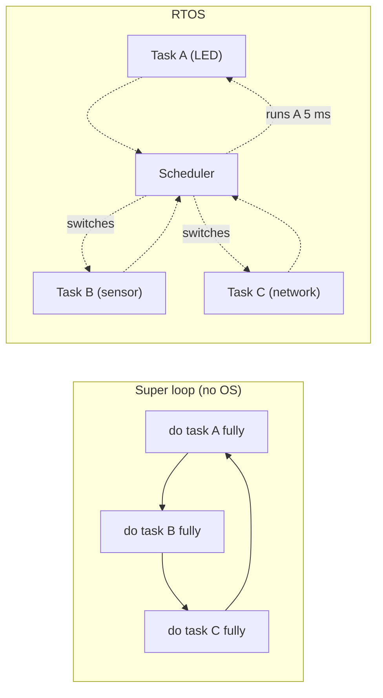
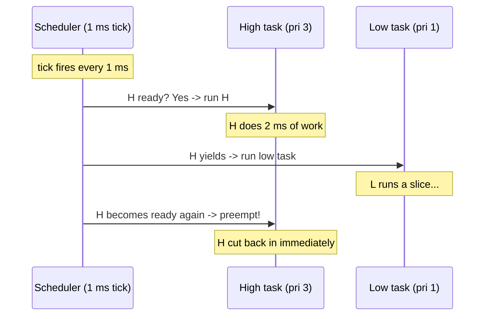
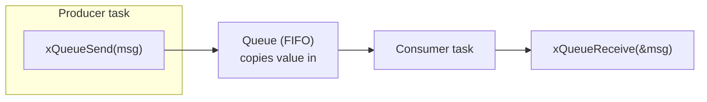

# RTOS on a Microcontroller — FreeRTOS Tasks, Queues, and Priority Done Right

> **Track:** Microcontrollers (FreeRTOS) · **Difficulty:** Intermediate
> **What you'll get:** what a real-time OS is (and isn't), super-loop versus RTOS, FreeRTOS
> tasks, delays and scheduling, queues for safe task-to-task data, mutexes & semaphores,
> and a complete two-task + queue project you can run on an ESP32 or an Arduino-style board.
> **Prereq:** the [Arduino C tutorial](../synthesized/arduino-c.md) or equivalent — you should
> already blink an LED and understand `millis()`. The [ESP32 C++ tutorial](../synthesized/esp32-cpp.md)
> is a helpful sibling but not required.

For your first few projects the "super loop" is plenty: `setup()` runs once, `loop()` runs
forever, and `delay()` paces things. But the moment you need to *blink an LED*, *read a
button*, *grab sensor data at a fixed rate*, *and* answer a network request all at once, the
super loop turns into a tangled web of `millis()` bookkeeping. A **real-time operating system
(RTOS)** is the professional answer: the OS gives each job its own function — a **task** —
and a tiny **scheduler** decides which task runs when. You stop juggling everything by hand;
you just write independent tasks and let the OS interleave them.

This page is a mini-course: the mental model (Part 1), tasks & scheduling (Part 2–3), the
communication objects that make tasks safe (Part 4–5), and the full project (Part 6). Jump to
whatever you need; each section stands alone and runs on real hardware.


---

## 🎯 Prerequisites

- An **ESP32 devkit** (the smoothest FreeRTOS experience — it ships with FreeRTOS baked in),
  or an Arduino Uno/Nano-class AVR board (FreeRTOS also has an AVR port).
- One **LED** and a **220 Ω resistor**, one **push button** and a **10 kΩ resistor** (optional).
- [Arduino IDE](https://www.arduino.cc/en/software) with the **esp32 board package** installed,
  OR a bare Arduino AVR board.
- The **FreeRTOS overview** from the [FreeRTOS site](https://www.freertos.org/) bookmarked — it
  is the definitive reference.

> ⚠️ **The #1 beginner trap in all of RTOS:** people reach for an RTOS to make a blinking LED
> "multitask," then wonder why their code got *harder*. An RTOS is a **concurrency tool**, not a
> clock. If you only have one thing to do, a super loop is better. The payoff appears at two or
> more genuinely concurrent jobs. Keep that in mind — it decides every design choice below.

---

## 🧠 Part 1 — The mental model: what an RTOS actually is

Think of a single-core chip as a **single chef in one kitchen**. The chef can only cook one
dish at a time. "Multitasking" isn't the chef growing arms — it's the chef **switching dishes
very fast**, doing a few seconds of soup, then a few of salad, and so on, so that all the meals
progress. An RTOS is the *kitchen manager* (the scheduler) plus the *recipe cards* (the tasks).



**The three ideas that matter (remember these — everything else builds on them):**

- A **task** is a function that never returns — it runs forever, or until it's deleted.
- The **scheduler** decides which task is on the CPU at any instant, switching on **time
  ticks** (a periodic timer interrupt, e.g. every 1 ms).
- A task **yields** (voluntarily pauses) by calling something like `vTaskDelay()` — letting
  another task run. That's why `delay()`-style blocking is **forbidden** in RTOS tasks; you
  use `vTaskDelay()` instead so the scheduler can keep working.

**"Real-time" does *not* mean "fast."** It means **predictable**: the RTOS guarantees that a
high-priority task will get the CPU within a bounded time of it being ready. That's a *deadline
guarantee*, the property that separates an RTOS from "just some threads."

---

## 🏗️ Part 2 — Defining your first tasks

FreeRTOS identifies a task by a **function pointer plus a few parameters**. On the ESP32, the
Arduino core already runs your `loop()` as a low-priority task, so you can add your own tasks
next to it. Let's create one task that blinks an LED using the RTOS `vTaskDelay()`.

```cpp
// rtos_blink.ino — run on an ESP32 (Arduino core).
// Creates one task that blinks the onboard LED using RTOS delays.

#include <freertos/FreeRTOS.h>
#include <freertos/task.h>

// This is a TASK body. It runs forever with its own stack.
void blinkTask(void *parameter) {
  // Whatever you pass to xTaskCreate arrives here via 'parameter'.
  uint8_t pin = *(uint8_t *)parameter;   // cast it back to a real value

  pinMode(pin, OUTPUT);

  while (true) {
    digitalWrite(pin, HIGH);
    vTaskDelay(500 / portTICK_PERIOD_MS);  // sleep 500 ms, letting other tasks run
    digitalWrite(pin, LOW);
    vTaskDelay(500 / portTICK_PERIOD_MS);
  }
}

uint8_t ledPin = 2;   // LED_BUILTIN on many ESP32 devkits

void setup() {
  Serial.begin(115200);
  vTaskDelay(1000 / portTICK_PERIOD_MS);   // let the serial console catch up

  // xTaskCreate(taskFn, "name", stackBytes, param, priority, &handle)
  xTaskCreate(
    blinkTask,     // the function that IS the task
    "Blink",       // human-readable name (for debugging)
    1024,          // stack size in bytes — generous is safer
    &ledPin,       // argument passed to the task
    1,             // priority (higher = more urgent, bumped later)
    NULL           // optional out-param for a task handle
  );

  Serial.println("Blink task created.");
}

void loop() {
  // The Arduino loop() still runs as its own task.
  // Add other work here, or just let it sleep.
  vTaskDelay(1000 / portTICK_PERIOD_MS);
}
```

**Anatomy of that call — the four things every task needs:**

| Argument | Meaning | Typical value |
|----------|---------|---------------|
| Task function | The `void f(void*)` that runs forever | `blinkTask` |
| Name | A label for debugging/logging | `"Blink"` |
| Stack size | Bytes of RAM reserved for the task's local variables | 1024–4096 |
| Priority | Urgency; bigger number = more urgent | 1–configMAX_PRIORITIES |

> ⚠️ **Pitfall — not enough stack.** Each task runs on its *own* private stack drawn from the
> heap. If you call functions with big local buffers (`String`, `snprintf` into a 256-byte
> array) you can overflow it, and the symptoms are nasty: random resets, corrupted variables,
> or an `_err` stack-overflow assertion. When in doubt, **double the stack size** and watch the
> FreeRTOS "high water mark" (described in Part 3) to see real usage.

> ⚠️ **Pitfall — hard-coded pin numbers.** Passing the pin through `&ledPin` is nice, but
> `ledPin` is a **global** — if two tasks share it you get a data race (Part 4). For now it's
> fine; we'll show the correct pattern with queues later.

---

## ⏱️ Part 3 — Scheduling & priority: who runs when

FreeRTOS uses **priority-based preemptive scheduling**. Two rules rule everything:

1. **Higher priority always runs first** — if a high-priority task is ready, the lower ones
   wait, no matter what.
2. **Ties rotate** — among tasks of equal priority, the scheduler **round-robins**, giving each
   a time slice.



A task can **yield** (pause until its next tick) with `vTaskDelay()`, or it can **block on a
kernel object** (a queue, mutex, or semaphore) — we meet those in the next parts. A task that
is *neither* running nor blocked is **ready** and competes for the CPU.

**Reading actual CPU usage — the high water mark.** Every task reports how much of its stack it
used, letting you tune stack sizes with data instead of guesses:

```cpp
// stack_usage.ino — print every task's minimum free stack.
// FreeRTOS stores a list of task handles you can walk.

void dumpStacks() {
  char name[16];                // task name buffer
  TaskHandle_t t = NULL;
  while (true) {
    t = xTaskGetHandle(NULL);   // for a single task, use uxTaskGetStackHighWaterMark:
    break;                      // (see inline example below instead inside your task)
  }
}

// INSIDE a running task you can ask for YOUR OWN high water mark:
#include <freertos/task.h>
extern "C" {

}
// The simplest use — inside blinkTask:
//   UBaseType_t hwm = uxTaskGetStackHighWaterMark(NULL);
//   Serial.printf("Blink high water mark: %u bytes\n", hwm);
```

(For readability, the full multi-task walk is often easier on a board that shows `Serial` —
the snippet above gives you the one call you'll actually use every debug session:
`uxTaskGetStackHighWaterMark(NULL)` inside your task.)

> ⚠️ **Pitfall — priority inversion.** Suppose a high-priority task waits on a **mutex**
> (Part 5) held by a medium-priority task. The medium task keeps preempting the *low* task
> that holds the mutex, so the high task starves — the priorities are *inverted*. FreeRTOS
> solves this with **priority inheritance** (a task holding a mutex temporarily borrows the
> highest waiter's priority), but it costs CPU. The lesson: **keep critical sections short**
> so mutex contention is rare.

---

## 📬 Part 4 — Queues: the safe mailbox between tasks

Two tasks sharing a global `int` is a **data race**: the read task can catch the write task
mid-update, seeing garbage. The correct mechanism is a **queue** — a FIFO buffer where the
producer `xQueueSend`s a *copy* of a value and the consumer `xQueueReceive`s it, both atomically
(no interleaving possible).



Let's build the canonical demo: **Task A** reads a button and sends a message; **Task B**
receives that message and flashes an LED. Two tasks, one queue, zero shared globals.

```cpp
// rtos_queue.ino — button press in ONE task, LED flash handled by ANOTHER task.
#include <freertos/FreeRTOS.h>
#include <freertos/task.h>
#include <freertos/queue.h>

QueueHandle_t pressQueue;      // the mailbox both tasks share

// Task A: watch the button. On every press, send "1" through the queue.
void buttonTask(void *parameter) {
  pinMode(15, INPUT_PULLUP);   // check YOUR board's pinout for a free GPIO!
  uint8_t last = HIGH;
  for (;;) {
    uint8_t now = digitalRead(15);
    if (now == LOW && last == HIGH) {          // falling edge = a press
      uint8_t msg = 1;
      xQueueSend(pressQueue, &msg, 0);         // put a COPY in the queue (don't block)
      Serial.println("Press queued.");
    }
    last = now;
    vTaskDelay(20 / portTICK_PERIOD_MS);       // debounce via task delay
  }
}

// Task B: wait for a message, then flash the LED 3 times.
void ledTask(void *parameter) {
  pinMode(2, OUTPUT);
  uint8_t msg;
  for (;;) {
    if (xQueueReceive(pressQueue, &msg, portMAX_DELAY) == pdTRUE) {
      // portMAX_DELAY blocks forever until a message is available
      for (int i = 0; i < 3; i++) {
        digitalWrite(2, HIGH);
        vTaskDelay(100 / portTICK_PERIOD_MS);
        digitalWrite(2, LOW);
        vTaskDelay(100 / portTICK_PERIOD_MS);
      }
      Serial.println("LED flashed from task B.");
    }
  }
}

void setup() {
  Serial.begin(115200);
  vTaskDelay(1000 / portTICK_PERIOD_MS);

  pressQueue = xQueueCreate(5, sizeof(uint8_t));   // hold 5 items of 1 byte each

  xTaskCreate(buttonTask, "Button", 2048, NULL, 1, NULL);
  xTaskCreate(ledTask,    "LED",    2048, NULL, 1, NULL);
}

void loop() { vTaskDelay(portMAX_DELAY); }        // nothing left to do here
```

**Why this is bulletproof:** `xQueueSend` and `xQueueReceive` are **atomic** — the producer
can't be interrupted halfway through, so the consumer *always* sees a complete, consistent
item. Compare that to a shared `uint8_t` global where "read low byte then high byte" can be
split by a preemption.

> ⚠️ **Pitfall — blocking forever on `portMAX_DELAY`.** If the producer dies, the consumer
> blocks forever and your system appears frozen. For production code, give receive a *finite*
> timeout (e.g. `xQueueReceive(q, &m, 500 / portTICK_PERIOD_MS)`) and handle the timeout —
> the system stays alive and can report "no data." Use `portMAX_DELAY` only when you *know*
> the producer can't go away.

> ⚠️ **Pitfall — copying big payloads.** Queues copy *by value*. Sending a 2 KB struct every
> loop is slow and eats heap in the queue buffers. Send a **pointer** instead (if the pointed
> data stays alive and is read-only while in the queue), or send a small fixed-size struct.

---

## 🔒 Part 5 — Mutexes & semaphores: protecting shared resources

A queue is for *moving data*. When two tasks need to *share one resource* (a display, an I²C
bus, a sensor register) you need a **critical section**. Two tools:

- **Mutex (mutual exclusion):** only *one* task may enter the guarded section at a time. If a
  task already holds it, the next task **blocks** until it's free. Unlock happens in the
  *same* task that locked (the owner).
- **Semaphore (binary, used as a signal):** one task *gives* it, another *takes* it — like a
  queue that carries no data, just "event happened." Use it to wake a task from an interrupt.

```cpp
// rtos_mutex.ino — protect a shared resource (here: the Serial console) with a mutex.
#include <freertos/FreeRTOS.h>
#include <freertos/task.h>
#include <freertos/semphr.h>

SemaphoreHandle_t serialMutex;   // guards Serial so two tasks don't garble prints

void printerTask(void *parameter) {
  int id = *(int *)parameter;
  for (;;) {
    xSemaphoreTake(serialMutex, portMAX_DELAY);   // lock BEFORE touching Serial
    Serial.print("Task "); Serial.print(id); Serial.println(" printing whole line");
    xSemaphoreGive(serialMutex);                  // unlock when done
    vTaskDelay(200 / portTICK_PERIOD_MS);
  }
}

int ids[2] = {1, 2};   // one id per task

void setup() {
  Serial.begin(115200);
  vTaskDelay(1000 / portTICK_PERIOD_MS);

  serialMutex = xSemaphoreCreateMutex();
  xTaskCreate(printerTask, "P1", 2048, &ids[0], 1, NULL);
  xTaskCreate(printerTask, "P2", 2048, &ids[1], 1, NULL);
}

void loop() { vTaskDelay(portMAX_DELAY); }
```

Without the mutex, the two `Serial.print` calls from different tasks can interleave, producing
garbled lines. With the mutex, each entire "print whole line" sequence is atomic.

> ⚠️ **Pitfall — `delay()` or other sleeps while holding a mutex.** Holding a mutex then
> calling `vTaskDelay()` stalls every other task that wants the resource. Keep the guarded
> section tiny: lock, do the minimal critical work, unlock immediately.

> ⚠️ **Pitfall — deadlock.** Task A holds mutex 1 and waits for mutex 2, while Task B holds
> mutex 2 and waits for mutex 1. Neither can proceed. The fix: **always acquire**
> multiple mutexes **in the same order** in every task, and keep each held for as short a time
> as possible.

---

## 🧰 Part 6 — The full project: Weather-ish sensor logger with tasks + queue

Grand finale — a project that genuinely *needs* an RTOS because it has three concurrent jobs:

1. **Sensor task** samples a temperature reading every 2 seconds.
2. **Blink task** blinks an LED at 1 Hz (pacemaker for "I'm alive").
3. **Logger task** receives sensor samples through a queue and prints them.

Three tasks, one queue, plus a mutex around the console. This is the exact skeleton of
countless real products (sensor + UI + network on one chip).

```cpp
// rtos_project.ino — three tasks: sample, blink, log.
#include <freertos/FreeRTOS.h>
#include <freertos/task.h>
#include <freertos/queue.h>
#include <freertos/semphr.h>

QueueHandle_t sampleQueue;
SemaphoreHandle_t consoleMutex;

// Emulate a sensor: a rising counter you'd replace with analogRead or an I2C read.
int fakeSensorValue = 20;

// Task 1: read the "sensor" and post the value to the queue.
void sensorTask(void *parameter) {
  for (;;) {
    fakeSensorValue = (fakeSensorValue + 1) % 40;   // 20..59
    int sample = fakeSensorValue;
    xQueueSend(sampleQueue, &sample, 0);            // non-blocking send
    vTaskDelay(2000 / portTICK_PERIOD_MS);          // sample every 2 s
  }
}

// Task 2: village pacemaker — 1 Hz LED blink.
void blinkTask(void *parameter) {
  pinMode(2, OUTPUT);
  for (;;) {
    digitalWrite(2, HIGH);
    vTaskDelay(500 / portTICK_PERIOD_MS);
    digitalWrite(2, LOW);
    vTaskDelay(500 / portTICK_PERIOD_MS);
  }
}

// Task 3: drain the queue and log each sample to the console.
void logTask(void *parameter) {
  int sample = 0;
  for (;;) {
    if (xQueueReceive(sampleQueue, &sample, 1000 / portTICK_PERIOD_MS) == pdTRUE) {
      xSemaphoreTake(consoleMutex, portMAX_DELAY);
      Serial.print("Temp sample: "); Serial.println(sample);
      xSemaphoreGive(consoleMutex);
    }
  }
}

void setup() {
  Serial.begin(115200);
  vTaskDelay(1000 / portTICK_PERIOD_MS);

  sampleQueue  = xQueueCreate(8, sizeof(int));
  consoleMutex = xSemaphoreCreateMutex();

  xTaskCreate(sensorTask, "Sensor", 2048, NULL, 2, NULL);
  xTaskCreate(blinkTask,  "Blink",  2048, NULL, 1, NULL);
  xTaskCreate(logTask,    "Log",    2048, NULL, 2, NULL);

  Serial.println("RTOS sensor logger started.");
}

void loop() { vTaskDelay(portMAX_DELAY); }
```

**Why priorities 2/1/2?** The sensor and logger are tied as the most urgent; the blink is a
cosmetic low-priority filler. Because they're equal priority, sensor and logger round-robin.
The blink only runs when neither of them is ready — exactly the "low-priority background"
behavior you want for a status LED.

```cpp
// What you should see in the Serial console (roughly):
//   RTOS sensor logger started.
//   Temp sample: 21
//   Temp sample: 22
//   Temp sample: 23
//   ... every 2 seconds, while the LED blinks continuously ...
```

**Run it, then extend it:**
- Add a 4th task (button read) that sends a message to stop the blink. Use a queue and have
  blinkTask `xQueueReceive` with a short timeout to check.
- Replace `fakeSensorValue` with a real `analogRead()` from a thermistor or light sensor.
- Print each task's high water mark once a minute to prove your stack sizes are safe.

---

## 📐 Why this matters

You've just learned the *professional* way to structure firmware:

- **Tasks** — each independent job gets its own function and stack, instead of a tangled loop.
- **Scheduling & priority** — you declare urgency, and the OS guarantees responsiveness.
- **Queues** — safe, atomic data handoff between tasks (no data races, no shared globals).
- **Mutexes & semaphores** — protect shared resources and signal events safely.
- **Predictability** — "real-time" means guaranteed deadlines, the property that makes sensors,
  controllers, and robots trustworthy.

None of this is ESP32-specific. FreeRTOS (and the concepts here) runs on AVR, STM32, nRF,
RISC-V, and dozens more. Learn it here and you'll recognize the same API on nearly every
professional embedded job.

## ▶️ Watch & learn

- [What is a Real-Time Operating System (RTOS)? — Intro to RTOS Part 1 (Digi-Key/Shawn Hymel)](https://www.youtube.com/watch?v=F321087yYy4) — the clearest big-picture explainer of what "real-time" really means.
- [Getting Started with FreeRTOS — Part 2](https://www.youtube.com/watch?v=JIr7Xm_riRs) — creating your first task on the ESP32, step by step.
- [Task Scheduling & Management — Part 3](https://www.youtube.com/watch?v=95yUbClyf3E) — how priorities and round-robin actually behave.
- [FreeRTOS Queue Example — Part 5](https://www.youtube.com/watch?v=pHJ3lxOoWeI) — the exact queue pattern we built, with a full challenge.
- <https://www.youtube-nocookie.com/embed/JIr7Xm_riRs> — follow along with Part 2 to see a task get created and scheduled live.
- <https://www.youtube-nocookie.com/embed/F321087yYy4> — Part 1: what an RTOS is and what "real-time" means.
- <https://www.youtube-nocookie.com/embed/95yUbClyf3E> — Part 3: priorities and round-robin scheduling in action.
- <https://www.youtube-nocookie.com/embed/pHJ3lxOoWeI> — Part 5: the exact queue pattern from Part 4, with its challenge.

## ✅ Next steps

- Read the **free Introduction to RTOS** course repo (already referenced above) and do the
  challenge at the end of each video — that's real practice.
- Port the button→queue→LED example from Part 4 to an **AVR Arduino Uno** using the FreeRTOS
  AVR port, and see the same API on 8-bit hardware.
- Add a **software timer** (`xTimerCreate`) to run the blink without a dedicated task.
- Learn the other IPC tools: event groups (`xEventGroupSetBits`) and stream buffers.

> **New to a term?** Look it up in the [Glossary](../GLOSSARY/README.md).

---

*Intermediate? See how these patterns combine with wireless in the [ESP32 advanced tutorial](../synthesized/esp32-advanced.md).*

---

<div class="quiz" data-title="Quick check: FreeRTOS on MCU">

<div class="q" data-type="choice">
  <p class="question">What is the basic unit of work in FreeRTOS?</p>
  <ul class="options">
    <li data-correct>A task</li>
    <li>A process</li>
    <li>A thread pool</li>
    <li>A coroutine</li>
  </ul>
</div>

<div class="q" data-type="choice">
  <p class="question">What does a mutex do?</p>
  <ul class="options">
    <li data-correct>Guarantees exclusive access to a shared resource</li>
    <li>Schedules tasks in round-robin order</li>
    <li>Counts clock ticks</li>
    <li>Stops all interrupts</li>
  </ul>
</div>

<div class="q" data-type="tf">
  <p class="question">True or false: a queue in FreeRTOS is the standard way to pass data between tasks safely.</p>
  <ul class="options">
    <li data-correct>True</li>
    <li>False</li>
  </ul>
</div>

<div class="q" data-type="fill">
  <p class="question">The FreeRTOS function that creates a new task is called xTask____ (one word).</p>
  <input class="answer" data-answers="create, create, xTaskCreate">
</div>

</div>

## 🧪 Exercises & Projects

> **Estimated total time:** ~2–3 hours. You'll need an ESP32 devkit (or an AVR board with a
> FreeRTOS port), its USB cable, the Arduino IDE with the **esp32** board package, and (for the
> lab) one LED, a 220 Ω resistor, and optionally a button.

### 📝 Exercises

**🟢 Easy — vocabulary check.** Reinforce Part 1's mental model.

- [ ] In one sentence, explain the difference between a **task** and the Arduino `loop()`.
      *(A task is a forever-function managed by the scheduler; `loop()` is just one such
      task running alongside others.)*
- [ ] Why is `delay()` (blocking) a problem inside an RTOS task, and what replaces it?
      *(It stops the scheduler from running other tasks; use `vTaskDelay()` instead.)*
- [ ] True or false: "real-time" means the system runs very fast. *(False — it means
      predictable/bounded deadlines.)*

**🟡 Medium — scheduling & queues.** Apply Parts 3–4.

- [ ] You have a pri-2 task and a pri-1 task; the pri-2 task is ready but the pri-1 task is
      running. What happens? *(The pri-1 task is preempted and the pri-2 task runs.)*
- [ ] `xQueueSend` copies the data *by value*. Why does this make it safe to share data
      between tasks, and what's the tradeoff for large payloads? *(Atomic copy = no torn data;
      tradeoff = copy cost + heap for buffers; send a pointer for large data.)*
- [ ] Your consumer uses `portMAX_DELAY` and the producer crashes. Describe the symptom and
      the fix. *(Consumer blocks forever = frozen system; use a finite timeout and handle it.)*

**🔴 Hard — the classic RTOS bugs.**

- [ ] A task overruns its stack and your board resets randomly. Name the diagnostic call and
      what it returns. *(`uxTaskGetStackHighWaterMark(NULL)` — bytes of free stack remaining.)*
- [ ] Two tasks both `Serial.print` a multi-line message and the lines interleave. Write the
      fix. *(A mutex around the print section.)*
- [ ] Task A holds mutex 1 and waits for mutex 2; task B holds mutex 2 and waits for mutex 1.
      What's happening and what habit prevents it? *(Deadlock; always acquire multiple
      mutexes in the same order and hold them briefly.)*

### 🛠️ Mini-Project: Three-task sensor logger

**Goal:** build Part 6's three-task logger end-to-end, then extend it so your tasks genuinely
**cooperate over a queue** instead of touching shared globals.

**Time:** ~60–90 minutes. **Components:** ESP32 devkit, onboard LED (pin 2) or an external LED
+ 220 Ω resistor, USB cable.

**Build steps:**

1. **Prepare:** install the **esp32** board package, select *ESP32 Dev Module*. First upload a
   plain `blink` to confirm your flashing path works.
2. **Upload `rtos_project`** from Part 6. Open Serial Monitor at **115200 baud** and confirm
   you see a `Temp sample:` line every ~2 seconds *while the LED blinks continuously*. Check
   each box:

- [ ] LED blinks at ~1 Hz the whole time.
- [ ] A `Temp sample: N` line appears roughly every 2 seconds.
- [ ] The values increment (21, 22, 23, …) — proving the sensor task is alive.

**Extend it (pick at least two):**

- [ ] **Real sensor:** replace `fakeSensorValue` with `analogRead()` on a thermistor/light
      sensor, or `temperatureRead()` (ESP32 internal sensor) if you have no external parts.
- [ ] **Stop-the-blink button:** add a button task that sends a "stop" message; when
      blinkTask receives it, it stops toggling (use a *short* `xQueueReceive` timeout inside
      the blink loop so it checks both the queue and its blink timing).
- [ ] **Stack telemetry:** once a minute, print each task's high water mark. Prove your stack
      sizes are safe, and experiment with shrinking one until it errors so you've *seen* the
      failure mode.
- [ ] **Higher-frequency sensor:** change the sample rate to every 200 ms and confirm the log
      keeps up, then change the queue length from 8 to 2 and watch what happens when the
      producer outruns the consumer (that's *backpressure* — the non-blocking send drops).

**The lesson:** you've now structured firmware the way real products are structured — by picking
independent jobs, giving each one a function, and letting a scheduler plus queues and locks
coordinate them. That's the skill that separates toy sketches from maintainable embedded
systems, and it transfers directly to STM32, nRF, and RISC-V RTOS work.

> **Tips:** if you see garbled console output, it's probably a missing mutex — add the
> `serialMutex` around *every* print. If uploads randomly fail, hold `BOOT` while plugging in
> and retry. And remember the golden rule from Part 1: only reach for an RTOS when you have
> two or more genuinely concurrent jobs — otherwise a super loop is simpler and easier to
> debug.
